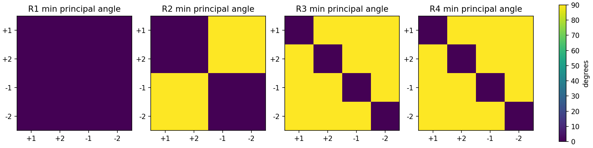
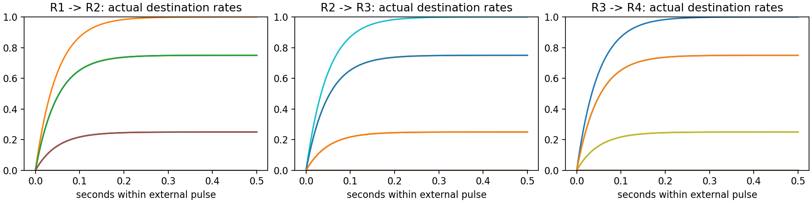

# 独立分层 response-state 模型

从已知L/D/S生成六位置环四秩序列。response分支按1→2→4→4展开；D仅用于R1→R2，S仅用于R2→R3，后续只通过当前response及固定正连接推进。默认关闭的通路采用正向符合阈值门；不导入或修改 `lds_decompressor`。

先读 [要求与两条路线的完整对照](REQUIREMENTS_AND_ROUTES.md)，实施范围与验收见 [执行计划](IMPLEMENTATION_PLAN.md)。

## 已核验环境与运行

本次核验：analysis环境，Python3.12.12、NumPy2.3.5、Matplotlib3.10.7，CPU。没有安装依赖；声明见 [requirements.txt](requirements.txt)。Windows在仓库根目录执行：

```powershell
.\LDS_prechosen\run.ps1 -Test
.\LDS_prechosen\run.ps1
```

脚本使用显式解释器及临时Conda DLL路径，退出时恢复PATH。其他机器通过`-PythonPath`指定兼容环境；也可在正确激活的环境执行：

```text
python -m unittest discover -s LDS_prechosen/tests -v
python -m LDS_prechosen.evaluate
```

```python
from LDS_prechosen import BranchModel, Code, decode
states, traces = BranchModel().run(Code(1, 1, 2))
print(tuple(map(decode, states)))  # (1, 2, 4, 5)
print(states[1].direction_cue)    # None: 已消耗
print(states[2].step_cue)         # None: 已消耗
suffix, _ = BranchModel().resume(states[2])  # 新实例仅凭R3状态继续
```

`decode`只用于输出和评估，不参与传播。`State`和记录为只读副本；`weights`是每实例独立的可编辑非负连接，可用于断路/错接控制。

## 验证记录

独立测试16/16通过；24/24完整序列正确；中心化实际活动的不同位置子空间方向数为1/2/4/4，每组位置维数为2。测试包含两种分支搬移、删除控制、无内容、错接、断路、混合状态、全边界新实例恢复和减半dt。旧模型36/36回归结果与新实现分别保存，不将旧正确率当成新模型证据。

[运行报告](artifacts/REPORT.md) 包含六种失败对照；[summary.json](artifacts/summary.json) 包含完整夹角、解释器版本与源码SHA256；[conditions.csv](artifacts/conditions.csv) 包含24条件实际输出；[activities.npz](artifacts/activities.npz) 保存实际末态及三次转移源/控制/驱动/完整目的轨迹。





局部几何图 [local_geometry.png](artifacts/local_geometry.png) 各组分别投影并添加排版偏移，只用于查看各组六边形，不能用于判断不同组的正交性。

## 解释范围

固定环移、分支嵌入和外部秩脉冲是预设。源态在脉冲内理想保持，目的群泄漏积分，秩边界由外部调度释放源群；不是稳定吸引子或自主时钟。代码匹配导师明确的表征与读取约束，不是神经数据拟合或文稿全部现象复现。最吻合的本地工作稿来源和未确认的导师版本、仿射偏置/细胞重叠等证据缺口详见完整对照文档。
