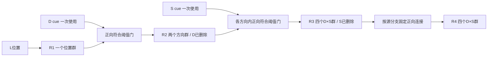

# 导师约束、模型路线与证据对照

## 1. 需求与任务定义

本交付落实三项要求：分层梳理导师约束；梳理当前模型及文献所代表的路线；提供独立代码及可复查验证。原始要求见 [导师要求.md](导师要求.md)。

六位置环标签顺时针递增。输入 L∈{1,…,6}，D∈{+1,−1}，S∈{1,2}。相邻位移依次是 D、SD、D：

\[
(L,\ L+D,\ L+D+SD,\ L+2D+SD)\pmod 6.
\]

例：L=1、D=+1、S=2 对应 1→2→4→5。S 只改变第二次位移。两个模型都以已经可用的 L/D/S 为起点，不完成动物从样本和奖励史推断这些变量的过程。全体合法组合为24条，这是穷举的工程验证集，没有训练集、测试集泛化结论。

## 2. 六层要求与验收

| 层次 | 导师要求的具体含义 | 可执行验收 |
|---|---|---|
| 任务 | 保持六点环与四秩序列规则 | 24条件完整序列、单秩实际活动读出 |
| 表征 | R1一个位置子空间，R2两个方向子空间，R3/R4四个D×S子空间 | 对24条件实际活动分组中心化，SVD计算位置维数；在共同空间计算两条principal angles和不同投影算子数 |
| 信息读取 | R2形成后不再读取独立D；R3形成后不再读取独立S | R2检查点D字段必须为空；R3/R4两者都为空，禁止重新注入；跨实例恢复与分支搬移 |
| 通路机制 | 默认不传内容，由控制信号开放相应路径 | 内容×控制四格、内容强度扫描；无控制或无内容均无传输；不激活其他通路的抑制群 |
| 动力学 | 当前response状态必须承接前一秩计算 | 保存源态、驱动和目标率轨迹；中途换分支改变后续；混合活动按各分支传播，不先做winner选择 |
| 科学解释 | 对齐实验表征，不再用同一位置群反复执行外部规则码 | 区分几何相符、工程充分性、数据支持和生物因果；报告失败控制与尚未覆盖的现象 |

“1/2/4/4”首先指各秩中按D/S分组的位置表征方向数，不是每个子空间的维数，也不是四秩累计的状态数。文稿讨论的是近似对齐与近似正交；实现选择理想的完全对齐/正交作为可检验边界，不赋予实测数据精确90°关系。

“不再需要读取”并不等于D/S从整个脑活动中不再可解码。分支本身就可以让它们继续可解码；要求是后续转移不再向一个独立D/S存储器查询控制值。

## 3. 文献来源与证据分级

导师文件没有给出题名、DOI或附件。当前定位到最吻合的来源，是本机 `wm-compression-manuscript` 阅读技能保存的用户工作稿，其出处索引与正文位于：

- [稿件导航](C:/Users/Totheinfinity/.codex/skills/wm-compression-manuscript/references/index.md)
- [稿件正文](C:/Users/Totheinfinity/.codex/skills/wm-compression-manuscript/references/manuscript.md)
- [图像阅读说明](C:/Users/Totheinfinity/.codex/skills/wm-compression-manuscript/references/figure-reading.md)

已在本次工作直接重读相关段落。**尚未确认导师指称的是否就是这一版本**。这是工作稿，不将其当作已经完整发表且统计资料完备的论文。以下是可定位的证据链：

| 锚点 | 文稿报告/设计 | 对模型的约束或边界 |
|---|---|---|
| P0033 | 四项目六位置任务，步长在block内固定，动物需从试错/奖励史确定S | 已知S输入只是检索阶段假设，不等价于完整行为任务 |
| P0041–P0043 | 延迟期L/D/S表征及引导降维；后来秩位置依赖R1，需要残差控制 | 不能把序列相关性直接当成四个独立项目记忆；监督选轴与block混杂应单独考虑 |
| P0056 | 共用位置空间、按秩空间、按秩与primitive层次组织的三个假说 | 新模型落实第三种结构假说，旧共用E读出更接近第一类 |
| P0057 | 检索中有效维数随秩增加 | 不能只比较输出正确率；还要核查活动几何 |
| P0058–P0059 | R1跨组合对齐；R2按D分组；R3/R4按D×S；二维位置子空间角度逐渐分离 | 位置子空间的1/2/4/4是核心表征验收；NMDS图本身不能作为高维夹角测量 |
| P0059 | D与S有关的仿射偏置分离早于相应位置子空间方向分离 | 新最小模型没有复现这一时间关系，不能称为全文几何复现 |
| P0062 | 延迟几何最初共享位置方向但有primitive相关偏置，检索中逐步重定向 | 内容位置与分支身份应该联合存在，不能只反复输出共用位置E |
| P0063–P0068 | 初态与检索残差关联、跨阶段细胞对关联、重叠细胞的可能作用 | 观察性耦合不证明因果突触传递；原文保留统计占位符；图5面板未提供 |

导师进一步提出的“消耗独立码、沿分支继续”和“默认关门、直接激活或去抑制”，是**本任务的机制规范**。上述观察性几何不单独排除所有重复读取机制，也不能唯一确定VIP/SST或直接兴奋回路。

本项目另有 [门控阅读清单](../docs/gating_gain_modulation_paperlist_20261020.md)。它是机制背景，不应与上述六点环工作稿混称为同一论文：

- **去抑制路线**：控制激活VIP样中间元，抑制SST/SOM样抑制元，释放对应树突输入；必须确实存在两级负连接、基线抑制和内容驱动，才可这样命名。Wang & Yang 2018 的摘要及图2/图4说明将通路去抑制、输入/输出门控和递归选择区分开：[PubMed](https://pubmed.ncbi.nlm.nih.gov/29414069/)。本次在线核对到该页；不将综述当作本任务的直接实验。
- **树突特异门控**：Yang、Murray & Wang 2016，DOI [10.1038/ncomms12815](https://doi.org/10.1038/ncomms12815)。其背景清单所述是分支输入的去抑制；本次期刊/PMC访问受限，未完成全文复核或代码复现。这里的“树突分支”不同于response表征的“D/S分支”，二者不能直接等号。
- **递归选择路线**：Mante等2013，DOI [10.1038/nature12742](https://doi.org/10.1038/nature12742)。背景清单将其用于区分输入门控与进入网络后的选择/累积；本次全文访问受限，不能据此声称当前模型复现该RNN。
- **直接激活路线**：本次采用内容与控制共同跨过固定阈值的简化率模型，作为导师允许的工程实现。它没有VIP/SST细胞或树突，因此不称为去抑制模型，也不声称其参数由上述文献确定。

## 4. 当前项目路线的完整计算链

已直接检查 [core.py](../lds_decompressor/core.py)、[neurons.py](../lds_decompressor/neurons.py)、[model.py](../lds_decompressor/model.py) 及说明文档。这里讨论的是当前checkout中的 `lds_decompressor`，不把历史Hennequin/SOC代码当成它的实现。

1. **初始化**：L→六位置调谐E；D/S→各两个sigmoid率；归一化D/S外积→四个联合J。D/S/J编码后保持。
2. **秩控制**：外部秩编号选 `rank_to_displacement` 的一个连接片；每次从同一保持J计算四位移读出V。第一/三次选±1，第二次选±S。
3. **选路**：V取唯一正峰值→one-hot winner→`winner_to_gate`。选中路径I为零，其他三路I激活。
4. **内容传递**：上一秩E归一化并保持为源；四路固定环移加对应负向门控，各自整流，再经输出投影加和为六维中继目标。
5. **动态响应**：M、E、全局I同步Euler；中继每次清零，E/I跨秩接续。D/S/J、读出、门控各自用恒定目标的一阶解析终值然后保持。
6. **输出**：始终在同一六维E群中取峰值。目标序列仅在evaluation生成，没有直接写回E；但“符号码只读一次”并不能否认以后重复读神经J码。
7. **状态与规模**：29标量率=E6+D2+S2+J4+V4+门控I4+M6+全局I1；13积分量、16保持量。四路各六维驱动不是24个独立中继状态。
8. **主要参数**：dt=.002s；E/I/M的τ=.100/.050/.030s；编码、读出、门控τ=.020s，窗口各.200s；转移积分.800s。原时间轴不包含读出/门控准备窗口，不能当成所有模块同时运行的物理时钟。
9. **既有证据边界**：README保存记录为24/24合法序列、288/288非边界角度诊断和36测试；本次独立回归结果见本目录README。规则、环移、硬峰值与外部秩控制均预设，正确行为不证明响应空间层次展开。

因此旧模型的问题不是“算错目标”，而是使用另一套内部组织：共用位置群＋反复读取独立关系码＋激活抑制排除其他路。导师要求的是response空间逐层承载已经使用过的关系。

## 5. 独立实现的全部计算约定

### 5.1 状态空间与时点

| response秩 | 分支 | 活动数组 | 尚可读取的独立码 | 后续计算 |
|---|---|---|---|---|
| R1 | 共用位置 | 1×6 | D、S | D开两个R2路径之一 |
| R2 | CW、CCW | 2×6 | S | 各D分支内由S开两个R3路径之一 |
| R3 | CW1、CW2、CCW1、CCW2 | 4×6 | 无 | 每个块使用自身固定±1连接 |
| R4 | 同四种关系，独立秩群 | 4×6 | 无 | 终止 |

完整response嵌入使用66维公共空间，4个秩块合计6+12+24+24。它是11个六维群体块，不是11个细胞。R1初始化位置调谐为 `0.5+0.5cos(θ−θL)`，已在[0,1]内；中心化后恰为二维位置六边形。零控制下的各潜在通路均无传输。

独立码在首次使用前保留为两维one-hot控制；R2构造时删除D，R3构造时删除S。仅保存rank、response和尚未消耗的cue，不保存符号L/D/S、目标序列、赢家分支或推断结果。`advance`不会解码branch identity再选择算子，所有分支并行通过静态矩阵投射。

### 5.2 正连接、阈值与动力学

令Pδ是六点环移矩阵，矩阵约定`[post,pre]`。转移连接形状为 `(2,1,6,6)`、`(4,2,6,6)`、`(4,4,6,6)`。各目的块只接其对应源块：

\[
u_b=\sum_a W_{ba}x_a,\quad
G(u_b,c_b)=[u_b+c_b-1]_+.
\]

第一层W为P+1/P−1，控制为D cue；第二层各D分支W为PD/ P2D，控制为S cue在两个D源内复用；第三层是四个块对角的PD，无cue和门控。

由于0≤u≤1，控制0时G=0、控制1时G=u；u=0时即使控制1也不制造内容。这里减1是固定内在阈值，所有内容与控制连接均为正，没有“激活另一路I来关闭当前路径”。它是有明确工作范围的加性符合门，并非普遍生物乘法；超出上界的连接干预会被拒绝。

每次外部秩脉冲期间：源态理想保持，目的从0积分：

\[
\tau\dot x=-x+x=0,\quad
\tau\dot y=-y+G(u,c),
\]

第三次转移把G替换为u。默认τ=.05s、dt=.002s、脉冲.5s，前向Euler；每次目标率有251个采样点。目的末态成为下一次源态，独立码按照上表消耗。源态保持属于理想单位增益复发记忆；没有证明对噪声/扰动稳定。秩结束时释放旧群是外部调度，未建模对应神经机制。`embedded()`是当前秩末态的统一嵌入，不是抹掉转移过程中旧源的真实历史；Trace另存源、驱动与目的完整响应。

### 5.3 为什么分支真的携带计算信息

R2只有CW或CCW块有内容，后面两套不同W读不同块，根本没有D cue可查。R3后相同逻辑用于四个联合分支。搬移R2内容到另一D块将改变下一步±S与最后±1；搬移R3内容到相反D的联合块会改变最后±1。混合源活动会沿多个块共同传递，不被argmax强制归入一条路。这些是可运行的因果干预，不只是给群体贴标签。

### 5.4 几何检验与局限

每个rank把24个实际66维末态按D/S分四组，每组六个L。分别减去组均值后做SVD；维数以奇异值>1e−9计数。基底Q用于构造投影QQᵀ，以投影差范数<1e−7合并相同空间方向。组间QᵀQ的两个奇异值给两条principal angles。分支数读自这些投影关系，不能直接拿配置常量当结果。

但相互独立的块结构本来就预设了正交性，所以测得1/2/4/4只能证明代码实现了设计。局部PCA图中为了排版添加的平移不代表神经仿射偏置；正式角度图在共同高维空间中计算。未拟合神经数据，没有NMDS应力、数据交叉验证、猴/FOV层级统计、置信区间或有效维数随真实时间增长的复现。

本最小版本没有神经元跨秩重叠、D/S仿射偏置的提前分离、完整延迟期几何、step block学习、感知L/D推断、可变布局泛化、VIP/SST实现、噪声吸引子或自主时钟。上述内容是证据范围，不是已交付功能。导师文件明确的1/2/4/4、码消耗与允许的直接激活路线均已在独立代码中落实。

## 6. 实际交付与核查入口

- [model.py](model.py)：全部传播方程和连接。
- [tests/test_model.py](tests/test_model.py)：码消耗、重启、分支搬移、通路切断、混合传播、门控真值及步长验证。
- [evaluate.py](evaluate.py)：唯一目标构造位置；24条件及六种失败对照；实际活动几何。
- [验证报告](artifacts/REPORT.md)、[原始摘要](artifacts/summary.json)、[逐条件结果](artifacts/conditions.csv)。

本交付是满足明确约束的独立手工机制基线。它没有将几何观察升级为唯一生物机制，也没有把预设连接的正确执行称为学习或泛化。
