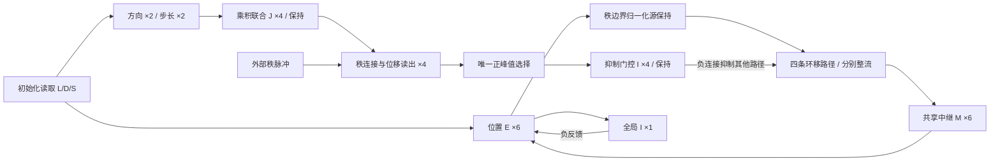
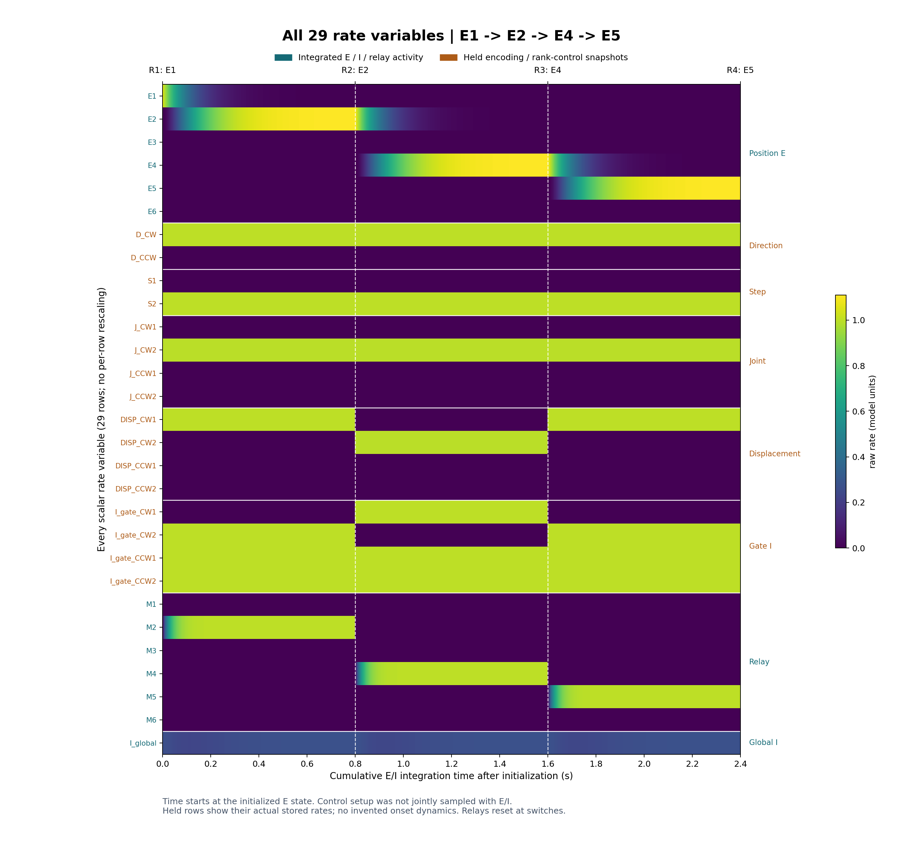
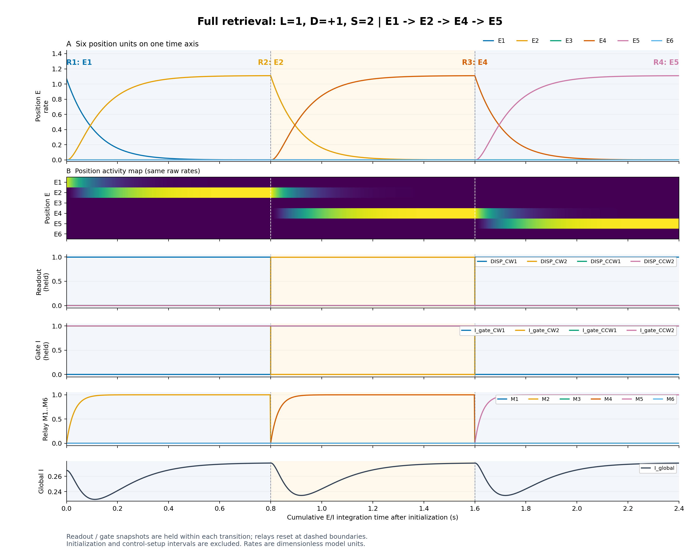

# LDS-EImodel：L/D/S 序列解压缩率回路

给定起始位置 L、方向 D 和步长 S，在六位置环上生成四秩序列。当前实现为独立的 `lds_decompressor` 包：**29 个标量率变量、六个共享中继状态、四条固定空间路径**。位移读出通过唯一正峰值选择路径，再由抑制门控关闭其他路径。

默认配置的保存结果为 **24/24 条合法序列正确**、**288/288 条非边界角度诊断通过**。本回路使用给定的 L/D/S 和预设规则，没有训练过程。

- [神经元公式与率状态](lds_decompressor/neurons.py)
- [参数、分组与连接](lds_decompressor/core.py)
- [模型调度与状态传递](lds_decompressor/model.py)
- [完整模型说明](lds_decompressor/README.md)、[中继架构](lds_decompressor/ARCHITECTURE.md)
- [实际运行报告](lds_decompressor/artifacts/REPORT.md)、[验证记录](lds_decompressor/VALIDATION.md)

## 输入与输出

输入范围为 L∈{1,…,6}、D∈{+1,−1}、S∈{1,2}。位置标签沿顺时针递增，D=+1 表示顺时针，D=−1 表示逆时针。

三次相邻秩位移依次为 D、S·D、D，所有位置按六点环取模：

$$
L\longrightarrow L+D\longrightarrow L+D+SD\longrightarrow L+D+SD+D.
$$

例如 L=1、D=+1、S=2，输出为 **1→2→4→5**。各秩位置从实际 E 群活动的峰值读取；目标序列只在评估模块中构造，不用于推进神经状态。

## 快速运行

需要 Python 及 [requirements.txt](lds_decompressor/requirements.txt) 中的 NumPy≥1.26、Matplotlib≥3.8。已验证环境为 **Python 3.12.12、NumPy 2.3.5、Matplotlib 3.10.7，CPU**；不需要 GPU。

在仓库根目录，使用已具备上述依赖的 Python 环境执行：

```bash
python -m unittest discover -s lds_decompressor/tests -v
python -m lds_decompressor
```

第一条运行 36 项测试；第二条评估全部 24 个合法条件和 288 条空间诊断，并导出数据与图，默认输出到 `lds_decompressor/artifacts`。可指定单独的输出目录：

```bash
python -m lds_decompressor --output results --probe-angles 72
```

Windows 可使用 [run.ps1](lds_decompressor/run.ps1)。它默认调用开发机器的 analysis 环境；其他机器请通过 `-PythonPath` 指定已配置依赖的解释器完整路径。脚本临时补齐 Conda DLL 路径，结束时恢复 PATH。

```powershell
.\lds_decompressor\run.ps1 -Test
.\lds_decompressor\run.ps1
.\lds_decompressor\run.ps1 -PythonPath 'C:\path\to\env\python.exe' -OutputDirectory results
```

只从已保存的时间轴重绘两张序列图：

```bash
python -m lds_decompressor.sequence_plotting
```

## Python 接口

```python
from lds_decompressor import CompressedCode, ModelParameters, RateDecompressor

model = RateDecompressor(ModelParameters())
result = model.decompress(CompressedCode(location=1, direction=1, step=2))
print(result.positions)                  # (1, 2, 4, 5)
print(result.position_activity.shape)    # (4, 6)
print(result.recording.rates.shape)      # (1201, 29)

rates = dict(zip(model.unit_names, model.rate_potentials))
print(rates)                            # 全部有名称的当前原始率
print(model.relay.rates)                 # 六个共享中继 M1…M6
```

`initialize(code)` 读取一次 L/D/S；`advance(state)` 推进一次秩转移，`resume(state)` 完成其余转移。后两个接口只接收神经状态，不读取符号码或评估目标。它们用于秩边界恢复，不是任意积分时刻的恢复接口。

## 单元与更新方式

| 群 | 单元数 | 对应对象 | 检索期间处理 |
| --- | ---: | --- | --- |
| Position E | 6 | `ENeurons` | Euler 积分，跨秩接续 |
| Direction | 2 | `DNeurons` | 编码响应后保持 |
| Step | 2 | `SNeurons` | 编码响应后保持 |
| Joint | 4 | `JNeurons` | 联合编码响应后保持 |
| Displacement | 4 | `VNeurons` | 每次转移读出响应后保持 |
| Gate I | 4 | `INeurons(gate=True)` | 每次转移门控响应后保持 |
| Relay M | 6 | `RelayNeurons` | Euler 积分，每次转移从零重置 |
| Global I | 1 | `INeurons` | Euler 积分，跨秩接续 |
| **合计** | **29** | | **13 个积分变量＋16 个保持变量** |

[core.py](lds_decompressor/core.py) 中的 `UNIT_GROUPS` 统一标签、列顺序和记录方式。实际公式与率状态属于 [neurons.py](lds_decompressor/neurons.py) 中的对象，时间常数和增益来自 `ModelParameters`；`mode` 字符串不负责切换动力学。

`rate_potentials`（别名 `rates`）是未归一化的非负率变量，不是膜电位；`Population.activity` 是群内归一化活动。率为无量纲模型活动，不能直接解释为 Hz。



## 公式、连接与时序

D/S 使用 sigmoid 调谐，J 的驱动是 D/S 归一化活动的外积；位移读出使用当前秩的联合群投射。D/S/J、读出和门控对恒定目标采用从零开始的一阶响应解析终值：

$$
\tau\dot r=-r+T,\qquad r(t)=T(1-e^{-t/\tau}).
$$

每次转移先计算读出，取唯一正峰值，再生成门控目标：选中路径的门控为零，其余三个门控被激活。门控响应完成后在该次转移内保持；不模拟读出与门控之间的连续竞争反馈。

令源活动 H=N(E)，N 表示群内和为 1 的归一化。四条路径分别执行 +1、+2、−1、−2 环移。每条路径先整流，再投影求和：

$$
F_p=[A_pH+C_pI_{gate}]_+,\qquad T_M=\sum_p B_pF_p,
$$

$$
\tau_M\dot M=-M+T_M,
$$

$$
\tau_E\dot E=-E+[u_E+w_{EE}E-w_{EI}I_{global}\mathbf1]_+,\qquad
\tau_I\dot I_{global}=-I_{global}+w_{IE}\sum_k E_k.
$$

初始化时 u_E 是六位置调谐活动；检索时 u_E=M。默认 A_p 是环移矩阵，B_p 为单位阵，C_p 提供对应门控的负连接。四路各六维的 F_p 是输入分量，不是额外的 24 个率状态。

| 可编辑连接字段 | 形状 | 功能 |
| --- | --- | --- |
| `e_to_relay` | 4×6×6 | 四种共享环移 |
| `relay_to_e` | 4×6×6 | 各路径在汇总前的输出投影 |
| `rank_to_displacement` | 3×4×4 | 三次转移的联合群→位移读出 |
| `winner_to_gate` | 4×4 | 兴奋未选路径的门控 |
| `gate_to_relay` | 4×6×4 | 门控对空间路径的负连接 |

连接均按 `[突触后, 突触前]` 组织，在各模型实例间独立分配，可通过 `model.connections` 干预。第一、三次转移执行 D，第二次执行 S·D；固定环移和秩连接是显式提供的任务先验。

默认 τ_D/S/J=τ_V=τ_gate=0.020 s，τ_M=0.030 s，τ_E=0.100 s，τ_I=0.050 s；编码、读出和门控响应窗口各为 0.200 s。E/I/M 用同步前向 Euler，dt=0.002 s，每次转移积分 0.800 s。其他参数见 [ModelParameters](lds_decompressor/core.py)。

[完整检索图](lds_decompressor/VISUALIZATION.md) 的横轴从位置初始化完成开始，三个积分段共 2.4 s，**不包含读出和门控的准备窗口**。D/S/J 保持编码终值，位移读出与门控在秩边界切换；E/I 连续接续，M 重置。该时间轴不能解释为全部模块共同积分的物理时钟。

## 验证与实际活动图

测试覆盖全部合法码、调谐与联合编码、秩连接干预、断路与门控消融、信息隔离、实例与历史隔离、dt 减半、真实率记录和共享中继的独立参考比较。当前清理后的代码重新通过 **36/36 项测试**；完整评估重新得到 **24/24 条合法序列、288/288 条空间诊断通过**。

保存的 [summary.json](lds_decompressor/artifacts/summary.json)、[conditions.csv](lds_decompressor/artifacts/conditions.csv) 和 [运行报告](lds_decompressor/artifacts/REPORT.md) 可直接核查；[VALIDATION.md](lds_decompressor/VALIDATION.md) 记录具体方法与历史验证范围。

### 全部 29 个率变量



### 位置、读出、门控和共享中继



图直接读取保存的模型活动，共用原始率尺度，不逐行归一化、不平滑。示例为 L=1、D=+1、S=2，四个位置为 1→2→4→5。

## 文件入口与数据

| 文件 | 内容 |
| --- | --- |
| [core.py](lds_decompressor/core.py) | 参数、静态连接、分组和不可变数据契约 |
| [neurons.py](lds_decompressor/neurons.py) | 神经元对象、率公式与历史 |
| [model.py](lds_decompressor/model.py) | 编码、运行状态、同步积分与秩推进 |
| [evaluation.py](lds_decompressor/evaluation.py) | 评估目标、24 条件和空间诊断、结果导出 |
| [timeline.py](lds_decompressor/timeline.py) | 真实率记录、边界检查与时间轴 |
| [plotting.py](lds_decompressor/plotting.py) / [sequence_plotting.py](lds_decompressor/sequence_plotting.py) | 已保存活动的绘图 |
| [测试](lds_decompressor/tests/test_model.py) | 行为、状态、记录与中继聚合验证 |
| [activities.npz](lds_decompressor/artifacts/activities.npz) | 24 条件输出、编码、示例动力学、通路输入及连接 |
| [sequence_timeline.npz](lds_decompressor/artifacts/sequence_timeline.npz) | 示例 1201×29 原始率、标签、分组和保持/积分标记 |

共享中继能闭合为六状态，依赖共同时间常数、转移内固定输出投影和匹配初值；路径专有时间常数或内部反馈不在此等价范围内。正确序列和有限角度诊断验证的是已知 L/D/S、固定结构与外部秩控制下的工程执行能力，不证明学习到规则、连续吸引子、自主工作记忆、自主时钟，或 29 个生物细胞的完整实现。
