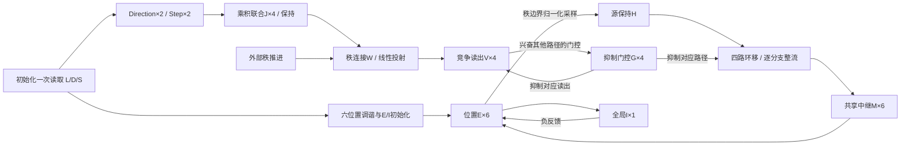
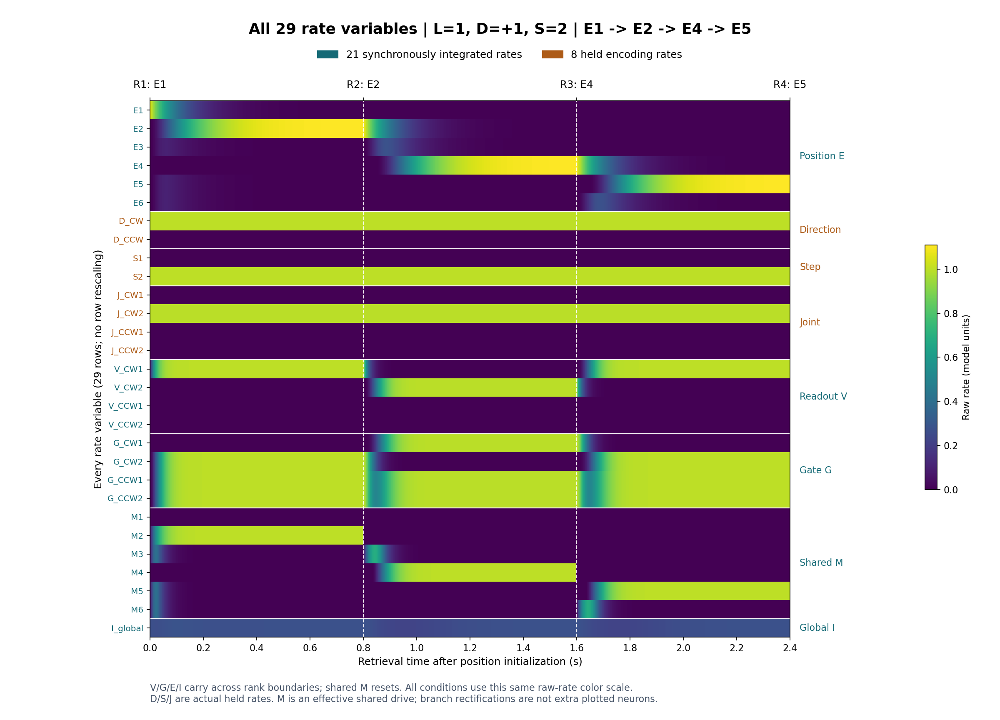
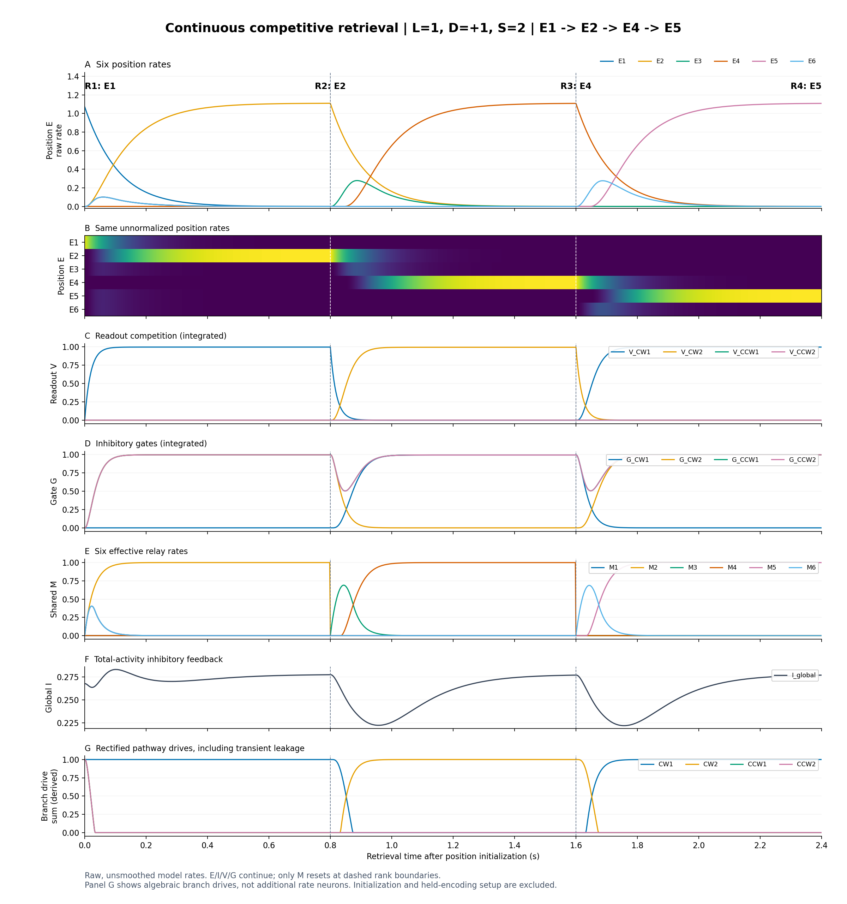
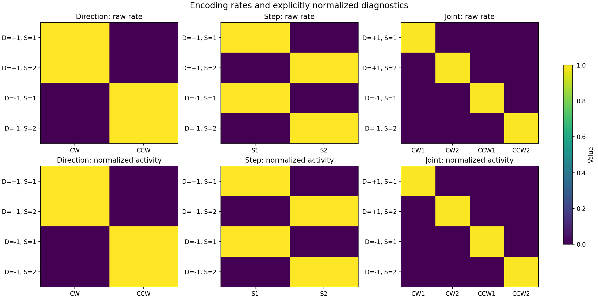

# LDS-EImodel：共享中继与竞争门控率回路

用**29个率变量**执行六位置、四秩序列的L/D/S解压缩：给定起点L、方向D和步长S，由连续竞争读出与抑制门控选择共享空间通路，输出实际位置群E的活动。

本仓库提供独立实现、28项测试、24条件的完整活动数组及图片。默认参数下24条序列全部正确；模型没有训练权重，也不从观察序列推断D/S。

- [模型源码](lds_competitive/model.py)
- [完整架构设计](plans/lds_shared_relay_competitive_design.md)
- [实际运行报告](lds_competitive/artifacts/REPORT.md)与[验证记录](lds_competitive/VALIDATION.md)
- [全部24条件活动图（24页PDF）](lds_competitive/artifacts/all_conditions_rates.pdf)

## 任务与输入

输入为L∈{1,…,6}、D∈{+1,−1}、S∈{1,2}。六个位置在单位圆上：

$$
\theta_k=(k-1)\pi/3,\qquad (x_k,y_k)=(\cos\theta_k,-\sin\theta_k).
$$

标签递增表示物理顺时针；D=+1为顺时针，D=−1为逆时针。相邻秩之间的三次位移为D、S·D、D，因此四个位置为：

$$
L\;\longrightarrow\;L+D\;\longrightarrow\;L+D+SD
\;\longrightarrow\;L+D+SD+D,
$$

所有标签按六点环取模。例如L=1、D=+1、S=2时，实际输出为1→2→4→5。输出从真实E活动的峰值观察得到，目标序列只在评估端构造，不反馈给模型。

## 快速运行

在仓库根目录、已经核验的兼容Python环境中执行：

```bash
python -m unittest discover -s lds_competitive/tests -v
python -m lds_competitive
```

第二条命令运行全部24条件、数值比较、位置群诊断并生成图和数据；默认输出到`lds_competitive/artifacts`。只想从已保存的数据重绘时：

```bash
python -m lds_competitive.plotting
```

依赖声明见[requirements.txt](lds_competitive/requirements.txt)：NumPy≥1.26、Matplotlib≥3.8、SciPy≥1.11。已验证环境为Python 3.12.12、NumPy 2.3.5、Matplotlib 3.10.7、SciPy 1.16.3，使用CPU，不需要GPU。

Windows还可使用[run.ps1](lds_competitive/run.ps1)。脚本默认解释器是开发机器上的analysis环境；其他机器须用`-PythonPath`指定已经核验的Python完整路径。脚本临时补齐该环境的Conda DLL路径，执行后恢复PATH。

```powershell
.\lds_competitive\run.ps1 -Test
.\lds_competitive\run.ps1
```

Python接口示例：

```python
from lds_competitive import CompressedCode, RateDecompressor

model = RateDecompressor()
result = model.decompress(CompressedCode(1, 1, 2))
print(result.positions)  # (1, 2, 4, 5)
print(result.transitions[1].v_rates[-1])
print(result.transitions[1].branch_target[-1])
```

`initialize(code)`只读取一次L/D/S；`advance(state)`推进一秩，`resume(state)`完成剩余秩。后两个接口只接受率状态。它们是秩边界接口，不是任意时刻的中途恢复接口。

## Rate unit与资源计数

每个rate unit表示一个无量纲的标量率变量，不直接解释为Hz。一般泄漏率形式为τ·dr/dt=−r+响应驱动；E、V和分支驱动使用整流，G与全局I使用保持非负性的线性驱动。

| 群 | 变量数 | 功能 | 检索期间处理 |
| --- | ---: | --- | --- |
| 位置E1…E6 | 6 | 六个位置偏好群 | 同步积分，跨秩接续 |
| Direction：CW、CCW | 2 | 方向的重叠sigmoid调谐 | 保持编码终值 |
| Step：S1、S2 | 2 | 步长的重叠sigmoid调谐 | 保持编码终值 |
| 联合J：CW1、CW2、CCW1、CCW2 | 4 | D/S活动的乘积联合 | 保持编码终值 |
| 读出V：+1、+2、−1、−2 | 4 | 在抑制反馈下竞争 | 同步积分，跨秩接续 |
| 门控G：+1、+2、−1、−2 | 4 | 抑制对应读出与空间路径 | 同步积分，跨秩接续 |
| 共享有效中继M1…M6 | 6 | 汇总四路空间驱动 | 同步积分，每秩重置 |
| 全局I | 1 | 接收E总活动并负反馈 | 同步积分，跨秩接续 |
| **合计** | **29** | **8个保持编码＋21个积分变量** | |

另有六维源活动H的采样保持、外部秩控制、四路各六维共24个分支整流分量，以及编码乘积和群内归一化。这些资源明确存在，但不计为额外率群。M是有效汇总状态；29不是“只用29个普通生物细胞即可实现”的证明。



## 编码与初始化公式

定义逐元素整流φ(z)=max(z,0)、sigmoid函数σ(z)=1/(1+exp(−z))，以及N(x)=x/Σx。N只对非负且总和为正的群活动定义；⊙表示逐元素乘积。

方向偏好d_pref=(+1,−1)，步长偏好符号s_pref=(−1,+1)：

$$
b_i^D=k_D D\,d_{\mathrm{pref},i},\qquad
T_i^D=g_i^D\sigma(b_i^D),
$$

$$
b_j^S=k_S(2S-3)s_{\mathrm{pref},j},\qquad
T_j^S=g_j^S\sigma(b_j^S).
$$

每个编码群从零响应恒定目标T，使用一阶响应的解析终值：

$$
\tau_t\dot r=-r+T,\qquad
r(T_{\mathrm{enc}})=T(1-e^{-T_{\mathrm{enc}}/\tau_t}),\qquad a=N(r).
$$

D/S先完成此映射，再生成联合群，顺序为(CW1、CW2、CCW1、CCW2)：

$$
b^J=\operatorname{vec}\!\left(a^D(a^S)^\top\right),\quad
T^J=g^J\odot b^J,\quad
r^J=T^J(1-e^{-T_{\mathrm{enc}}/\tau_t}),\quad a^J=N(r^J).
$$

默认k_D=k_S=6、τ_t=0.020 s、T_enc=0.200 s，各单元增益均为1。编码是初始化映射，之后保持快照，没有将D/S/J终值计算拼接成未经模拟的共同物理时间轴，也不宣称自主工作记忆。

`raw_drive`、`rates`、`activity`分别保存sigmoid前或乘积输入、未归一化率、归一化活动；三者不混用。

位置输入为六个重叠偏好群，正式L使用θ=θ_L：

$$
q_k(\theta)=\exp\{\kappa[\cos(\theta-\theta_k)-1]\},\qquad
a^L=N(q),\qquad \kappa=8.
$$

从E=0、I=0出发，用u_E=a^L驱动下述E/I方程0.800 s，取真实末态为第1秩位置。此时V=G=M=0。正式任务L只能是六个整数标签；连续角度只用于位置群诊断。

## 连接方式与检索动力学

### 秩连接与竞争门控

联合群顺序为(CW1、CW2、CCW1、CCW2)，位移路径顺序为(+1、+2、−1、−2)。第r次转移的驱动为：

$$
b^V=g^V\odot(W_r a^J),\qquad W_2=I_4,
$$

$$
W_1=W_3=
\begin{pmatrix}
1&1&0&0\\
0&0&0&0\\
0&0&1&1\\
0&0&0&0
\end{pmatrix}.
$$

因此第1、3次只执行方向D，第2次执行S·D。三个矩阵片独立分配，可分别干预。每秩b^V恒定，要求非负、非静默且最大分量唯一；静默或并列条件显式报告失效。

令C=11ᵀ−I₄，V→G的默认连接为C，G→V为−I₄：

$$
\tau_V\dot V=-V+\phi(b^V-G),\qquad
\tau_G\dot G=-G+CV.
$$

某一路V升高会兴奋**另外三路**G，压低那三路V并抑制其空间分支；胜出V对应的G逐渐降低，释放自己的路径。四个G同时负责读出竞争和空间门控，没有额外竞争群。控制不使用argmax下指令，也不归一化V来驱动G。

固定驱动的最大分量b_k唯一时，平衡点为V*=b_k e_k、G*=CV*；此时本路G_k*=0，其余门控为b_k。该平衡局部渐近稳定，但不据此宣称任意初值全局收敛。实际切换时间由仿真测量。

### 环移、负向分支抑制与共享中继

每次转移开始采样H=N(E)，该秩内保持H不变，重置M=0。四条路径的矩阵为A_p、B_p、C_p，分别对应源→分支、分支→共享坐标、门控→分支：

$$
F_p(t)=\phi(A_pH+C_pG(t)),\qquad
F_{\mathrm{pool}}(t)=\sum_{p=1}^4 B_pF_p(t),
$$

$$
\tau_M\dot M=-M+F_{\mathrm{pool}}(t).
$$

默认A_p=P_p，四个P分别为+1、+2、−1、−2环移；B_p=I₆；C_pG=−βG_p·1₆，β=2。以0…5索引源j和目标i，(P_p)_ij=1当且仅当i=(j+位移_p) mod 6。所有起点共享同一组路径，±2直接投射到两格外。

**先逐路径整流，再汇总。** 一般Σφ(x_p)≠φ(Σx_p)，不能把四路负驱动先相加再统一整流。

固定B、相同τ_M且初值匹配时，若独立参考中继满足τ_M·dR_p/dt=−R_p+F_p(t)，则M=ΣB_pR_p。此聚合对随时间变化的G和多路同时活动也成立；不同路径τ、路径内部反馈、特有噪声或中途变化的B不在承诺内。

### 位置E与全局I

$$
\tau_E\dot E=-E+\phi(u_E+w_{EE}E-w_{EI}I\mathbf1_6),\qquad
\tau_I\dot I=-I+w_{IE}\sum_kE_k.
$$

初始化时u_E=a^L；三个检索段中u_E=M。全局I接收E总活动，向六个E提供相同的负反馈。

### 可干预连接与源码字段

所有矩阵以**[突触后，突触前]**为约定，每个实例独立分配；可修改`model.connections`实施干预。

| 源码字段 | 形状 | 默认值与符号 |
| --- | --- | --- |
| `e_to_branch` | 4×6×6 | A_p=P_p，非负环移 |
| `branch_to_m` | 4×6×6 | B_p=I₆，非负投射 |
| `rank_to_readout` | 3×4×4 | W₁、W₂、W₃，非负且三片独立 |
| `readout_to_gate` | 4×4 | C=11ᵀ−I₄，只兴奋其他门控 |
| `gate_to_readout` | 4×4 | −I₄，只抑制对应V |
| `gate_to_branch` | 4×6×4 | 每条路径六个分量接收−βG_p |

E→E的自反馈和E/I连接由`ModelParameters`中的w_ee、w_ei、w_ie给定；每单元调谐增益也集中于该参数类。神经状态及结果数组是只读快照，可用`dataclasses.replace`构造明确的状态干预。

## 参数与时序

| 参数 | 默认值 |
| --- | --- |
| κ；k_D、k_S | 8；6、6 |
| D/S/J/V逐单元增益 | 全1 |
| 编码τ_t；T_enc | 0.020 s；0.200 s |
| τ_V、τ_G、τ_M | 0.020、0.020、0.030 s |
| τ_E、τ_I | 0.100、0.050 s |
| 路径抑制β；G→V抑制幅度 | 2；1 |
| w_EE、w_EI、w_IE | 0.15、0.20、0.25 |
| 位置初始化；每秩转移 | 各0.800 s |
| 同步Euler步长dt | 0.002 s |

以位置初始化结束为t=0，四个观察时刻为0、0.8、1.6、2.4 s。每次秩切换仅更新W片、采样H并重置M；E/I/V/G跨秩连续。

21个检索变量使用共同时间步，同一步全部导数从旧时刻状态计算：G不用新V，分支不用新G，E不用新M。步长限制为dt≤0.2·min(τ_V,τ_G,τ_M,τ_E,τ_I)。没有额外的读出准备窗口、门控准备窗口或路径轮流执行的子相位。

初始G=0时各路可短暂传输；切换时也有旧路径残余和新路径释放延迟。完整轨迹保留这些瞬态，不能用末段静默推断全程无泄漏。

## 测试方式与实际结果

[测试目录](lds_competitive/tests/test_model.py)中的行为测试、[参考积分测试](lds_competitive/tests/test_reference.py)及[时间轴测试](lds_competitive/tests/test_timeline.py)共28项，保存的验证记录显示全部通过。以下结果来自2026-10-17的默认配置运行，详细配置与数值见[summary.json](lds_competitive/artifacts/summary.json)；本次README整理没有改变模型、重新调参或重新生成结果。

| 检查 | 方法与预先固定标准 | 实际结果 |
| --- | --- | --- |
| 行为 | 全部6×2×2输入，观察真实E的四秩峰值 | 24/24序列正确，各秩100% |
| 竞争切换 | 最后0.1 s的V/G平衡误差≤1e−4，未选分支驱动≤1e−6；稳定不晚于0.6 s | 72/72转移通过，最长0.306 s |
| 共享中继聚合 | 同步展开四路参考中继，逐样本比较M与E/I/V/G；容差1e−10 | 最大差4.44089e−16 |
| 步长减半 | dt=0.002与0.001 s，24条件全部29率比较；最大差≤0.025且标签相同 | 最大差0.0151725，标签一致 |
| 独立ODE参考 | 四种D/S、L=1；solve_ivp，rtol=1e−10、atol=1e−12；粗步长误差≤0.040、细/粗比≤0.70 | 最大误差0.0296643，最大比0.488528 |
| 空间诊断 | 72个非边界角度×4种D/S | 288/288，仅为有限网格诊断 |

测试还覆盖：J和单片W干预、路径断路、V→G/G→V/G→分支消融、非单位B与多路活动下的聚合、符号码只读一次、历史隔离、实例独立、只读快照、静默/并列失效，以及真实同步更新和边界重置。

末段未选分支最大驱动为0，最大V/G平衡误差约1.015e−12；瞬态未选分支驱动峰值约0.999992，最大泄漏积分约0.057261（无量纲驱动×秒）。这些是工程验收结果，不是生物阈值或统计置信区间。[验收契约](lds_competitive/VALIDATION_CONTRACT.md)保留了运行前固定的标准。

## 三张实际活动图

### 1. 全部29个率变量

代表条件L=1、D=+1、S=2，实际输出1→2→4→5。每个变量单独一行，8个保持编码与21个积分变量分别标注；24条件共用原始率色标，不逐行归一化、不平滑。时间从位置初始化结束开始。



### 2. 完整动力学与门控切换

依次展示E曲线及热图、V竞争、G抑制、M共享中继、全局I和四路分支驱动。末面板是**派生驱动**，不是额外神经元；切换时的泄漏与M重置均来自真实保存数组。



### 3. Direction、Step和联合调谐

四种D/S条件的原始编码率及群内和为1的归一化活动分开显示，避免把诊断归一化误当作神经率。



全部条件可查[图片索引](lds_competitive/artifacts/all_conditions/INDEX.md)与[24页PDF](lds_competitive/artifacts/all_conditions_rates.pdf)。图中的曲线和热图直接读取保存数组；编码终值准备过程不拼入检索时间轴。

## 文件与数据入口

| 文件 | 内容 |
| --- | --- |
| [model.py](lds_competitive/model.py) | 参数、连接、编码、状态和同步积分 |
| [evaluation.py](lds_competitive/evaluation.py) | 评估目标、条件遍历和产物导出；模型不导入此模块 |
| [reference.py](lds_competitive/reference.py) | 验证专用四路展开Euler与独立ODE参考 |
| [timeline.py](lds_competitive/timeline.py) / [plotting.py](lds_competitive/plotting.py) | 真实率时间轴与图片绘制 |
| [activities.npz](lds_competitive/artifacts/activities.npz) | 24×1201×29原始率、分段状态、编码、驱动及连接 |
| [numerical_reference.npz](lds_competitive/artifacts/numerical_reference.npz) | 独立ODE与展开参考数据，明确用于验证 |
| [conditions.csv](lds_competitive/artifacts/conditions.csv) / [control_metrics.csv](lds_competitive/artifacts/control_metrics.csv) | 24条件输出与72次转移的控制指标 |

唯一检索时间轴采用秩边界右侧样本；每段完整401点数据另外保留边界两侧端点。M的重置和其他率的连续接续都可从原始数据核对。

## 解释范围

本模型验证已知L/D/S、固定环结构及外部秩时钟下的规则执行。固定环移、联合乘积、归一化、源保持和编码保持均为显式提供的机制或资源。正确输出、竞争平衡或有限角度诊断不证明学习到规则、自主工作记忆、自主时钟、六位置吸引子，或29个细胞的完整Dale实现。
