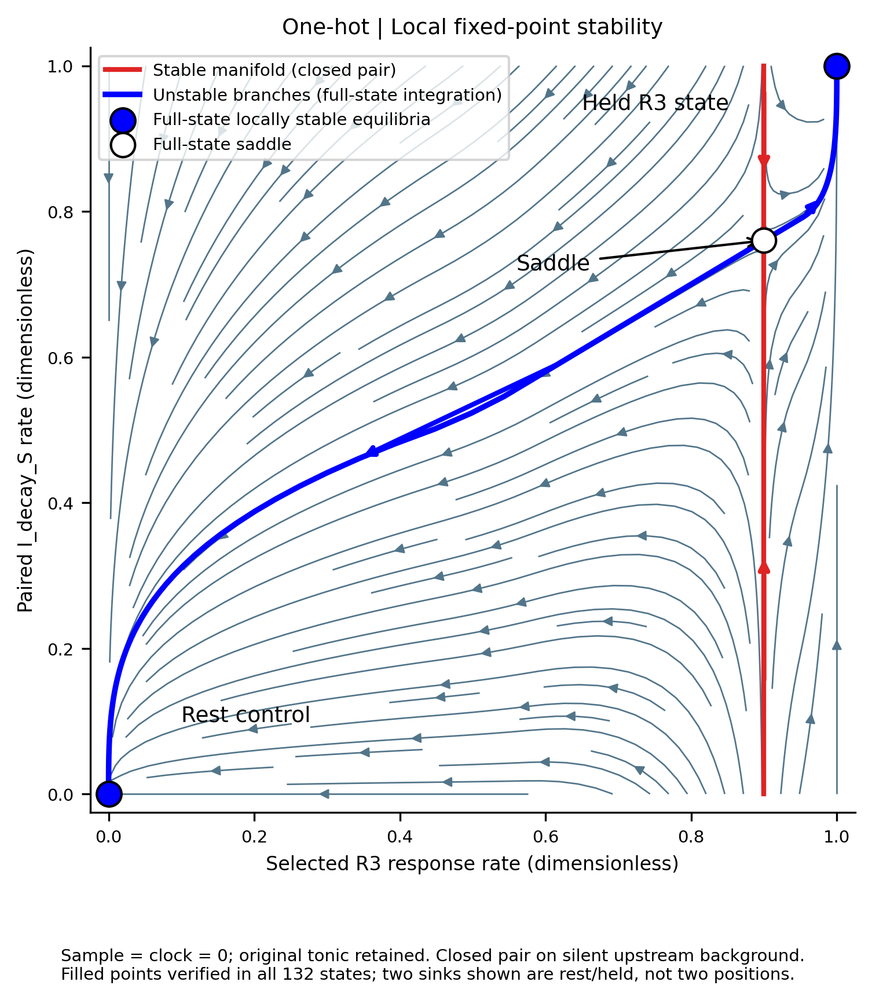
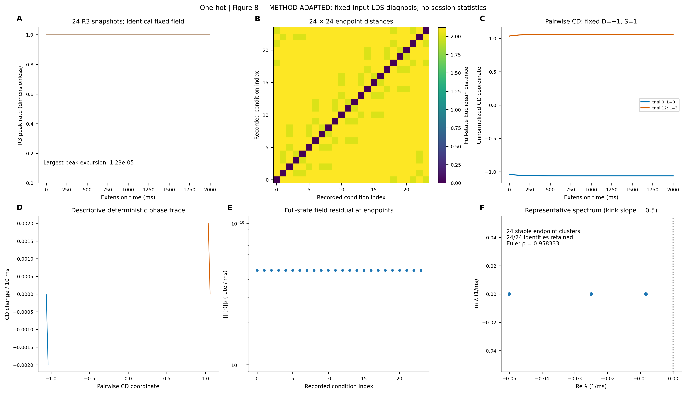
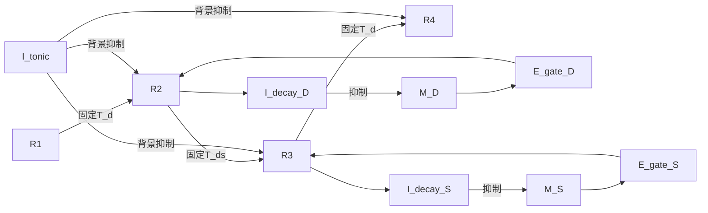

# LDS-EImodel：Handcrafted E/I Decompression v2

## 当前版本与主要结论

当前版本包含三种位置编码、完整132维神经活动分析、经来源方法审计的Figure 8/9，以及两套独立的流线/局部不动点相图。模型固定连接、不训练；所有动力学干预均在独立评估副本进行。

- **表征子空间：** R3各分支六位置活动的中心化rank为5，有效维数PR≈5；完整网络分支对平均principal angles约83.35°–83.44°。分支分离有固定不重叠神经坐标的结构贡献，不解释为训练涌现的正交性或强低维压缩。
- **局部点吸引子：** 在共同的sample=clock=0、原tonic保留条件下，每种编码的24个task-seeded R3终点可区分、局部稳定，且24/24保持位置与分支身份。该计数不是系统全部吸引子的穷举。
- **结论边界：** 六个离散位置和二维PCA形状不证明连续环吸引子；正常四阶段序列由clock组织。固定clock下所测50ms输入扰动未恢复原完整状态，不支持自主动态轨迹吸引子的结论。

数值、协议及限制见[完整科研报告](artifacts/paper2agent_reproduction/FINAL_REPRODUCTION_REPORT.md)；最新局部相图另经[来源专家反审](audit/local_fixed_points/source/LDS_ADAPTATION_REVIEW.md)和[独立数值验收](audit/local_fixed_points/reviewer/INDEPENDENT_REVIEW.md)，裁决均为 **PASS_WITH_LIMITS / METHOD ADAPTED**，不冒称原作者数据或代码的精确复现。

## 最新可视化导航

| 科学问题 | 图与证据 | 阅读要点 |
|---|---|---|
| 分支是否占据不同子空间？ | [Figure 5](artifacts/neural_representation_v2/figures/one_hot/figure_05_one_hot.png) · [三编码图集](artifacts/neural_representation_v2/FIGURE_INDEX.md) | C看维数，G看分支夹角，K看移除分支坐标后的重合控制 |
| 多个状态是否保持且稳定？ | [新版Figure 8](artifacts/paper2agent_reproduction/figures/one_hot/figure_08.png) | B看24×24终点距离，E看全状态残差；F须结合折点稳定性证书 |
| 小扰动是否恢复原身份？ | [Figure 9 state](artifacts/paper2agent_reproduction/figures/one_hot/figure_09_state.png) | C联合检查完整状态恢复与位置/分支身份；A展示二维投影可能遗漏的误差 |
| 有限输入扰动是否恢复？ | [Figure 9 input](artifacts/paper2agent_reproduction/figures/one_hot/figure_09_input_R3_fixed_clock.png) | D/F完整状态距离未回零；不与瞬时状态扰动混同 |
| 局部稳定点与鞍点在哪里？ | [三编码不动点图集](artifacts/local_fixed_points_v2/README.md) | 实心点为完整状态稳定平衡，空心为鞍点；两sink为静息/保持态，不是两个位置 |
| 固定驱动条件怎样改变流线？ | [三条件相图](artifacts/phase_portraits_v2/README.md) | 蓝色切片流线与红色完整轨迹分开解释，主图披露离面误差 |

以下为本项目One-hot模型的实际计算结果；Ring与Topology版本见对应图集。图像源文件同时提供SVG/PDF及数值provenance。





**局部稳定不动点相图：[三编码图集与数值证据](artifacts/local_fixed_points_v2/README.md)。** 实心稳定点、空心鞍点、红稳定流形和蓝不稳定分支；入口 `python -m handcrafted_ei.visualization.plot_all --local-fixed-points`。

**论文式流线相图（三编码）：[直接查看](artifacts/phase_portraits_v2/README.md)。** 三列保持/固定R3时钟/退役，蓝色streamlines＋红色完整132维积分轨迹；入口 `python -m handcrafted_ei.visualization.plot_all --phase-portraits`。图中已直接披露非闭合平面的误差，详细方法与独立评审见入口文档。

固定连接、不训练的 E/I rate network，将已给定的 L/D/S primitive 解压缩为四次独立空间读出。主模型采用**直接兴奋性通路选择、真实背景抑制和 Response 驱动的规则记忆终止**。

[完整架构](architecture.md) · [开发规则](AGENTS.md) · [P0–P7验收](todo.md) · [实验契约](docs/v2_protocol.md)

## 任务与科学边界

六位置圆环 Z6，L∈0…5，D∈{+1,−1}，S∈{1,2}。独立评价器定义：

$$ (R_1,R_2,R_3,R_4)=(L,L+D,L+D+DS,L+2D+DS)\pmod6. $$

模型只接收编码电流与无内容 clock，不读取目标、下一位置或试次标签。固定候选分支1→2→4→4，两次选择先D后S；R2/R3形成后规则身份由Response分支继承。L由R1维持，不新增M_L。一个共享六位置Y按严格readout-first输出。没有训练、primitive推断、block学习或泛化结论。

## 回路



E_gate向分支提供亚阈值兴奋，位置由上游固定投射传入；source、规则gate和阶段许可共同作用才能激活正确位置。已形成Response递归维持，旧Response由单独retire I统一退役。路径选择由可记录、可干预的E_gate连续活动完成。

M_D/M_S在sample撤除后抵抗tonic inhibition保持。R2/R3逐位置强活动经慢阈值I_decay反馈，分别终止D/S memory；没有按phase清零或定时gain切换。记忆终止不改变任务时序。

全部132个连续率状态（81 E、51 I）采用相同bounded-ReLU率方程，Dale符号由突触前身份决定。权重手工设置，无生理拟合；dt5 ms、τ_E40 ms、τ_I20 ms、τ_decay120 ms。完整参数见[配置说明](handcrafted_ei/config/README.md)和[baseline.yaml](handcrafted_ei/config/baseline.yaml)。

## 三种外部位置编码

- one_hot：6维one-hot。
- ring：1维周期相位，经周期调谐映射为六位置电流。
- topology：2维单位圆坐标，经连续非负调谐映射为六位置电流。

内部每个Response分支均为六单元，连续编码产生宽调谐输入，没有离散重编码。ring/topology无噪声电流相同。本实验比较外部编码与噪声空间，不能解释为三种不同内部维度的网络。

固定T变换只在初始化构建；二维旋转矩阵只作几何验证，其负系数不直接作为E权重。相位使用模运算，不存在非平凡1×1实旋转矩阵。三模式电流L2归一化，噪声总原始坐标期望能量为σ²；实际电流误差也需报告。

## 验证与复现

依赖[requirements.txt](handcrafted_ei/requirements.txt)，验证环境analysis：Python3.12.12、NumPy2.3.5、PyYAML6.0.3、Matplotlib3.10.7，CPU。运行前应核对已安装依赖；模型无需GPU或训练。

```powershell
.\handcrafted_ei\run.ps1 -Test
.\handcrafted_ei\run.ps1 -OutputDirectory results\v2-run
```

等价命令：

```text
python -m unittest discover -s handcrafted_ei/tests -v
python -m handcrafted_ei.evaluate --output <fresh-output-directory>
python -m handcrafted_ei.receipt <output-directory>
python -m handcrafted_ei.recompute <output-directory>
```

输出目录必须为空。当前完整回归为**77/77测试通过**，日志见[最新测试记录](audit/local_fixed_points/tests.txt)。行为归档中三模式各24/24、四阶段均100%；198组实验共4,752个trial，独立轨迹复算通过。完整结果与科学局限见[实现与验收报告](docs/v2_implementation_report.md)及[实验报告](handcrafted_ei/artifacts/v2/run/REPORT.md)。

完整评估穷举三模式24条件、seeds7/11/19、噪声、A/B/C/D与额外机制消融及匹配随机对照；归档配置、源码哈希、环境、全率、事件、独立target和复算。验收结果只对应明确记录的配置与实验条件。

吸引子分析关闭sample，明确区分关闭全部clock的自由演化与保留阶段许可的受迫对照；保留恒定tonic背景。报告固定点残差、局部谱、扰动恢复、有限盆扫描和不同初态。持续高活动、正确率或PCA聚类均不单独证明吸引子。不存在吸引子也如实报告。

## 代码导航

[位置编码](handcrafted_ei/model/location_encoding.py)、[固定连接](handcrafted_ei/model/connectivity.py)、[网络动力学](handcrafted_ei/model/ei_network.py)、[时序及干预](handcrafted_ei/simulation/__init__.py)、[行为](handcrafted_ei/evaluation/behavior.py)、[记忆指标](handcrafted_ei/evaluation/memory.py)、[表征](handcrafted_ei/evaluation/representation.py)、[吸引子](handcrafted_ei/evaluation/attractors.py)、[归档入口](handcrafted_ei/evaluate.py)、[独立复算](handcrafted_ei/receipt.py)。

[架构规格](architecture.md)定义当前模型的完整动力学、时序与信息边界；[验收清单](todo.md)记录当前阶段及证据。吸引子与编码比较的科学局限见实现报告。

## 神经群体表征与论文图工作流

```powershell
$env:PATH="C:\Users\Totheinfinity\.conda\envs\analysis\Library\bin;"+$env:PATH
& C:\Users\Totheinfinity\.conda\envs\analysis\python.exe -m handcrafted_ei.visualization.plot_all --input handcrafted_ei/artifacts/v2/run --output artifacts/neural_representation_v2 --formats png,svg,pdf
```

已激活兼容环境时直接执行相同的 `python -m`。单图/编码例如追加 `--figures 3,5,6 --encoding ring`；`--force`重导图。仅运行独立动力学实验：`python -m handcrafted_ei.evaluation.population_dynamics --input handcrafted_ei/artifacts/v2/run --output artifacts/neural_representation_v2`。QA命令：`python -m handcrafted_ei.visualization.quality_check artifacts/neural_representation_v2`。

正式输出：[数据审计](artifacts/neural_representation_v2/DATA_AUDIT.md)、[方法](artifacts/neural_representation_v2/METHODS.md)、[逐图结果](artifacts/neural_representation_v2/RESULTS.md)、[十问总结](artifacts/neural_representation_v2/SUMMARY.md)、[参考panel核对](artifacts/neural_representation_v2/FIGURE_REFERENCES.md)、[图表manifest](artifacts/neural_representation_v2/figure_manifest.json)。数据和指标按编码独立保存，Figure1–9含必要补图，Figure10拆为定位/几何/动力学/量化比较。大体积完整扰动NPZ保留本地并由summary哈希索引，可由同一命令重建；原论文PDF与原图仅本地核验，不作为模型图提交。

引用来源包括Kobak2016（dPCA）、Churchland2012（群体轨迹）、Mante2013（任务变量投影）、Gallego2018（子空间角度/VAF）、Kriegeskorte2008（RSA）、Seelig2015（环状定位）、Inagaki2019（离散吸引子）、Zhou2023（扰动轨迹）与Langdon2023（流形综述）。完整作者、DOI与具体panel见参考文档。

全网络分析不删除静息神经元。输入维数与神经PCA维数分开；分支结构是handcrafted先验。等距相关性保留NA，报告微小距离效应量；确定性条件不伪造置信区间。稳定性在固定外驱及完整状态空间判断，六个离散位置不证明连续环吸引子。分析不改变模型参数或readout-first时序。
## 文献方法审计与当前重绘入口

本地新版模型与历史结果为准。当前源方法审计见 [完整科研报告](artifacts/paper2agent_reproduction/FINAL_REPRODUCTION_REPORT.md)、[独立评审](artifacts/paper2agent_reproduction/INDEPENDENT_REVIEW.md)、[阶段证据](audit/REPRODUCTION_STATUS.md)、[Skill能力实测](audit/PAPER2AGENT_CAPABILITIES.md)。历史Figure1–10保留于 `artifacts/neural_representation_v2`；新的三编码Figure8/9及Figure10位于 `artifacts/paper2agent_reproduction/figures`。

```powershell
$env:PATH="C:\Users\Totheinfinity\.conda\envs\analysis\Library\bin;"+$env:PATH
$env:PYTHONUTF8="1"
$env:OPENBLAS_NUM_THREADS="1"
& C:\Users\Totheinfinity\.conda\envs\analysis\python.exe -m unittest handcrafted_ei.tests.test_reference_adapter -v
& C:\Users\Totheinfinity\.conda\envs\analysis\python.exe -m handcrafted_ei.visualization.plot_all --reference-grounded
```

全入口依次运行校验、lossless adapter、独立副本分析、重绘8/9、复核1–7并更新10、源图三列内部对照与文件QA。亦可单独运行 `python -m handcrafted_ei.evaluation.reference_reproduction`、`python -m handcrafted_ei.evaluation.reference_consistency`、`python audit/numerical/independent_check.py`；全回归命令保持 `python -m unittest discover -s handcrafted_ei/tests -v`。无安装步骤，先核对已有环境；全量盆轨迹只本地留存，由manifest索引。

Paper2Agent本地实际入口为 `C:/Users/Totheinfinity/.codex/skills/paper2agent/SKILL.md`。两论文独立专家证据位于 `audit/paper2agent/inagaki` 与 `audit/paper2agent/zhou`；四轮通信、数据/figure契约及反向评审持久保存。阅读包路径和真实转换/strict命令见各目录 `ORIGINAL_REPRODUCTION_REPORT.md`。Skill不自动执行论文算法；作者未公开的raw/权重或不可用MATLAB runtime不以重建代码冒充。原实验精确复现的BLOCKED与LDS METHOD ADAPTED必须分别阅读；源图与文献包本地使用，不擅自发布。

## 独立绘图入口与归档

```text
python -m handcrafted_ei.visualization.plot_all --reference-grounded
python -m handcrafted_ei.visualization.plot_all --phase-portraits
python -m handcrafted_ei.visualization.plot_all --local-fixed-points
```

三条命令分别写入 `artifacts/paper2agent_reproduction`、`artifacts/phase_portraits_v2`、`artifacts/local_fixed_points_v2`，不得混用输出目录覆盖历史归档。每图保留300dpi PNG、SVG/PDF、分析指标及源码/数据哈希。完整大型扰动轨迹和受版权限制的论文原图仅本地保存，GitHub包含可发布结果、复算代码与索引；克隆后按对应入口重建未版本化的大文件。
