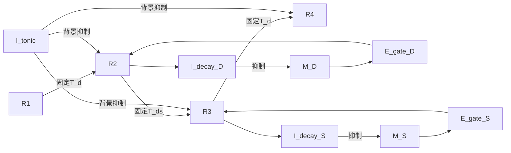

# LDS-EImodel：Handcrafted E/I Decompression v2

固定连接、不训练的 E/I rate network，将已给定的 L/D/S primitive 解压缩为四次独立空间读出。主模型采用**直接兴奋性通路选择、真实背景抑制和 Response 驱动的规则记忆终止**。

[完整架构](architecture.md) · [开发规则](AGENTS.md) · [P0–P7验收](todo.md) · [实验契约](docs/v2_protocol.md)

## 任务与科学边界

六位置圆环 Z6，L∈0…5，D∈{+1,−1}，S∈{1,2}。独立评价器定义：

$$ (R_1,R_2,R_3,R_4)=(L,L+D,L+D+DS,L+2D+DS)\pmod6. $$

模型只接收编码电流与无内容 clock，不读取目标、下一位置或试次标签。固定候选分支1→2→4→4，两次选择先D后S；R2/R3形成后规则身份由Response分支继承。L由R1维持，不新增M_L。一个共享六位置Y按严格readout-first输出。没有训练、primitive推断、block学习或泛化结论。

## 回路



E_gate向分支提供亚阈值兴奋，位置由上游固定投射传入；source、规则gate和阶段许可共同作用才能激活正确位置。已形成Response递归维持，旧Response由单独retire I统一退役。路径选择由可记录、可干预的E_gate连续活动完成。

M_D/M_S在sample撤除后抵抗tonic inhibition保持。R2/R3逐位置强活动经慢阈值I_decay反馈，分别终止D/S memory；没有按phase清零或定时gain切换。记忆终止不改变任务时序。

全部132个连续率状态（81 E、51 I）采用相同bounded-ReLU率方程，Dale符号由突触前身份决定。权重手工设置，无生理拟合；dt5 ms、τ_E40 ms、τ_I20 ms、τ_decay120 ms。完整参数见[配置说明](handcrafted_ei/config/README.md)和[baseline.yaml](handcrafted_ei/config/baseline.yaml)。

## 三种外部位置编码

- one_hot：6维one-hot。
- ring：1维周期相位，经周期调谐映射为六位置电流。
- topology：2维单位圆坐标，经连续非负调谐映射为六位置电流。

内部每个Response分支均为六单元，连续编码产生宽调谐输入，没有离散重编码。ring/topology无噪声电流相同。本实验比较外部编码与噪声空间，不能解释为三种不同内部维度的网络。

固定T变换只在初始化构建；二维旋转矩阵只作几何验证，其负系数不直接作为E权重。相位使用模运算，不存在非平凡1×1实旋转矩阵。三模式电流L2归一化，噪声总原始坐标期望能量为σ²；实际电流误差也需报告。

## 验证与复现

依赖[requirements.txt](handcrafted_ei/requirements.txt)，验证环境analysis：Python3.12.12、NumPy2.3.5、PyYAML6.0.3、Matplotlib3.10.7，CPU。运行前应核对已安装依赖；模型无需GPU或训练。

```powershell
.\handcrafted_ei\run.ps1 -Test
.\handcrafted_ei\run.ps1 -OutputDirectory results\v2-run
```

等价命令：

```text
python -m unittest discover -s handcrafted_ei/tests -v
python -m handcrafted_ei.evaluate --output <fresh-output-directory>
python -m handcrafted_ei.receipt <output-directory>
python -m handcrafted_ei.recompute <output-directory>
```

输出目录必须为空。当前实测32/32测试通过；三模式各24/24、四阶段均100%；198组实验共4,752个trial，独立轨迹复算通过。完整结果与科学局限见[实现与验收报告](docs/v2_implementation_report.md)及[实验报告](handcrafted_ei/artifacts/v2/run/REPORT.md)。

完整评估穷举三模式24条件、seeds7/11/19、噪声、A/B/C/D与额外机制消融及匹配随机对照；归档配置、源码哈希、环境、全率、事件、独立target和复算。验收结果只对应明确记录的配置与实验条件。

吸引子分析关闭sample，明确区分关闭全部clock的自由演化与保留阶段许可的受迫对照；保留恒定tonic背景。报告固定点残差、局部谱、扰动恢复、有限盆扫描和不同初态。持续高活动、正确率或PCA聚类均不单独证明吸引子。不存在吸引子也如实报告。

## 代码导航

[位置编码](handcrafted_ei/model/location_encoding.py)、[固定连接](handcrafted_ei/model/connectivity.py)、[网络动力学](handcrafted_ei/model/ei_network.py)、[时序及干预](handcrafted_ei/simulation/__init__.py)、[行为](handcrafted_ei/evaluation/behavior.py)、[记忆指标](handcrafted_ei/evaluation/memory.py)、[表征](handcrafted_ei/evaluation/representation.py)、[吸引子](handcrafted_ei/evaluation/attractors.py)、[归档入口](handcrafted_ei/evaluate.py)、[独立复算](handcrafted_ei/receipt.py)。

[架构规格](architecture.md)定义当前模型的完整动力学、时序与信息边界；[验收清单](todo.md)记录当前阶段及证据。吸引子与编码比较的科学局限见实现报告。
