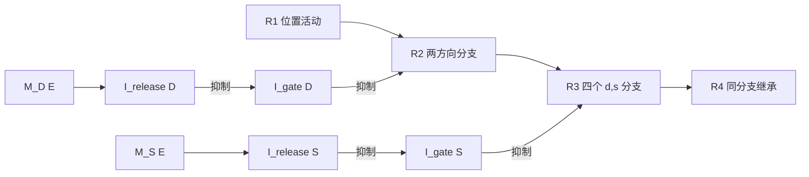

# Handcrafted E/I Decompression v1 — 架构规格

本规格定义已实现的固定连接、不训练 E/I rate network。科学问题是：给定 L/D/S 后，R1 的位置活动、D/S 短时记忆、两层 I→I 去抑制、Response 分支继承与四次在线 readout 能否生成正确序列。它是解压缩机制原型，不研究 primitive 推断、任务学习或生理参数拟合。

## 1. 冻结决定与信息边界

- F1：L/D/S 是合法直接输入，sample 同时提供 6+2+2 个电流通道。
- F2：专门 memory 只有 M_D、M_S；L 由 R1 自身活动保持，无 M_L、LocationMemory 或 M_DS。
- F3：符号标签与 target 仅存在于 task 和试次后的评价器。model 只接收编码输入与无内容 clock，不接收下一位置或答案数组。
- F4：真实回路为 M(E) → I_release(I) ⊣ I_gate(I) ⊣ E_target(E)，同时存在固定 E_source→E_target 投射。
- F5：R1→R2 用 D；R2→R3 用 S 与活跃 R2 分支；R3→R4 沿本分支推进，不重读 D/S。
- F6：四次 readout-first；每个输出完成后才允许下一转移。
- F7：唯一六位置 Y，所有阶段、分支采用相同位置坐标投射；argmax 仅供外部观测。
- F8：不强制 low-rank、正交、PCA rank 或吸引子结论。
- F9：handcrafted 固定权重，不训练，不引入 optimizer 或 architecture search。

两样本方向比较、历史反馈、block learning、跨 trial 学 S、额外位置 memory 均移出 v1；不得保留其占位接口。结构常量 d/s 仅在 connectivity 初始化时定义线路，不是运行时试次标签。evaluation 不写回状态；模型不 import task/evaluation。

## 2. 数学任务

六位置圆环为 Z₆={0,…,5}，位置沿顺时针递增：

$$\theta_k=2\pi k/6,\quad L\in Z_6,\quad D\in\{-1,+1\},\quad S\in\{1,2\}.$$

仅环境/评价器计算真值：

$$\begin{aligned}R_1&=L,\\R_2&=L+D,\\R_3&=L+D+DS,\\R_4&=L+2D+DS\end{aligned}\pmod 6.$$

相邻位移为 D、DS、D；S 只改变中间一次转移。例：L=0,D=+1,S=2 → [0,1,3,4]。验证穷举 6×2×2=24 个条件，无训练/测试划分，无泛化结论。

输入 L 为六维 one-hot，进入 R1；D 顺序为 [D+,D−]，进入 M_D；S 顺序为 [S1,S2]，进入 M_S。apply_input 只改变外部电流，不覆写神经活动。200 ms sample 后清空输入；memory 需要在无外部 clamp 时保持到相应 gate。模型不能访问 target；评价发生在 run_trial 返回之后。

## 3. 群体与统一率动力学

| 群体 | 类型/数量 | 作用 |
| --- | --- | --- |
| R1 | E/6 | 保持 L |
| R2 | E/12 | 两个方向分支，每支六位置 |
| R3、R4 | E/各24 | 各四个 (d,s) 分支，每支六位置 |
| M_D、M_S | E/各2 | 分别保持方向、步长 |
| Y | E/6 | 单个共享位置 readout |
| I_gate | I/10 | 2+4+4 个默认抑制门 |
| I_release | I/5 | D 两个、S 两个、内容无关第三层一个 |
| I_competition | I/10 | R1 六个、M_D/M_S 各两个 |
| I_retire | I/3 | 分别退役 R1/R2/R3 |

合计 E76+I28=104 个率状态。clock 为外部无内容电流，没有额外 clock 神经元。抑制规模是候选工程实现，不是生物事实或最小规模证明。群体分离便于检查与 lesion；并不声称皮层必须有四套 response 神经元。

所有状态（包括 gate、release、competition、retire、Y）遵守：

$$\tau_i\dot r_i=-r_i+\phi\left(\sum_{j\in E}W_{ij}r_j-\sum_{j\in I}W_{ij}r_j+I_i-\theta_i\right),\quad \phi(z)=\min(1,\max(0,z)).$$

矩阵按 [post,pre]，保存非负 magnitude；实际符号由突触前 E/I 身份唯一决定。I→I 也是抑制。E 的自反馈、E→竞争 I、I→其他候选 E 均可逐边检查。

Euler：

$$r_i(t+dt)=r_i(t)+\frac{dt}{\tau_i}[-r_i(t)+\phi(\cdot)].$$

dt=5 ms，τ_E=40 ms，τ_I=20 ms；dt≤0.5 min τ 是保守步长约束，并非全网络稳定性证明。更新检查有限、非负、≤1。时间单位 ms；率为归一化无量纲活动，非 Hz/膜电位；权重、阈值、外部电流均无量纲。Neuron/E/I 子类提供标量参考更新，网络用同一方程向量化。

R1/M_D/M_S 和 response 位置单元具有自反馈与次阈 tonic：

$$\tau_E\dot r=-r+\phi(w_{rec}r+w_{proj}r_{src}+I_{sample}+I_{tonic}-w_g g-w_{ret}r_{ret}-I_{comp}-\theta_E).$$

记忆通过活动保持，不靠保存 LDS 标签或持续电流。有限 delay 保持与零 recurrence 对照可验证功能；不据此宣称连续吸引子。

## 4. 固定拓扑与真实去抑制

$$ (T_\delta)_{k'k}=\begin{cases}1,&k'=(k+\delta)\bmod6,\\0,&其他.\end{cases} $$

只在 connectivity 初始化生成固定移位连线：

$$W_{12}^{(d)}=w_pT_d,\quad W_{23}^{(d,s)}=w_pT_{ds},\quad W_{34}^{(d,s)}=w_pT_d.$$

R1 投到 R2(+)/R2(−)；每个 R2(d) 投到其 R3(d,1)/R3(d,2)；R3(d,s) 只投到同分支 R4(d,s)。运行期不按真实 D/S roll 活动、选矩阵或覆写答案。



D/S release 的统一动力学驱动为 w_mem m + c − θ_release。memory 与阶段电流单独均低于阈值，两者同时才释放：

$$\max(w_{mem},c)<\theta_{rel}<w_{mem}+c.$$

门驱动为 I_gate_tonic − w_release r_release − θ_gate。未 release 时门稳态为 0.5，抑制下游。S1/S2 release 各作用于两个方向的相同步长 gate；方向由源 R2 活动继承，无第二次 D 查询。第三层 release 只有 clock，无 memory 投射。

阶段许可开启后保持电平至结束；目标自反馈足够在形成后抵御门重新关闭，因而断开记忆输出不会自动抹掉 response。继承能力必须做 B/D 因果测试，不能仅靠缺少直连宣告成立。

## 5. 时序与共享 Y

Sample → Delay → Readout1 → Transition1 → Readout2 → Transition2 → Readout3 → Transition3 → Readout4 → End。无 feedback 阶段。每次 transition：先留源 200 ms 完成传输，再激活该源的统一 I_retire，等待160 ms，才开始下一读出窗口。

| 事件 | 默认区间/ms |
| --- | --- |
| Sample | 0–200 |
| Delay | 200–1800 |
| Readout1 | 1800–1900 |
| gap；Transition1；retire1 | 1900–1910；1910–2110；2110–2270 |
| Readout2 | 2270–2370 |
| gap；Transition2；retire2 | 2370–2380；2380–2580；2580–2740 |
| Readout3 | 2740–2840 |
| gap；Transition3；retire3 | 2840–2850；2850–3050；3050–3210 |
| Readout4 | 3210–3310 |

严格不等式：1900<1910、2370<2380、2840<2850；延长 delay 时后续事件整体平移。advance_phase 只施加无内容电流，不能改连接或读取标签。旧阶段是否足够抑制由轨迹验证，不能假定瞬时清零。

唯一 Y[k] 接收所有 response 同位置单元：

$$\tau_E\dot y_k=-y_k+\phi\left(w_{out}\sum_{r,b}e_{r,b,k}-\theta_Y\right).$$

每次100 ms窗口取最后20 ms平均；外部 argmax 给出位置。若最大值<0.1，输出 −1 表示无有效读数；该值不能回流。使用固定六位置投射，不做 rank-specific 答案头；旧源退役后才采样。

## 6. 配置、初值与选择依据

完整配置是 handcrafted_ei/config/baseline.yaml，解析快照归档。默认全部状态为0，只有10个 I_gate 以无输入稳态0.5初始化，避免默认关闭测试被门启动瞬态污染。sample 外 stimulus 全零；clock 初始全零。

| 参数 | 值 | 依据/状态 |
| --- | --- | --- |
| sample/delay | 200/1600 ms | delay 扫描到4000 ms |
| transfer/retire/readout/decision/gap | 200/160/100/20/10 ms | 工程时间窗，需轨迹验证 |
| w_rec/tonic_E/θ_E | 2.0/0.15/0.25 | 已亮状态门关闭时仍可维持；暗态不自发 |
| input/projection/output | 各0.8 | 非负固定兴奋连接 |
| w_mem/clock_release/θ_release | 0.9/0.9/1.0 | 单项不释放、两项释放 |
| clock_release3/θ_release3 | 1.0/0.3 | 第三层仅 clock |
| tonic_gate/θ_gate/w_release/w_gate | 0.6/0.1/0.8/1.6 | gate稳态0.5；release稳态0.8时关门 |
| competition drive/inhibition | 1.0/0.3 | E→I、I→其他候选E |
| clock_retire/θ_retire/w_retire | 1.1/0.1/3.2 | retire 稳态1，足以压制自反馈与残留源输入 |
| θ_Y/decision threshold | 0.3/0.1 | 读数阈值配置化 |

暗态无源驱动为−0.1；默认关闭时最大源输入0.8−0.8−0.1=−0.1；开门无自反馈时驱动0.7。已亮目标即使门关闭，驱动2−0.8−0.1=1.1，可保持；退役时即使源仍最大，驱动2+0.8−0.1−3.2<0。这些是稳态候选不等式，瞬态正确性必须实测。

基线噪声0。扩展只在 sample 开始对 x_L 一次采样 ε_j~N(0,σ²)，x_L=clip(onehot(L)+ε,0,1)，D/S保持无噪声。σ=0.03为指定噪声；另扫较大值观察退化。种子7/11/19；同一种子跨条件复用同一噪声向量，结果是条件穷举、三次噪声样本，不是大规模统计估计。零噪声结果要求种子无关。

## 7. 软件边界、日志与复现

- task：conditions、encode、target；真值公式仅在此出现。
- model：Neuron、connectivity、EINetwork；只接收编码输入、无内容事件。
- simulation：统一积分时钟、逐窗观测、全率记录；诊断 lesion 只切指定边，不用标签修改活动。R3位置扰动只在显式因果测试回调中，不属于正常运行。
- evaluation：输出之后的行为和表征计算，不写模型状态；evaluate 入口组织独立试验与归档。

公开正常接口 initialize/apply_input/remove_stimulus/step/integrate/advance_phase/get_activity/readout；readout 返回连续 Y 副本。初始拓扑固定；lesion 是明确标记的干预例外，每个试验用新网络。

每步归档104维rates、六维Y、时间和标签；各分支/gate/release由标签索引重建。events 独立保存全部时序、干预起止与切断边/幅度、四次平均Y和决策；task文件独立保存LDS/编码/target/seed。config、source_hashes、environment固定来源，metrics由这些产物复算。源码/文档改变后重新生成新目录，不覆写已有 receipt。

复现：

```powershell
python -m unittest discover -s handcrafted_ei/tests -v
python -m handcrafted_ei.evaluate
```

Windows推荐调用 analysis 环境绝对解释器，见 handcrafted_ei/run.ps1。声明依赖numpy>=1.26、PyYAML>=6、matplotlib>=3.8；实际版本记录到环境receipt。无需GPU，无训练。

## 8. 分层验收与因果试验

Level1：八项信息边界、四类Dale符号、撤除刺激后的R1/M_D/M_S保持、默认关门/正确release/错误分支抑制、readout-first、单个Y、24/24与逐stage正确率、断开memory输出后的继承。测试名与M0–M5门槛见todo.md。失败先查泄漏→Dale→时序/门控→数值。

| 干预 | 时机与对象 | 可否证预期 |
| --- | --- | --- |
| A | Transition1前切D release→gate边 | R1保持，R2–R4退化 |
| B | R2读完后切M_D→release输出 | 后续R3/R4保持 |
| C | Transition2前切S release→gate边 | R1/R2保持，R3/R4退化 |
| D | R3读完后切M_D/M_S全部release输出 | R4保持 |

每项随机对照用相同边数、权重幅度、突触前符号、起止时窗，从全网同权重候选边无放回抽样，种子7/11/19；候选池可含原始目标边。对照不保证无效，应报告原始效应，不能因结果不符合叙述而改真值。并设置去I→I、去recurrence的负对照。

M4通过后才进行M5：delay 1.6–4 s、位置噪声、gate幅度与recurrence敏感性、干预和表征。归档代码支持按实验单独复算，不把退出码当科学验收。

## 9. 事后表征与解释边界

每阶段取读出时刻活动，报告全response坐标的中心化SVD/PCA奇异值、VAF、participation ratio、活跃比例；按活跃分支分组，报告六位置的线性维数与中心化位置维数，并计算中心化分支位置张成空间之间的principal angles。

neural subspace是观察对象。稀疏活跃不等于低秩；1→2→4→4是固定L遍历D/S时潜在分支数，不是同时活动分支数或PCA rank。分支使用独立坐标，分离角受固定拓扑影响，不能宣称涌现正交几何。有限delay保持不是连续吸引子、自主阶段转换或生理复现证据。

历史包lds_decompressor、LDS_prechosen、LDS_disinhibitory不导入v1，不充当其验收证据。根目录README以v1为主，保留历史入口并标明边界。

## 10. Open design decisions

1. I群规模是否最小、竞争回路是否必要：当前为可检查实现，不是最优性结论。
2. 阈值重合检测与持续阶段电平的其他实现：当前仅验证此候选，不声称唯一回路。
3. 权重/阈值、settle与退役时间的容差：敏感性结果只覆盖明示扫描点，不作普适稳定性推断。
4. 更长delay、持续噪声、扰动恢复、吸引子盆与response群复用：未覆盖者不可当已验证结果。
5. 生物细胞亚型及参数映射未确定；当前为功能性机制原型。

启发性参考（不照搬参数，不据引用冒充复现）：[Song, Yang & Wang 2016](https://doi.org/10.1371/journal.pcbi.1004792)、[Yang, Murray & Wang 2016](https://pmc.ncbi.nlm.nih.gov/articles/PMC5034308/)。
