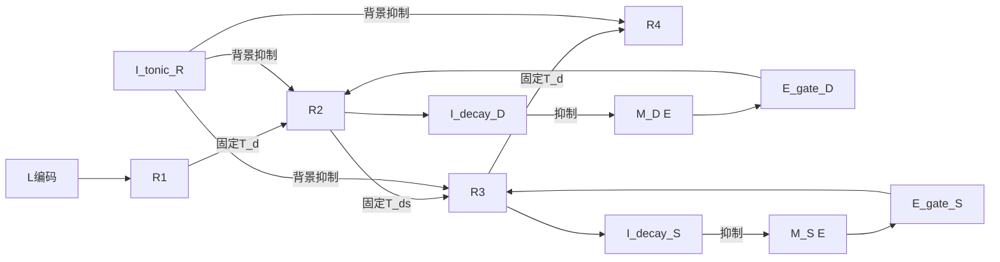

# Handcrafted E/I Decompression v2：架构规格

## 1. 科学问题与冻结定义

研究给定压缩 primitive 后神经活动如何依次解压缩四个位置。固定连接、handcrafted E/I rate network，不训练、不拟合生理数据，不研究历史推断、奖励或 block learning。专门记忆只有 M_D/M_S；L 由 R1 自身维持，禁止 M_L/M_DS。

六位置为 Z6，顺时针递增。L∈{0,…,5}，D∈{+1,−1}，S∈{1,2}。仅 task.target 生成真值：

$$ (R_1,R_2,R_3,R_4)=(L,L+D,L+D+DS,L+2D+DS)\pmod6. $$

模型不接收标签、target 或下一位置。两次选择依次使用 D、S；潜在分支数1→2→4→4。R2 形成后方向由分支继承；R3 后不再查询 D/S。每次先读出再转移，四次独立窗口共用唯一六位置 Y。clock 仅提供无内容许可与统一退役电流。

## 2. 群体、连接与 Dale

实现：handcrafted_ei/model/connectivity.py，矩阵方向 [post,pre]。

| 群体 | 类型/维度 | 功能 |
| --- | --- | --- |
| R1/R2/R3/R4 | E，6/12/24/24 | 每分支六位置，递归保持 |
| M_D/M_S；Y | E，各2；6 | 规则记忆；共享读出 |
| E_gate_D/E_gate_S/E_gate_34 | E，2/2/1 | 前两层规则与时钟重合；第三层仅时钟 |
| I_tonic_R/I_tonic_M | I，各1 | 实际背景抑制单元 |
| I_decay_D/I_decay_S | I，12/24 | R2/R3逐位置慢反馈 |
| comp_R1/comp_D/comp_S | I，6/2/2 | 输入候选竞争 |
| retire | I，3 | 旧Response统一退役 |

共132个率状态：81 E、51 I。I_decay 每个单元仅感受对应层一个 Response 位置，逐单元阈值后再抑制对应 memory。R1 不驱动 decay；R2 只终止 D，R3 只终止 S。多个弱分支不在阈值前求和。足够强且持久的错误 Response 也可能触发终止；这是活动检测，不是答案正确性检测。

## 3. 连续动力学、初值与静息态

所有 E/I、Y、gate、反馈使用 model/neuron.py 的统一方程：

$$\tau_i\dot r_i=-r_i+\phi(\sum_j s_jW_{ij}r_j+b_i+u_i+c_i-\theta_i),\quad\phi(z)=\min(1,\max(0,z)).$$

W≥0，s_j仅由突触前E/I身份决定；I→I如存在也为抑制。Euler dt=5 ms，τ_E=40、τ_I=20、τ_decay=120 ms。全部率初始0，仅两个 tonic I 以无输入稳态1初始化。率、权重、电流无量纲，不解释为Hz；参数集中于 config/baseline.yaml，均为手工工程选择，无数据拟合。

Response递归权重2、tonic E=.15、θ_E=.25。I_tonic_R 对R1投射.1、对下游.8。下游净静息偏置−.9；位置源投射.8；选中gate稳态.8、投射.8，提供.64。暗态仅source驱动−.1，仅gate为−.26，组合为.54。已亮态无gate时2−.9=1.1，可自维持。gate对分支内六位置提供相同亚阈兴奋，具体位置只由源的固定投射决定。R1用较弱背景抑制保持起点。

记忆与反馈：

$$\tau_E\dot m_a=-m_a+\phi(2m_a-.3-I_{comp,a}-3\sum_qz_q+u_a),$$
$$120\dot z_q=-z_q+\phi(2.4r_q-1.4).$$

memory背景I权重.2，sample电流.8x；撤输入后已亮状态抵抗抑制。q分别为R2/R3单元，r_q>7/12才驱动反馈，慢积分滤除瞬态。递归权重不变；增强抑制降低有效维持能力，不能声称等价于乘法gain调制。不存在clock→decay、事件清零、标签判断或正常运行期改权。反馈切断、提前破坏memory递归维持、延后Response形成需作因果验证。

## 4. 直接激活、继承与退役

$$\tau_E\dot g_{D/S,a}=-g_{D/S,a}+\phi(.9m_a+c-1),\quad c\in\{0,.9\}.$$

memory和clock单独均不产生gate，重合时选中gate趋近.8。D gate分别投R2两支；S gate投两个方向内相同步长子支，方向来自活跃R2。不存在I_release→I_gate路由。第三层单个E_gate_34由clock驱动，对全部R4候选支等价，只由R3源携带内容。旧Response由retire I提供3.2统一抑制，独立于选择。Y接收各阶段同位置.8投射、阈值.3；argmax仅是外部观察。

## 5. 编码、固定变换及噪声

model/location_encoding.py；配置location_encoding取one_hot、ring、topology。外部维度6/1/2；内部每分支均6，输出6。

- one_hot：e_k，直接映射六位置电流。
- ring：θ_k=2πk/6；周期距离|atan2(sinΔ,cosΔ)|；电流exp[κ(cos(θ−θ_j)−1)]。
- topology：v_k=[cosθ_k,sinθ_k]；非零输入投回单位圆，电流exp[κ(v·v_j−1)]。零向量映射零电流。

κ=4；两种连续编码产生宽调谐，邻居非零，不做离散解码。映射后L2归一化。范围仅是外部编码对相同Response网络的影响；ring/topology无噪声电流相同，不声称比较不同内部维度。

$$ (T_\delta)_{post,pre}=1\ \text{iff}\ post=(pre+\delta)\bmod6,$$
$$A=\begin{bmatrix}\cos(\pi/3)&-\sin(\pi/3)\\\sin(\pi/3)&\cos(\pi/3)\end{bmatrix}.$$

固定拓扑在初始化建全部W12=w_pT_d、W23=w_pT_ds、W34=w_pT_d。A只验证外部二维几何，不把负系数写入E连接。ring用模2π加法，不存在非平凡1×1实旋转矩阵；内部用六维T嵌入。测试A⁶=I、逆、平方以及全部位置±1/±2映射。

sample开始采样一次原始坐标高斯，总期望平方范数σ²，每坐标SD=σ/√dim；ring wrap，topology投回圆，one_hot截负后归一化。三种电流均归一化，并记录实际电流扰动范数。相同原始噪声能量不意味着相同神经电流误差，禁止由此直接宣称编码优越性。seeds7/11/19，各条件使用可复现派生种子。

## 6. 时序、接口与日志

sample200、delay1600、readout100、decision20、gap10、transfer200、retire160 ms。读出结束1900/2370/2840/3310；转移许可1910/2380/2850。先传输后退役；未来Response在许可前保持低活动。延迟交接实验只推迟内容无关许可，不改正常顺序。

task编码及真值；model不import task/evaluation；simulation仅clock、积分与观测；evaluation在返回输出后评价。正常接口initialize/apply_input(x_L,x_D,x_S)/remove_stimulus/step/integrate/advance_phase/get_activity/readout。apply_input只写stimulus，不写rates。字符串与数值分别校验；时间窗必须是dt整数倍。

每步记录全部132维rates、labels/groups、Y和时间；事件、干预边/单元、幅度、窗口独立保存。LDS/编码/target/seed在独立task文件。分析与正常运行隔离；吸引子测试仅在独立副本施加明确记录的扰动，不反馈到任务状态。

## 7. 验收、因果与后验分析

旧16测试与源码先归档。P4须三编码各24/24、逐stage、Dale、信息边界、readout-first、门前保持与分支继承通过，才开展P5–P7。

A首次转移前切M_D→E_gate_D，预期只保留R1；C第二次前切M_S→E_gate_S，预期保留R1/R2；B/D在R2/R3读出后切已用memory输出，后续保持。另测gate→Response、tonic、recurrence、Response→decay、早期记忆抑制、延迟交接。随机lesion匹配边数、幅度、突触前符号及窗口。移除tonic或decay不必降低任务正确率；分别以未选通路泄漏、不能终止memory作为机制退化指标。

分阶段记录全Response与trial平均轨迹、SVD/VAF、participation ratio、分支内位置几何、principal angles、活跃比例、分支选择性、拓扑距离、memory消退后的分支稳定性。固定分支坐标影响角度，不能称为涌现正交；1/2/4/4不是PCA rank。

吸引子：关闭sample；关闭全部clock的自由演化与保留阶段电流的受迫对照分开，明确保留tonic。测静息初态、已形成Response、不同初态、扰动幅度、恢复/跳转/衰减、盆扫描、向量场残差及Euler谱半径。低残差、谱半径<1、局部恢复共同支持所测固定点局部稳定，不证明全局盆或连续吸引子；分段线性阈值附近有限差分有局限。吸引子存在与否都可接受。

## 8. 复现与解释边界

依赖numpy≥2.0（记忆AUC使用trapezoid）、PyYAML≥6、matplotlib≥3.8，analysis环境CPU。命令：`python -m unittest discover -s handcrafted_ei/tests -v`、`python -m handcrafted_ei.evaluate --output <fresh-dir>`、`python -m handcrafted_ei.receipt <dir>`、`python -m handcrafted_ei.recompute <dir>`。吸引子轨迹按快照分包，index.json记录SHA256；recompute独立复算表征、扰动、谱及全部自由演化步。

历史artifacts/v1不覆盖；新结果artifacts/v2。归档完整配置、源码SHA256、环境、轨迹及复算。失败如实保存；不把24/24当作学习/泛化，不把高活动、聚类或分支结构当吸引子证据。未测参数范围、连续时间稳定性、生物参数映射均属局限。
