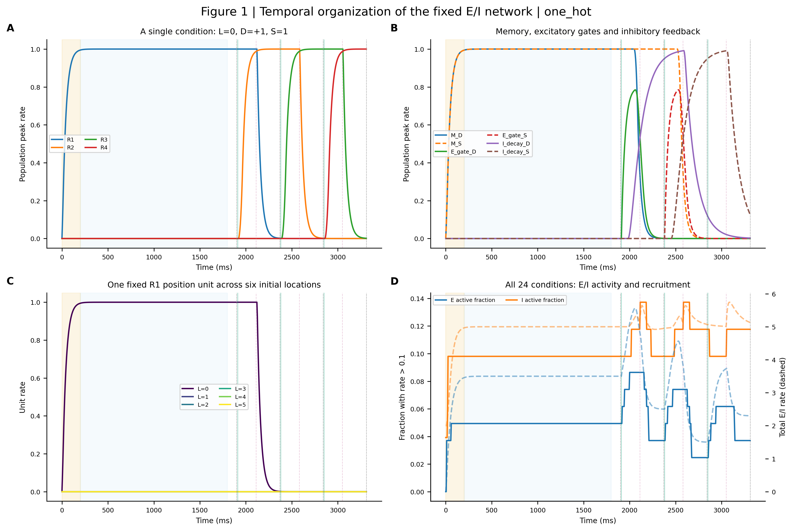
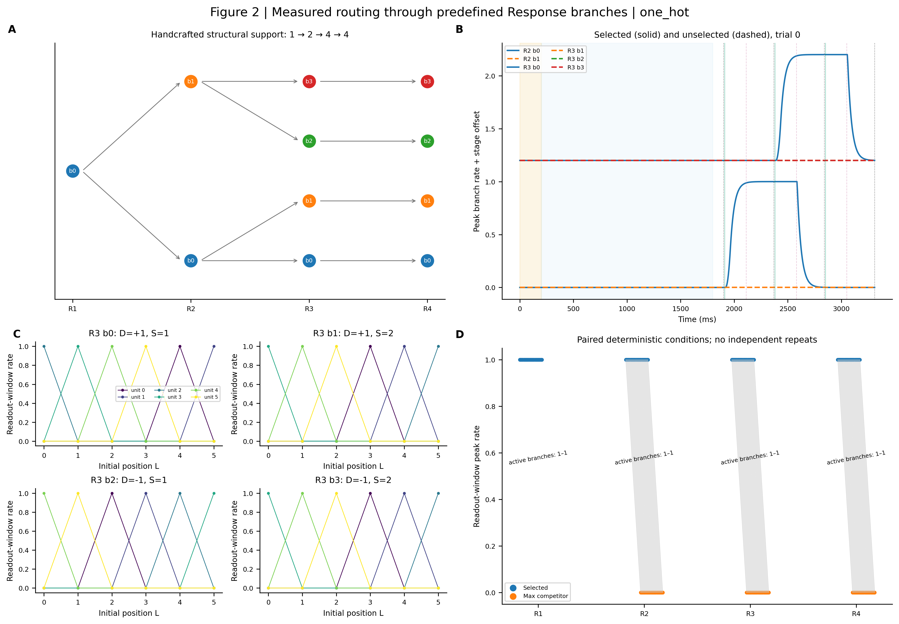
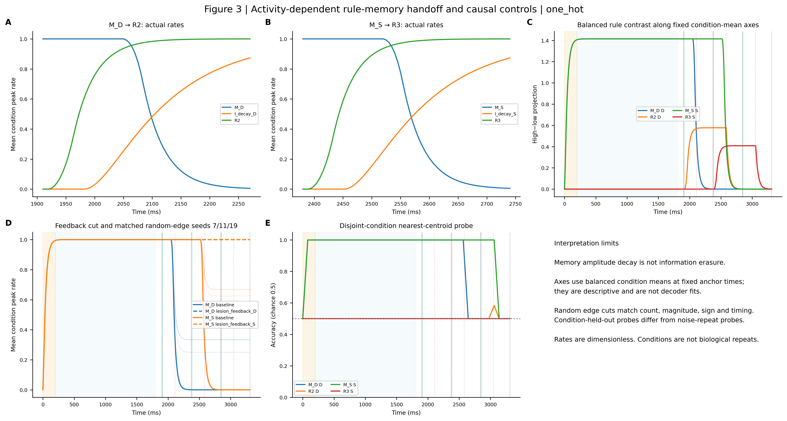
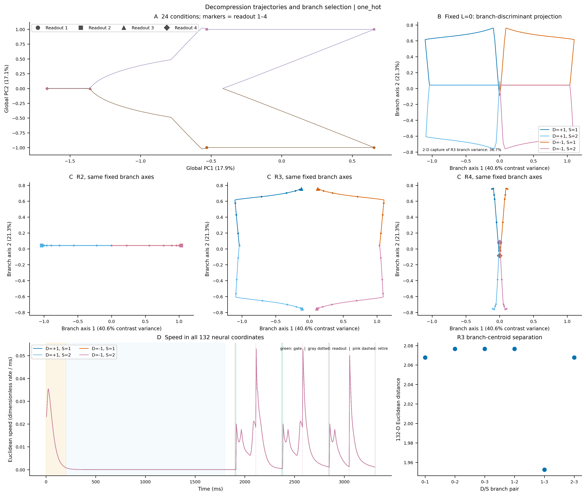
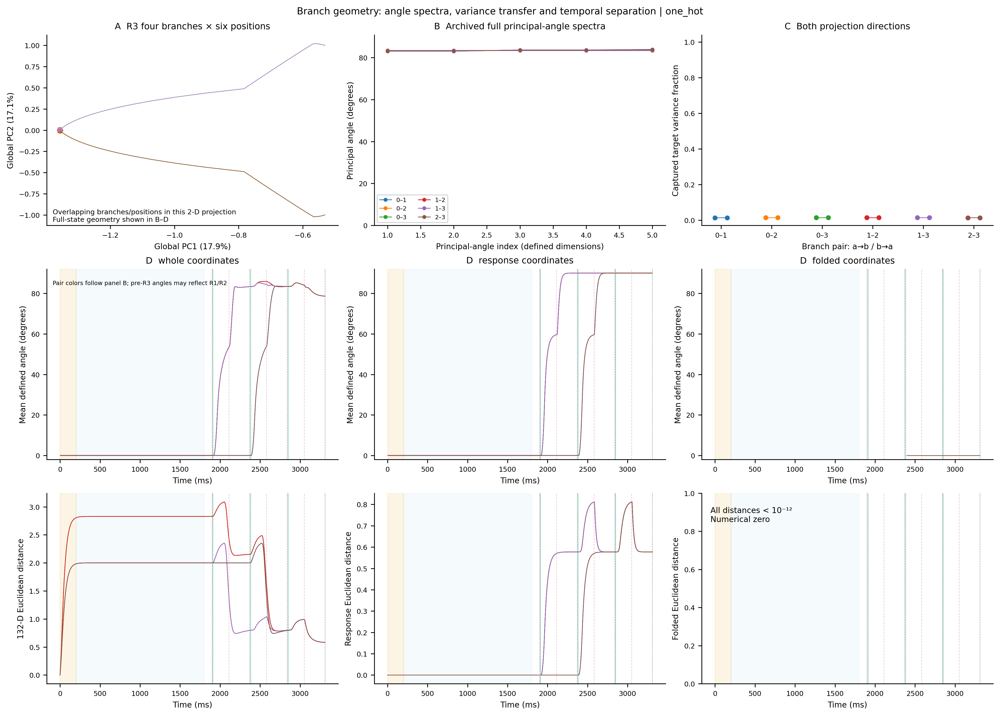
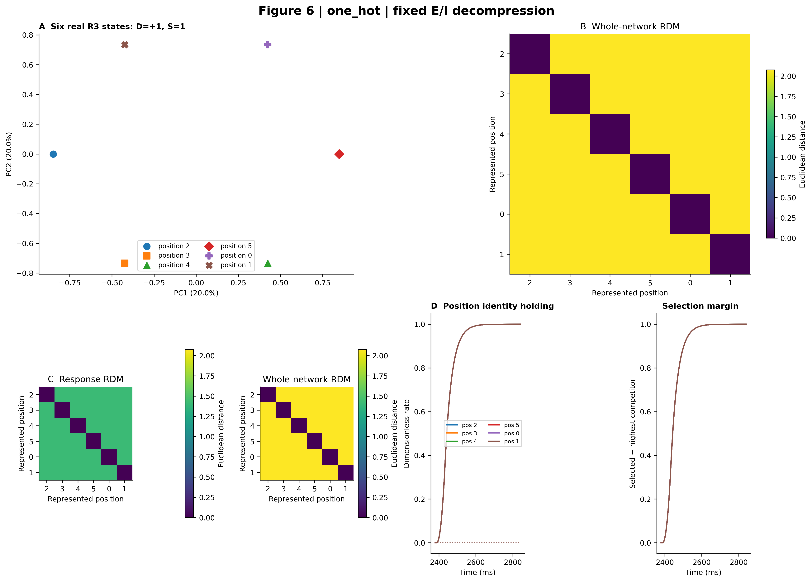
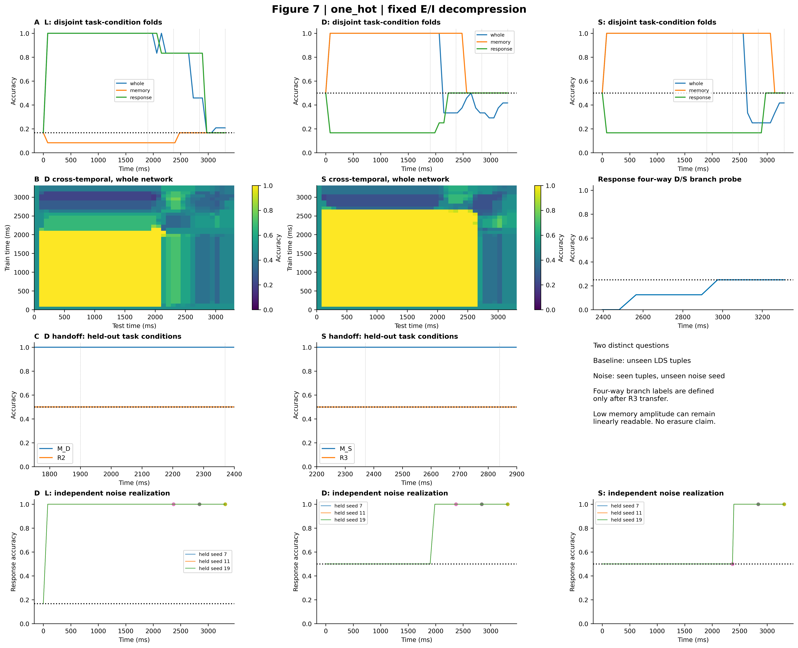
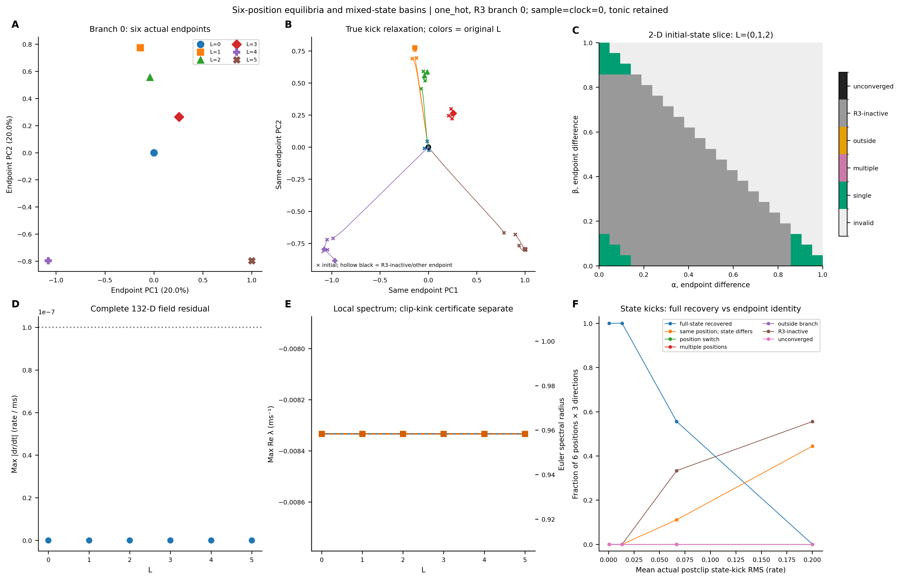
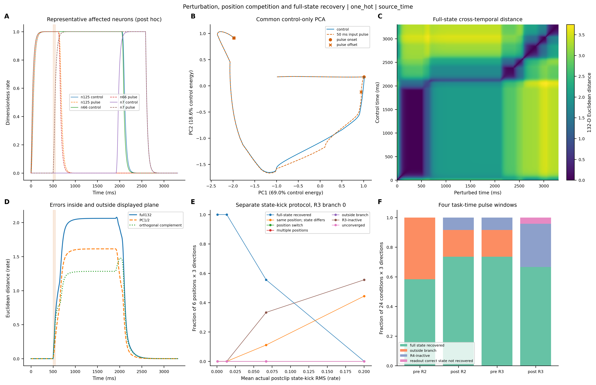
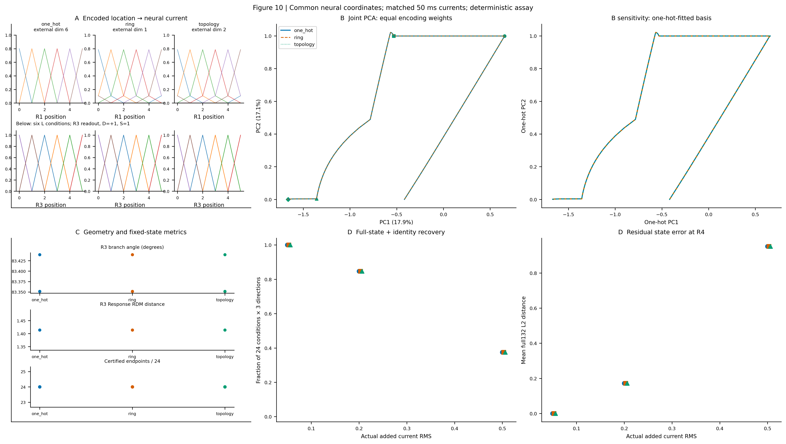

# V3 科研图表交付

主图、三编码补图、派生数据、数值与来源证据全部位于本目录。核心结论：分支判别投影能显示路由，但二维投影不能保留全部状态误差；混合初态扫描多数失去R3活动；相同最终读出不等于完整状态恢复。

[数据与panel映射](FIGURE_DATA_MAP.md) · [文献方法](REFERENCE_METHOD_MAP.md) · [数值验证](NUMERICAL_VALIDATION.md) · [逐图审阅](FIGURE_REVIEW.md) · [重建命令](RUN_INSTRUCTIONS.md)

## fig01_one_hot

## fig02_one_hot

## fig03_one_hot

## fig04_one_hot_decompression_trajectories

## fig05_one_hot_branch_subspaces

## fig06_one_hot

## fig07_one_hot

## fig08_one_hot_six_point_attractors_branch0

## fig09_one_hot_perturbation_dynamics_source_time

## fig10_encoding_comparison

## 全部图片索引

- [fig01_one_hot](figures/main/fig01_one_hot.png)
- [fig02_one_hot](figures/main/fig02_one_hot.png)
- [fig03_one_hot](figures/main/fig03_one_hot.png)
- [fig04_one_hot_decompression_trajectories](figures/main/fig04_one_hot_decompression_trajectories.png)
- [fig05_one_hot_branch_subspaces](figures/main/fig05_one_hot_branch_subspaces.png)
- [fig06_one_hot](figures/main/fig06_one_hot.png)
- [fig07_one_hot](figures/main/fig07_one_hot.png)
- [fig08_one_hot_six_point_attractors_branch0](figures/main/fig08_one_hot_six_point_attractors_branch0.png)
- [fig09_one_hot_perturbation_dynamics_source_time](figures/main/fig09_one_hot_perturbation_dynamics_source_time.png)
- [fig10_encoding_comparison](figures/main/fig10_encoding_comparison.png)
- [fig01_ring](figures/supplementary/fig01_ring.png)
- [fig01_topology](figures/supplementary/fig01_topology.png)
- [fig02_ring](figures/supplementary/fig02_ring.png)
- [fig02_topology](figures/supplementary/fig02_topology.png)
- [fig03_ring](figures/supplementary/fig03_ring.png)
- [fig03_topology](figures/supplementary/fig03_topology.png)
- [fig04_one_hot_global3d](figures/supplementary/fig04_one_hot_global3d.png)
- [fig04_one_hot_transition_speed_zooms](figures/supplementary/fig04_one_hot_transition_speed_zooms.png)
- [fig04_ring_decompression_trajectories](figures/supplementary/fig04_ring_decompression_trajectories.png)
- [fig04_ring_global3d](figures/supplementary/fig04_ring_global3d.png)
- [fig04_ring_transition_speed_zooms](figures/supplementary/fig04_ring_transition_speed_zooms.png)
- [fig04_topology_decompression_trajectories](figures/supplementary/fig04_topology_decompression_trajectories.png)
- [fig04_topology_global3d](figures/supplementary/fig04_topology_global3d.png)
- [fig04_topology_transition_speed_zooms](figures/supplementary/fig04_topology_transition_speed_zooms.png)
- [fig05_one_hot_structural_controls](figures/supplementary/fig05_one_hot_structural_controls.png)
- [fig05_ring_branch_subspaces](figures/supplementary/fig05_ring_branch_subspaces.png)
- [fig05_ring_structural_controls](figures/supplementary/fig05_ring_structural_controls.png)
- [fig05_topology_branch_subspaces](figures/supplementary/fig05_topology_branch_subspaces.png)
- [fig05_topology_structural_controls](figures/supplementary/fig05_topology_structural_controls.png)
- [fig06_ring](figures/supplementary/fig06_ring.png)
- [fig06_topology](figures/supplementary/fig06_topology.png)
- [fig07_ring](figures/supplementary/fig07_ring.png)
- [fig07_topology](figures/supplementary/fig07_topology.png)
- [fig08_one_hot_multiple_slices](figures/supplementary/fig08_one_hot_multiple_slices.png)
- [fig08_one_hot_six_endpoints_3d](figures/supplementary/fig08_one_hot_six_endpoints_3d.png)
- [fig08_one_hot_six_point_attractors_branch1](figures/supplementary/fig08_one_hot_six_point_attractors_branch1.png)
- [fig08_one_hot_six_point_attractors_branch2](figures/supplementary/fig08_one_hot_six_point_attractors_branch2.png)
- [fig08_one_hot_six_point_attractors_branch3](figures/supplementary/fig08_one_hot_six_point_attractors_branch3.png)
- [fig08_ring_multiple_slices](figures/supplementary/fig08_ring_multiple_slices.png)
- [fig08_ring_six_endpoints_3d](figures/supplementary/fig08_ring_six_endpoints_3d.png)
- [fig08_ring_six_point_attractors_branch0](figures/supplementary/fig08_ring_six_point_attractors_branch0.png)
- [fig08_ring_six_point_attractors_branch1](figures/supplementary/fig08_ring_six_point_attractors_branch1.png)
- [fig08_ring_six_point_attractors_branch2](figures/supplementary/fig08_ring_six_point_attractors_branch2.png)
- [fig08_ring_six_point_attractors_branch3](figures/supplementary/fig08_ring_six_point_attractors_branch3.png)
- [fig08_topology_multiple_slices](figures/supplementary/fig08_topology_multiple_slices.png)
- [fig08_topology_six_endpoints_3d](figures/supplementary/fig08_topology_six_endpoints_3d.png)
- [fig08_topology_six_point_attractors_branch0](figures/supplementary/fig08_topology_six_point_attractors_branch0.png)
- [fig08_topology_six_point_attractors_branch1](figures/supplementary/fig08_topology_six_point_attractors_branch1.png)
- [fig08_topology_six_point_attractors_branch2](figures/supplementary/fig08_topology_six_point_attractors_branch2.png)
- [fig08_topology_six_point_attractors_branch3](figures/supplementary/fig08_topology_six_point_attractors_branch3.png)
- [fig09_one_hot_perturbation_dynamics_R3_fixed_clock](figures/supplementary/fig09_one_hot_perturbation_dynamics_R3_fixed_clock.png)
- [fig09_ring_perturbation_dynamics_R3_fixed_clock](figures/supplementary/fig09_ring_perturbation_dynamics_R3_fixed_clock.png)
- [fig09_ring_perturbation_dynamics_source_time](figures/supplementary/fig09_ring_perturbation_dynamics_source_time.png)
- [fig09_topology_perturbation_dynamics_R3_fixed_clock](figures/supplementary/fig09_topology_perturbation_dynamics_R3_fixed_clock.png)
- [fig09_topology_perturbation_dynamics_source_time](figures/supplementary/fig09_topology_perturbation_dynamics_source_time.png)
