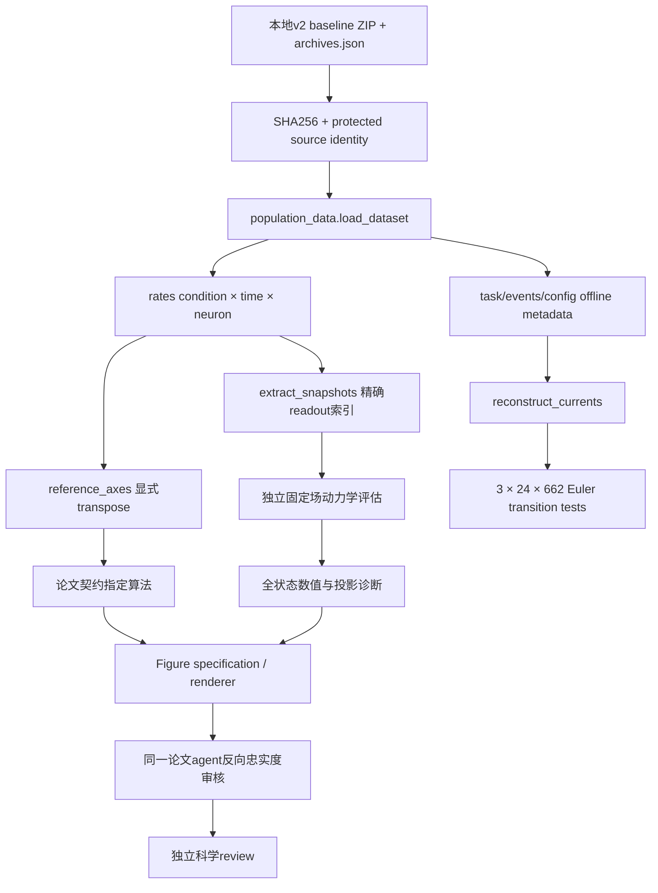

# 数据流与所有权

- raw rates/labels/times来自ZIP NPZ；task/seed/encoded input来自task JSON；population/events/interventions来自events JSON。
- archive配置来自manifest；neuron E/I与sample/clock/tonic由protected-code identity一致的模型构建信息重建。保存真实与重建字段的界限。
- `target`只保存在offline任务信息，不传入神经网络，不用于构造snapshot或决定分支。
- reference_axes不决定CD/PCA/距离算法；论文agent拥有原方法contract，主agent负责复现实现与适配。
- 原始数据、旧Figure与旧metrics只读；新代码只写数据audit与新reproduction archive。
- `audit/data/`与reference_adapter.py/test_reference_adapter.py由Agent C独占写入；不会同时修改主agent动力学/renderer。
