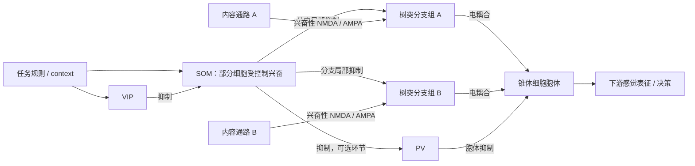

# DisinhibitoryCircuit2016：神经环路、连接性质与通路选择

## 1. 下载与本次核验范围

代码已克隆至 `D:\Library\10-16-handcrafted\external\DisinhibitoryCircuit2016`，保留独立 Git 历史。

- 来源：https://github.com/gyyang/DisinhibitoryCircuit2016
- 本次 HEAD：`1062f181e5335574428a1c1c31a247627e54e971`。
- 原论文：Yang, Murray & Wang (2016), *A dendritic disinhibitory circuit mechanism for pathway-specific gating*。[论文](https://www.nature.com/articles/ncomms12815)，[PubMed](https://pubmed.ncbi.nlm.nih.gov/27649374/)。
- 本次完成静态代码核验，未运行仿真、安装依赖或重现论文图。仓库含 Python 2 风格代码和 Brian 1 API；不能据此声称能在现有现代 Python 环境直接运行。

**核心机制：感觉内容沿兴奋性突触进入不同树突分支；任务规则通过 VIP–SOM 去抑制改变特定分支的通透性，使相同胞体主要响应当前相关的输入通路。**

## 2. 先分清代码中的三个层次

1. **详细细胞与突触模型**：[MultiCompartmentalModel.py](https://github.com/gyyang/DisinhibitoryCircuit2016/blob/1062f181e5335574428a1c1c31a247627e54e971/MultiCompartmentalModel.py)、[equations.txt](https://github.com/gyyang/DisinhibitoryCircuit2016/blob/1062f181e5335574428a1c1c31a247627e54e971/data/equations.txt)。模拟树突电压、NMDA/AMPA/GABA、电耦合与胞体放电。基本通路实验直接给不同树突施加不同抑制率。
2. **中间神经元网络的简化计算**：[InterneuronalCircuit.py](https://github.com/gyyang/DisinhibitoryCircuit2016/blob/1062f181e5335574428a1c1c31a247627e54e971/InterneuronalCircuit.py)。生成 VIP→SOM、SOM→树突等矩阵，计算情境对应的 SOM 发放率及树突抑制，再调用拟合的树突输入输出函数和胞体发放函数。这里并非逐个模拟全部中间神经元的脉冲。
3. **功能任务读出**：[NewsomeTask.py](https://github.com/gyyang/DisinhibitoryCircuit2016/blob/1062f181e5335574428a1c1c31a247627e54e971/NewsomeTask.py)、[WongWangModel.py](https://github.com/gyyang/DisinhibitoryCircuit2016/blob/1062f181e5335574428a1c1c31a247627e54e971/WongWangModel.py)。把经过门控的感觉响应接入决策模型。

因此，读到完整 VIP–SOM–PV 示意图时，不能推断仓库每个实验都完整运行了这张脉冲网络。

## 3. 环路如何实现



图中的抑制边用文字标明；箭头只表示作用方向。

### 3.1 内容到达树突

查看 `two_pathway_gating_experiment()`，约第 856 行。两个输入群都是 `PoissonGroup`，输入强度由各自发放率给定。每个锥体细胞的前四根树突接收两条通路，分成两个各含两根的分支组：

```python
w_path1 = [w_input[0]]*2 + [w_input[1]]*2
w_path2 = [w_input[1]]*2 + [w_input[0]]*2
```

当 `w_input=(1,0)`，通路 1 只有效投向第一组，通路 2 只有效投向第二组；当两项都非零，两条通路有重叠输入，只是偏好相反。

**“通路”在这里首先是输入群与树突上的突触权重分布，不要求分别进入两个互不重叠的胞体群。**同一锥体细胞可以接收两种感觉信息。

### 3.2 SOM 抑制树突，VIP 抑制 SOM

`get_r_som()` 的核心关系是：

```python
Inh2som = np.dot(W_vip2som, r_vip)
input2som = Exc2som - Inh2som + p['Exc2som0']
r_som = fI_SOM(input2som)
```

VIP 活动增加，会通过负项降低 SOM 净输入；SOM 的发放率由阈值线性函数给出。随后：

```python
Inh2dend = np.dot(W_som2dend, r_som) * tauGABA
```

SOM 活动降低，使其靶向树突的 GABA 电导降低。两级抑制形成净去抑制：`VIP ↑ → SOM ↓ → 树突抑制 ↓`。

`Control2VIPSOM` 还给部分 SOM 直接兴奋。它的作用是塑造不同 SOM 的净输入：某些细胞被 VIP 压低，另一些细胞得到兴奋补偿，因而可以产生有选择的抑制图样。不能把控制信号理解为把所有 SOM 一起关闭。

### 3.3 树突为什么能成为局部门

`equations.txt` 定义每根树突自己的电压、电导及与胞体的电耦合。不同分支没有直接树突间耦合项，但经共同胞体可间接相互影响。

NMDA 电流中有电压依赖项：

```python
iNMDA = -w*gNMDA*sNMDA*(V_post-vE) / (
    1 + exp(-(V_post-vHalfNMDA)/vSpreadNMDA)
)
```

树突去极化可增强 NMDA 电流，形成局部再生性响应；局部 GABA 抑制会改变电压及总电导，妨碍强去极化建立。解除该分支的抑制后，相同兴奋输入更容易产生较大响应，并通过耦合电流影响胞体。

这是一个连续、非线性的生物物理门，不能精确等同于二值开关或统一乘法增益。

## 4. 神经连接的性质

### 4.1 作用符号由细胞类型和靶点决定

- 输入→树突：兴奋性，NMDA/AMPA。
- VIP→SOM：抑制性，间接提高目标树突的可响应性。
- SOM→锥体树突：抑制性，控制分支局部输入。
- PV→锥体胞体：抑制性，调节最终输出。
- SOM→PV、PV→PV：可选简化网络中的抑制连接。
- 树突↔胞体：电耦合，与上述化学突触不是同一种连接。

矩阵里的抑制权重通常存为正的强度/电导；抑制作用通过减去输入或抑制电流表达。看到正数矩阵，不能直接叫它兴奋性连接。

### 4.2 固定解剖连接上改变活动和有效传递

`generate_W()` 生成目标数×来源数的矩阵。`strict` 固定每个目标的输入数量并打乱来源；默认 `strict_interp` 用一个分数权重插值非整数输入数；另有随机及指定树突模式。因此“随机连接”不一定指每对细胞独立做一次伯努利抽样。

权重按总输入强度除以期望/指定输入数归一化。这样扫描连接密度时，可以尽量区分“输入来源多少”和“总强度多少”。

在门控比较中，主要改变的是 `r_vip`、`r_som` 和树突抑制；并非每换一个情境就重写全部突触矩阵。变化的是**固定结构上的有效信息传递**。

### 4.3 胞体连接稠密，树突连接仍可稀疏

默认参数为 160 个 SOM、140 个 VIP、3000 个锥体细胞，每个锥体细胞 30 根树突；`p_som2pyr=0.6`。代码将细胞级概率换算为：

\[
p_{\mathrm{SOM\to dend}}=1-(1-p_{\mathrm{SOM\to pyr}})^{1/N_d}.
\]

在该独立分支概率假设下，单根树突只接收整个 SOM 群的一小部分。即使一个 SOM 能连接很多锥体细胞，也不意味着它抑制每个细胞的所有树突。因此，抑制某个 SOM 子群能对部分分支产生更强去抑制。

这些参数是特定模型配置，不能直接当作所有皮层区域的普适解剖事实。

### 4.4 兴奋输入必须与去抑制位置对齐

这是代码中最容易漏读的前提。`get_gatingselectivity()` 先生成各情境的抑制图样，再调用 `get_exc()` 构造对应兴奋图样。默认 `invprop_inh` 为：

```python
exc = maximum(inh_threshold-inh, 0) / inh_threshold * g_exc
```

这段简化写法与源代码逐元素条件乘法等价。某情境抑制越弱的树突，被分配的该通路兴奋越强。

**因此，这部分网络结果不仅依赖随机抑制连接，还预设了兴奋输入与去抑制图样的对齐。**构造完成后，代码再在同一情境下测试匹配和不匹配的输入；它不是完全无结构的随机网络自动获得全部选择性。

仓库另含钙依赖可塑性代码：NMDA 钙与反向传播动作电位钙形成 `CaTrace`，通过超过增强/减弱阈值的时间计算权重变化。它为长期形成对齐提供建模机制。注意基本绘图函数的 `prelearning=(1,1)`、`postlearning=(2.75,0.47)` 是直接给定比较权重，调用该函数本身不等于现场完成训练。

## 5. 通路选择怎样体现为信息传递

在 `PathwayGating.py` 的 `specific` 条件下，基础树突抑制为 5 Hz，第二组额外叠加 30 Hz 抑制。结合 `(1,0)` 的输入分布：

1. 两条内容通路都可以发送脉冲。
2. 通路 1 主要落在低抑制的第一组树突，容易驱动局部响应。
3. 通路 2 主要落在高抑制的第二组树突，对胞体的影响较小。
4. 胞体输出偏向反映通路 1 的内容。

所以，被过滤的信息可以仍存在于上游；关键是它对下游的影响减小，而非上游必须停止活动。

更明确的计算表达是：

\[
r_{\mathrm{out}}=F\!\left(\{H(E_d(x_1,x_2),I_d(c))\}_d,I_{\mathrm{soma}}(c)\right).
\]

`x1/x2` 是内容，`c` 是情境；`H` 是单分支非线性，`F` 汇总树突并产生胞体输出。通路选择意味着在固定情境下，输出对相关内容的敏感度大于对无关内容的敏感度。这是对代码的计算解释，不是本次新测得的导数结果。

`get_gatingselectivity()` 在固定情境下比较匹配通路、其他通路、无内容和全部内容，得到 `ron/roff/rnone/rboth`。扣除无内容基线后计算：

\[
GS=\frac{\Delta r_{on}-\Delta r_{off}}
{\Delta r_{on}+\Delta r_{off}+\epsilon}.
\]

代码还区分逐细胞选择性再平均与群体均值先平均再计算，并对逐细胞值作范围处理。因此不能混用不同定义，也不能把单一选择性数值当成全部信息传递性质。

任务层中，`NewsomeTask.py` 先计算运动、颜色不同组合产生的感觉响应，再把投射群响应差转换为 `diff_current`，送入 Wong–Wang 决策模型。这里的功能检验是相关维度能否影响选择，而无关维度影响较小；本次没有重新运行该检验。

## 6. 与当前 Handcrafted E/I v1 的边界

本文件记录的是论文作者源码及其树突去抑制机制，属于文献背景。当前项目的工程规格见 [architecture.md](../architecture.md)，运行与验证入口见 [README.md](../README.md)。

当前模型用显式的 `M_D/M_S(E) → I_release(I) ⊣ I_gate(I) ⊣ Response(E)` 回路进行阶段限定的通路选择，并以固定连接实现响应分支继承。该实现采用统一的有界 rate 动力学，不导入论文代码，也不构成对作者多区室模型或原始实验的数值复现。当前序列行为与因果干预的证据见 [v1 验证报告](../handcrafted_ei/artifacts/v1/REPORT.md)。

## 7. 推荐代码阅读顺序与证据边界

1. [PathwayGating.py](https://github.com/gyyang/DisinhibitoryCircuit2016/blob/1062f181e5335574428a1c1c31a247627e54e971/PathwayGating.py)：`run_basic_pathway_gating()`，先看两条内容路径与抑制条件。
2. [MultiCompartmentalModel.py](https://github.com/gyyang/DisinhibitoryCircuit2016/blob/1062f181e5335574428a1c1c31a247627e54e971/MultiCompartmentalModel.py)：`two_pathway_gating_experiment()`，看突触实际连接哪些树突。
3. [equations.txt](https://github.com/gyyang/DisinhibitoryCircuit2016/blob/1062f181e5335574428a1c1c31a247627e54e971/data/equations.txt)：看局部电压、GABA、NMDA 与胞体耦合。
4. [InterneuronalCircuit.py](https://github.com/gyyang/DisinhibitoryCircuit2016/blob/1062f181e5335574428a1c1c31a247627e54e971/InterneuronalCircuit.py)：`get_r_som()` → `get_gatingselectivity()` → `get_exc()`，追踪控制、抑制和输入对齐。
5. [NewsomeTask.py](https://github.com/gyyang/DisinhibitoryCircuit2016/blob/1062f181e5335574428a1c1c31a247627e54e971/NewsomeTask.py)：`run_Newsome_model()`，追踪感觉响应如何成为决策电流。

源码可支持上述实现解释；论文提供机制与模型研究背景。尚未完成现代环境兼容、原始仿真重现、全部补充材料精读或对我们任务的迁移验证。原仓库含 Python 2 的 `print`、`sys.exc_clear`、`map` 副作用语义及 Brian 1 接口，运行前须先核对兼容环境，不应只安装 Brian 2 就假定完成迁移。

