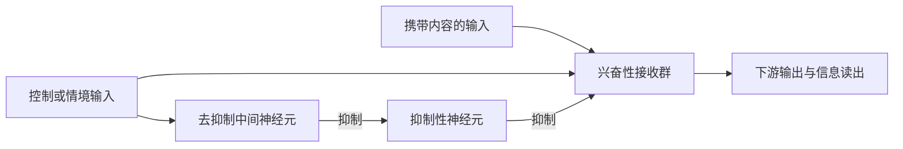

# Gating、gain modulation 与神经信号流：分主题阅读清单

检索日期：2026-10-20。目标：理解神经计算中增益调制和通路门控的机制，再比较直接兴奋、抑制、去抑制及递归动力学如何改变信息传递。

本清单精选 18 篇，侧重可以形成模型或解释模型连接的经典研究及机制综述；不是系统综述或最新论文的穷尽列表。题名、作者、年份与主题依据期刊页面、PubMed/PMC 或作者机构来源核对；本次完成文献筛选与摘要／可访问正文的定向查阅，不代表已逐篇精读补充材料或复现。下文“模型启发”“阅读任务”为本清单的建议，不是原文已验证的结论。

## 1. 先区分需要解释的现象

| 概念 | 需要判断的现象 | 常见误判 |
| --- | --- | --- |
| 直接兴奋驱动 | 输入本身携带信号并提高下游响应 | 看到下游更活跃就认为它传递了指定输入的信息 |
| 加性调制 | 输入—输出关系发生偏移，如阈值或基线改变 | 将所有放电增加叫作 gain modulation |
| 增益调制 | 改变对输入变化的敏感度，常表现为响应曲线斜率／尺度变化 | 把固定激活函数中的 gain 参数当成情境依赖增益机制 |
| 通路门控 | 同一接收网络选择性传递某条输入通路 | 只降低总活动，却没有验证通路选择性 |
| 去抑制 | 抑制原本抑制目标的神经元，释放目标的响应 | 认为抑制减少必然产生输出；它仍依赖驱动与工作点 |
| 递归选择 | 输入进入网络后，情境改变其后续累积和读出 | 将任务无关输入未被使用等同于它从未进入网络 |

这些区分的入门依据是 Silver（2010，R2）与 Sherman & Guillery（1998，F1）。Gating 是功能描述，disinhibition 是电路机制，gain modulation 是输入—输出变换；三者可重叠，但不是同义词。

图是比较机制的概念示意，不是对某个脑区或论文连接图的复现。直接控制 E 与经 I→I 链控制 E 可以具有不同的基线、动态范围、时延与输入选择性。

## 2. 第一组：建立概念框架的综述（4 篇）

### R1. Salinas, E. & Sejnowski, T. J. (2001)
**Gain modulation in the central nervous system: where behavior, neurophysiology, and computation meet.** *The Neuroscientist*, 7, 430–440.

[PubMed 与 DOI](https://pubmed.ncbi.nlm.nih.gov/11597102/) · [开放全文](https://pmc.ncbi.nlm.nih.gov/articles/PMC2887717/)

- 类型：计算与生理综述。
- 重点：gain fields、近似乘法交互、坐标变换与不变性计算之间的联系。
- 阅读任务：区分“为什么计算需要乘法”与“生物电路如何实现乘法”；不要把表型拟合直接当成突触实现。

### R2. Silver, R. A. (2010)
**Neuronal arithmetic.** *Nature Reviews Neuroscience*, 11, 474–489. DOI：10.1038/nrn2864。

[期刊页面](https://www.nature.com/articles/nrn2864) · [开放全文](https://pmc.ncbi.nlm.nih.gov/articles/PMC4750293/)

- 类型：单神经元计算综述；本清单的优先起点。
- 重点：输入／输出加法、乘法、除法，发放率编码与巧合检测条件下的不同输入—输出关系。
- 优先读 Figure 1 与 “Algebraic transformation of I–O relationships”；随后看噪声、树突和短时程突触可塑性如何实现这些操作。

### R3. Ferguson, K. A. & Cardin, J. A. (2020)
**Mechanisms underlying gain modulation in the cortex.** *Nature Reviews Neuroscience*, 21, 80–92. DOI：10.1038/s41583-019-0253-y。

[期刊页面](https://www.nature.com/articles/s41583-019-0253-y)

- 类型：皮层增益机制综述。
- 重点：把细胞、突触和网络层面的增益机制放在同一框架，连接状态、行为与计算。
- 阅读任务：整理每一种机制实际改变的是输入电导、细胞兴奋性、递归反馈，还是群体工作点。

### R4. Wang, X.-J. & Yang, G. R. (2018)
**A disinhibitory circuit motif and flexible information routing in the brain.** *Current Opinion in Neurobiology*, 49, 75–83. DOI：10.1016/j.conb.2018.01.002。

[PubMed](https://pubmed.ncbi.nlm.nih.gov/29414069/) · [开放全文](https://pmc.ncbi.nlm.nih.gov/articles/PMC6599531/)

- 类型：去抑制与灵活路由综述。
- 重点：VIP／SOM 等细胞类型构成的去抑制 motif、通路输入门控及替代机制。
- 阅读任务：建立“控制信号指向哪种细胞、释放哪条输入”的电路语言，为 P3 作准备。

## 3. 第二组：gain modulation 的具体机制与模型（4 篇）

### G1. Chance, F. S., Abbott, L. F. & Reyes, A. D. (2002)
**Gain modulation from background synaptic input.** *Neuron*, 35, 773–782. DOI：10.1016/S0896-6273(02)00820-6。

[PubMed](https://pubmed.ncbi.nlm.nih.gov/12194875/) · [作者机构 PDF](https://columbia.edu/cu/neurotheory/Larry/ChanceNeuron02.pdf)

- 类型：切片电导注入实验，结合定量机制分析。
- 机制：平衡增加背景兴奋与抑制输入可产生除性增益变化，而不只是提高平均放电。
- 模型启发：把携带信号的驱动输入与调节背景 E/I 的输入分开，扫描输入—输出曲线。
- 边界：不能由此推断任意 E/I 同时增加都会产生相同增益效果。

### G2. Prescott, S. A. & De Koninck, Y. (2003)
**Gain control of firing rate by shunting inhibition: roles of synaptic noise and dendritic saturation.** *PNAS*, 100, 2076–2081. DOI：10.1073/pnas.0337591100。

[开放全文](https://pmc.ncbi.nlm.nih.gov/articles/PMC149961/)

- 类型：生物物理计算模型。
- 机制：分流抑制对膜电位与发放率的影响并不等价；噪声和树突饱和影响除性／减性成分。
- 阅读任务：检查为什么“增加抑制电导”不能无条件写成 firing rate 除法。
- 优先级：高，适合防止把简单负权重、分流电导和乘法门控混为一谈。

### G3. Rothman, J. S., Cathala, L., Steuber, V. & Silver, R. A. (2009)
**Synaptic depression enables neuronal gain control.** *Nature*, 457, 1015–1018. DOI：10.1038/nature07604。

[开放全文](https://pmc.ncbi.nlm.nih.gov/articles/PMC2689940/)

- 类型：实验与计算模型。
- 机制：短时程突触抑郁可使调节性电导缩放神经元对驱动输入的敏感性。
- 模型启发：除固定权重和激活函数外，突触本身的动态状态也能实现增益控制。
- 阅读任务：比较有／无突触抑郁时，调制表现为曲线平移还是斜率变化。

### G4. Reynolds, J. H. & Heeger, D. J. (2009)
**The normalization model of attention.** *Neuron*, 61, 168–185. DOI：10.1016/j.neuron.2009.01.002。

[开放全文](https://pmc.ncbi.nlm.nih.gov/articles/PMC2752446/) · [作者模型软件页面](https://www.cns.nyu.edu/heegerlab/content/software/attentionModel.php)

- 类型：计算模型／理论综合。
- 机制：注意场乘性调节刺激驱动，随后经过归一化；刺激与注意场的空间关系影响观察到的调制形式。
- 阅读任务：区分 response gain、contrast gain，以及归一化池的贡献。
- 边界：功能性归一化模型并不唯一指定 PV／SOM／VIP 的突触实现；软件页面已定位，本次未运行代码。

## 4. 第三组：信号传播与 gating 的网络模拟（3 篇，核心）

### P1. Vogels, T. P. & Abbott, L. F. (2005)
**Signal propagation and logic gating in networks of integrate-and-fire neurons.** *Journal of Neuroscience*, 25, 10786–10795. DOI：10.1523/JNEUROSCI.3508-05.2005。

[开放全文](https://pmc.ncbi.nlm.nih.gov/articles/PMC6725859/)

- 类型：稀疏递归 integrate-and-fire 网络模拟。
- 重点：在内部产生的不规则活动背景中，rate 信号如何跨层传播、多路并行，以及特定连接增强如何形成逻辑门。
- 阅读任务：先辨认内容通路、背景网络和控制连接，再比较 rate propagation 与 synfire propagation。
- 与建模的关系：回答“有连接之后，输入真的能被可靠传下去吗”。

### P2. Vogels, T. P. & Abbott, L. F. (2009)
**Gating multiple signals through detailed balance of excitation and inhibition in spiking networks.** *Nature Neuroscience*, 12, 483–491. DOI：10.1038/nn.2276。

[期刊页面](https://www.nature.com/articles/nn.2276) · [作者机构 PDF](https://www.columbia.edu/cu/neurotheory/pdfs/Vogels_Abbott_2009.pdf)

- 类型：大规模 integrate-and-fire 网络模拟；最高优先级。
- 机制：输入诱发的兴奋通常被局部抑制抵消；改变 E/I 增益、打破这种详细平衡，可打开传输。
- 阅读任务：区分全局平均 E/I 平衡与针对信号的 detailed balance；看 Figures 2、4、6、7。
- 模型启发：门控不一定要改变结构权重，也可以改变固定网络中信号的有效传输。

### P3. Kremkow, J., Aertsen, A. & Kumar, A. (2010)
**Gating of signal propagation in spiking neural networks by balanced and correlated excitation and inhibition.** *Journal of Neuroscience*, 30, 15760–15768. DOI：10.1523/JNEUROSCI.3874-10.2010。

[开放全文](https://pmc.ncbi.nlm.nih.gov/articles/PMC6633769/)

- 类型：LIF 网络模拟。
- 机制：除 E/I 幅度平衡外，二者的相对时序影响积分窗口及传播；平均活动被阻断时，瞬态仍可能漏过。
- 阅读任务：分别检查持续信号、刺激 onset 与短暂相关输入；不要只用时间平均放电评价关门效果。
- 与 P2 的关系：补充门控的时间维度，而不是只看稳态幅度。

## 5. 第四组：驱动、直接抑制与去抑制的电路依据（5 篇）

### F1. Sherman, S. M. & Guillery, R. W. (1998)
**On the actions that one nerve cell can have on another: distinguishing “drivers” from “modulators”.** *PNAS*, 95, 7121–7126。

[PubMed](https://pubmed.ncbi.nlm.nih.gov/9618549/) · [开放全文](https://pmc.ncbi.nlm.nih.gov/articles/PMC22761/)

- 类型：以丘脑为核心的概念与生理证据综合。
- 重点：区分携带主要被转发信息的 driver，与改变转发方式的 modulator。
- 阅读任务：不要仅凭连接是兴奋性的，就认定它传递主要内容；关注感受野、突触动力学与受体作用。
- 边界：该分类来自特定回路，推广到任意皮层网络需要另外验证。

### F2. Pi, H.-J. et al. (2013)
**Cortical interneurons that specialize in disinhibitory control.** *Nature*, 503, 521–524. DOI：10.1038/nature12676。

[期刊页面](https://www.nature.com/articles/nature12676)

- 类型：在体与切片实验。
- 机制：VIP 神经元抑制主要为 SOM 及部分 PV 的中间神经元，形成去抑制控制；行为强化信号可招募 VIP。
- 阅读任务：逐条标注“谁激活谁／谁抑制谁”，同时检查 principal neuron 的响应改变是否具有群体选择性。
- 边界：是细胞类型与回路依据，不能直接当成任意任务的通路门控模型。

### F3. Lee, S., Kruglikov, I., Huang, Z. J., Fishell, G. & Rudy, B. (2013)
**A disinhibitory circuit mediates motor integration in the somatosensory cortex.** *Nature Neuroscience*, 16, 1662–1670. DOI：10.1038/nn.3544。

[开放全文](https://pmc.ncbi.nlm.nih.gov/articles/PMC4100076/)

- 类型：跨区输入与局部回路实验。
- 重点：运动皮层信号通过感觉皮层去抑制回路影响局部处理，连接长程兴奋性输入与局部抑制链。
- 阅读任务：分别画长程输入到 VIP、VIP 到 SST、SST 到锥体细胞的连接，区分直接驱动与间接释放。

### F4. Wilson, N. R., Runyan, C. A., Wang, F. L. & Sur, M. (2012)
**Division and subtraction by distinct cortical inhibitory networks in vivo.** *Nature*, 488, 343–348. DOI：10.1038/nature11347。

[期刊页面](https://www.nature.com/articles/nature11347) · [作者机构 PDF](https://web.mit.edu/surlab/publications/2012_WilsonRunyan_etal.pdf)

- 类型：光遗传操控与在体记录。
- 重点：在研究条件下，PV 与 SOM 操控呈现主要为除性与减性的不同响应变换。
- 阅读任务：比较 gain、response offset 与刺激选择性的改变。
- 边界：不应把“PV=除法、SOM=减法”作为普适规则；与 F5 配对阅读。

### F5. El-Boustani, S. & Sur, M. (2014)
**Response-dependent dynamics of cell-specific inhibition in cortical networks in vivo.** *Nature Communications*, 5, 5689. DOI：10.1038/ncomms6689。

[期刊页面](https://www.nature.com/articles/ncomms6689) · [开放全文](https://pmc.ncbi.nlm.nih.gov/articles/PMC4268659/)

- 类型：实验与计算模型。
- 重点：抑制产生减法还是除法与响应动态、连接和突触求和有关；同类抑制的计算作用可随条件变化。
- 模型启发：将输入工作点、时序和网络结构纳入解释，避免由细胞类型名称直接指定运算。

## 6. 第五组：通路去抑制与递归选择的直接比较（2 篇）

### C1. Yang, G. R., Murray, J. D. & Wang, X.-J. (2016)
**A dendritic disinhibitory circuit mechanism for pathway-specific gating.** *Nature Communications*, 7, 12815. DOI：10.1038/ncomms12815。

[开放全文](https://pmc.ncbi.nlm.nih.gov/articles/PMC5034308/) · [论文声明的代码仓库](https://github.com/gyyang/DisinhibitoryCircuit2016)

- 类型：树突、锥体神经元及多类中间神经元的计算模型；最高优先级。
- 机制：不同来源的输入聚集到不同树突分支，通过分支特异去抑制选择输入；进一步用于情境依赖决策。
- 阅读任务：先读单细胞门控，再读中间神经元网络和情境任务；标明 context、content、VIP、SOM、PV 分别承担的角色。
- 边界：模型门控是非线性、非二元的，选择性有限；不能把输入到同一细胞体的模型直接称为分支特异门控。
- 代码状态：已由论文核对代码链接；本次未下载、检查依赖或验证能否运行。

### C2. Mante, V., Sussillo, D., Shenoy, K. V. & Newsome, W. T. (2013)
**Context-dependent computation by recurrent dynamics in prefrontal cortex.** *Nature*, 503, 78–84. DOI：10.1038/nature12742。

[期刊页面](https://www.nature.com/articles/nature12742) · [开放全文](https://pmc.ncbi.nlm.nih.gov/articles/PMC4121670/)

- 类型：猴神经记录与训练 RNN。
- 机制：情境改变递归动力学中的选择与累积；输入有神经表征，不意味着它必然影响最终决策。
- 阅读任务：重点看 Figure 6，区分“阻止输入进入”与“进入之后不被累积”。
- 边界：训练网络提供功能机制，不直接确定 VIP／SOM 的生物实现。

## 7. 推荐阅读顺序

### 最小核心路线：8 篇

1. **R2 Silver 2010**：先学会用输入—输出曲线区分加法与乘法。
2. **R3 Ferguson & Cardin 2020**：建立皮层增益机制地图。
3. **G1 Chance et al. 2002**：理解背景 E/I 怎样调节驱动响应。
4. **G2 Prescott & De Koninck 2003**：理解分流抑制的条件依赖。
5. **P2 Vogels & Abbott 2009**：从单细胞增益进入网络通路门控。
6. **F2 Pi et al. 2013**：建立真实去抑制连接的实验依据。
7. **C1 Yang et al. 2016**：将去抑制落实为通路特异的计算模型。
8. **C2 Mante et al. 2013**：比较输入门控和递归选择两种解释。

### 第二阶段：专门追踪信号流

按 **F1 → P1 → P2 → P3 → F3 → C1** 阅读：从 driver／modulator 分类，到直接传播、E/I 抵消、时间窗门控、跨区去抑制与树突选择。用 **F4 + F5** 校正“细胞类型对应固定运算”的简化；用 **G3 + G4** 扩展突触动态与归一化机制。

## 8. 读每篇时固定记录的内容

每篇形成一张机制卡：

- **内容与控制**：哪条输入携带待传递的变量，哪条输入只指定情境或通路？
- **连接与状态**：控制作用于 E、I、树突、突触动态，还是递归群体工作点？哪些变量有独立时间演化？
- **运算与信号流**：是加性驱动、减性抑制、分流、去抑制、乘性缩放，还是进入网络后的选择？
- **证据**：是数学分析、数值模拟、实验操控还是综述？门控指标究竟是输出发放、信号重建还是行为？
- **条件与失败**：是否需要背景活动、特定噪声、时延、树突分离或塑性；关门时瞬态是否泄漏？
- **映射到模型**：提取最小状态方程、连接符号、时间常数和可检验的输入—输出预测；保留原文条件，不凭拟合成功推断唯一机制。

对于比较直接激活与去抑制的模拟，可先在内容输入、输出读出和基线条件可比的前提下，对比输入存在／缺失 × 控制打开／关闭四种条件，再扫描内容输入强度。这样能区分控制本身制造的输出与控制对内容传输的改变。这是阅读后可采用的分析框架，本清单未实施模拟。

## 9. 后续自行检索的关键词

- `gain modulation neuronal input output function background synaptic conductance`
- `shunting inhibition subtractive divisive dendritic saturation`
- `pathway specific gating detailed balance excitation inhibition`
- `VIP SST SOM disinhibition dendritic gating computational model`
- `driver modulator signal propagation neural circuit`
- `context dependent selection recurrent dynamics information routing`

检索时优先从期刊原文、作者机构全文及 PMC 获取材料；综述用于导航，具体机制回到其原始研究核查。这里的“信号流”指指定输入对下游响应与读出的传递作用，不将活动相关或示意箭头单独当作因果证明。
