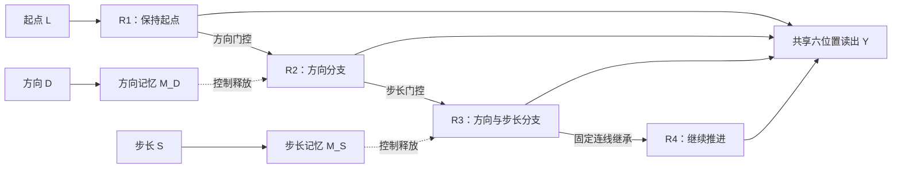
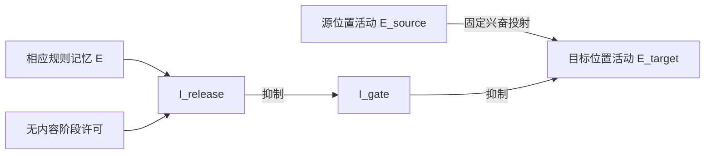

# 从简短规则到逐步行动：项目进展讲解提纲

适用对象：完全没有项目背景的同学。建议时长：15 分钟，10 页。核对日期：2026-10-25。

## 讲解主线

**我们搭建了一个固定连接、不训练的兴奋／抑制神经网络，检验已经给定的起点、方向和步长，能否在输入撤除后，通过记忆保持、去抑制门控和响应状态继承，依次生成四个空间位置。**

整场围绕三个问题展开：为什么要研究这个问题？我们做出了什么、凭什么相信它？接下来哪些问题最值得检验？

本提纲以当前 `handcrafted_ei` 主线为准。数字来自已有归档，本次整理未重新运行仿真；历史实现的测试数量不计入当前 v1。

## 第 1 页｜从生活直觉进入：一句规则如何展开成一串行动？（1 分钟）

**本页要让同学记住：保存一条简短规则，与按正确顺序执行它，是两个不同的问题。**

- 用导航作类比：“从这里出发，顺时针走一步，再走两步，最后再走一步。”
- 一条规则可以紧凑地描述多次行动，但执行时仍需要逐步生成当前目标，且不能提前串台。
- 我们研究的是这段从规则到依次响应的过程，称为“解压缩”。
- 项目先把规则直接提供给网络，集中研究其后的神经实现。

**建议配图（待制作）：**左边三张规则卡，右边四次依次出现的位置目标。导航仅为帮助理解的类比，不作为实验依据。

**过渡句：**“为了把这个问题变得能算、能测，我们把它缩小为六个位置上的一个任务。”

## 第 2 页｜一个例子讲清整个任务（1.5 分钟）

**本页结论：给网络三个变量，要求它分四次给出位置。**

- 六个位置编号为 0–5，围成圆环，顺时针递增。
- `L`：从哪里开始；`D`：顺时针或逆时针；`S`：中间那次移动走 1 步还是 2 步。
- 三次移动的位移依次为 `D、D×S、D`，只有中间一次受 `S` 影响。
- 例子：`L=0、D=+1、S=2`，应依次输出 **0 → 1 → 3 → 4**。
- 一共有 `6×2×2=24` 种输入条件，全部穷举评价，没有训练／测试集划分。

**建议配图（待制作）：**六位置圆环，用三支箭头画出上述路径，并标注“1 步、2 步、1 步”。首次讲解不必展示完整目标公式。

**讲解提示：**先让听众看懂例子，再引入 `R1–R4`，它们只是四个响应阶段的名称。公式由评价器计算真值；网络不接收四位置答案。

## 第 3 页｜我们具体要解释哪几个环节？（1 分钟）

**本页结论：输出正确之外，还要说明信息如何保持、何时传递、由什么承接。**

1. 输入消失后，起点、方向、步长怎样保留下来？
2. 什么时候允许某条通路传递位置内容？
3. 已经完成一次转换后，后续还能否依赖当前响应状态继续推进？
4. 能否每次先输出，再开始下一次转换？

当前任务直接提供 `L/D/S`；从感官样本推断规则、通过反馈学习规则，不属于 v1。固定连线是我们提供的先验，参数没有拟合生理数据。

**建议配图（待制作）：**“短暂输入 → 内部保持 → 通路选择 → 响应继承 → 逐次输出”的流程。

## 第 4 页｜我们搭建了怎样的网络？（2 分钟）

**本页结论：用可检查的神经活动和连接，把上述环节具体化。**

- **率网络：**用连续变化的活动强度表示神经单元状态，不模拟每个动作电位；活动是归一化数值，不直接解释为 Hz。
- **E／I：**E 单元通过输出连接促进下游，I 单元抑制下游；连接符号受细胞类型约束，遵守 Dale 约束。
- **记忆：**起点由 `R1` 自身活动保持；方向、步长分别由 `M_D/M_S` 保持，没有额外的起点记忆群。
- **响应：**`R1–R4` 承担四阶段的位置活动；最后都通过同一个六位置输出群 `Y` 读出。
- 当前共 **104 个率状态：76 E + 28 I**。数量放在图角落即可，重点讲功能。

图中虚线概括控制作用；实际控制经过下一页的抑制中间层。四阶段分群是工程设计，不代表皮层必然有四套独立响应群。

## 第 5 页｜关键机制：通过“抑制抑制者”打开通路（2 分钟）

**本页结论：规则决定允许哪条固定通路传递，位置内容由源响应活动携带。**

- 默认 `I_gate` 活跃，压住目标通路。
- 规则记忆与阶段许可共同驱动 `I_release`。
- `I_release` 抑制 `I_gate`，目标受到的抑制减少，源位置活动才得以传递。
- “解除抑制”本身不提供位置答案，还需要固定的位置投射和源活动。
- 两个 I 单元都有实际动态状态，I→I 的作用也是抑制。

**建议配图：**用上述回路配合已有 [validation.png](../handcrafted_ei/artifacts/v1/validation.png) 中的 gate／release 轨迹；幻灯片制作时可裁出相关面板并放大标签。回路类比为“两层刹车”即可，不必展开微分方程。

## 第 6 页｜关键机制：规则用过后，由响应状态接着走（1.5 分钟）

**本页结论：规则身份可以体现在当前活跃的响应分支中。**

- `R1→R2` 使用方向记忆，选定方向分支。
- `R2→R3` 的方向由当前 `R2` 分支继承，只需再用步长记忆。
- `R3→R4` 沿当前 `(d,s)` 分支的固定连接推进，不再查询方向或步长记忆。
- 顺序始终是：**读 R1 → 转移 → 读 R2 → 转移 → 读 R3 → 转移 → 读 R4**。
- 外部 clock 提供阶段时间，不提供位置或规则；当前并非自主产生阶段切换。

**建议配图（待制作）：**随时间展开的分支树，用一条亮线追踪同一个 trial。标出 `M_D` 和 `M_S` 分别在何时完成其必要作用。

**必须说明：**`1→2→4→4` 是各阶段的潜在分支数。一个 trial 每阶段只有一个主要分支承载位置；该数字不代表 PCA 维数或涌现低秩结构。

## 第 7 页｜目前做到什么程度？（1.5 分钟）

**本页结论：当前机制在定义的条件内完成了行为、回路与记录层面的验证。**

- **行为：**无噪声 24/24 条完整序列正确，四阶段准确率分别为 100%。
- **记忆：**撤除 200 ms 输入后，1.6 s 与 4.0 s 测试中仍保持所需选择性；delay 的四个扫描点均为 24/24。
- **时序和边界：**有检查防止提前路由、答案回流、输出反写与违反 Dale 符号。
- **自动化判据：**归档为 16/16 测试通过；五类机制故障注入能使判据失败。
- **可复核：**39 个实验、936 个 trial 的保存轨迹已有独立复算记录，包含四次读出、真值与行为汇总。

**建议配图：**已有 [validation.png](../handcrafted_ei/artifacts/v1/validation.png)。展示时先指一个 trial 的活动轨迹，再指行为结果，避免整页只放“100%”。

**口头边界：**这里的全正确是固定任务的条件穷举结果；936 个 trial 包含不同配置和干预，并非 936 个独立实验样本，也不意味着这些 trial 全部正确。

## 第 8 页｜凭什么认为这些回路确实发挥了作用？（1.5 分钟）

**本页结论：干预的时机不同，后果也不同，支持规则门控与状态继承的分工。**

| 操作与时机 | 已归档结果 | 支持的解释 |
| --- | --- | --- |
| A：第一转移前阻断 D release | R1 正确，R2–R4 失败；完整序列 0/24 | 第一层释放对方向转换必要 |
| B：R2 读出后切断 D memory 下游输出 | 完整序列仍为 24/24 | 此后可由响应分支承接方向 |
| C：第二转移前阻断 S release | R1/R2 正确，R3/R4 失败；完整序列 0/24 | 第二层释放对步长转换必要 |
| D：R3 读出后切断 D/S memory 下游输出 | 完整序列仍为 24/24 | 最后一次转换可依赖响应状态 |

另有 `R3` 位置扰动影响 `R4` 的检查，帮助区分“当前响应参与后续生成”和“输出只是独立照表播放”。

**建议配图（待制作）：**四条四阶段时间线，标干预位置，用绿／灰格子表示各阶段正确／失败，比只比较完整序列准确率更清楚。

每项干预有等边数、等权重幅度、等时窗随机 lesion 对照，各三种种子。随机破坏也可能损伤关键通路；不能概括为“随机 lesion 都不影响”，也不据此宣称统计显著性。

## 第 9 页｜这些工作有什么意义？（1 分钟）

**本页结论：项目把一种解压缩解释变成了可以运行、检查和反驳的机制原型。**

1. **机制上的意义：**在当前固定拓扑和所测条件下，记忆、去抑制、响应继承足以共同完成定义好的逐步输出任务。
2. **概念上的意义：**方向／步长不必在每一步都从专门记忆重新读取；规则被使用后，可以由当前响应的分支身份承接。
3. **研究方法上的意义：**除了“答对没有”，还能问“切断哪里、在哪个时刻切断，会破坏哪一步”，由此形成可检验的因果预测。
4. **后续工作的价值：**已有固定任务、测试与完整轨迹，未来改机制时可比较行为代价及信息流变化。

**证据边界：**尚未证明大脑采用同一结构、网络学会了压缩／规则、存在连续吸引子、正交子空间由动力学涌现，或具有普适鲁棒性。分支间分离角受固定独立群体坐标影响；有限时间保持也不能替代稳定性证明。

## 第 10 页｜接下来怎么做？（1.5 分钟）

**本页结论：优先量化现有机制的适用边界，再讨论任务与结构扩展。**

以下是讲解中建议的研究路线，尚未启动，不修改当前 v1 的冻结决定。

### 近期：补足鲁棒性和动力学证据

- **连续扰动：**当前噪声只在 sample 起始对位置输入采样一次。后续可单独定义 delay／转移期间的持续噪声，增加独立样本，报告序列错误率、阶段错误及不确定性。
- **保持与恢复：**测试更长 delay、不同幅度状态扰动及恢复轨迹，确定失效范围；吸引子与吸引域须有单独判据。
- **参数边界：**在已有门强度和 recurrence 扫描上，检查关键参数的联合变化与积分步长收敛，区分可靠工作区和脆弱工作点。

### 中期：检验结构与时序的必要性

- **最小实现：**在保持信息边界、Dale 约束、24 条件与四次在线读出的前提下，检验哪些抑制单元或群体划分可简化；不能预先称当前规模最小。
- **自主阶段转换：**用单独版本定义内部推进与终止的机制和验收，比较其与当前外部 clock 的差别。
- **表征解释：**若研究子空间，区分固定坐标造成的分离与动力学产生的性质，并配合因果干预。

### 更远期：另行定义任务版本

若要研究从观察提取 `L/D/S`、反馈学习、训练或与生理数据比较，应先制定独立规格与评价协议。这些不属于当前 v1 的缺失模块，也不能从现有正确率直接推得。

**收尾句：**“目前我们完成了一个可检查的规则到响应机制原型；下一步要确定它在什么扰动下仍然成立、哪些结构确实必要，以及能否用更少的外部时序支持完成同样的任务。”

## 可直接使用的开场与收尾

**开场：**“如果我告诉你从哪个位置开始、朝哪个方向走，以及中间一步走多远，你很容易生成一串位置。但神经网络需要解决几个具体问题：输入消失后怎么记住规则，什么时候允许活动传到下一阶段，以及规则用过以后由什么状态继续推进。我们用一个小型、固定连接的神经网络，把这些环节具体做了出来。”

**收尾：**“我们目前的结果支持：在直接给定规则、固定连线和外部时钟下，记忆保持、两层去抑制与响应状态继承可以共同生成全部 24 种序列。工作的价值在于可以检查信息走过哪里，并用干预检验各环节的作用。鲁棒性、稳定性、自主时序和生物对应仍需要进一步证据。”

## 证据导航

- [README](../README.md)：当前主线与结果概览。
- [架构规格](../architecture.md)：任务定义、104 状态、固定连接、时序与噪声范围。
- [M0–M5 清单](../todo.md)：已完成验收与未覆盖问题。
- [v1 验证报告](../handcrafted_ei/artifacts/v1/REPORT.md)：干预原始数值和解释限制。
- [轨迹复算记录](../handcrafted_ei/artifacts/v1/verification.json)：39 实验、936 trial、PASS 及复核项目。
- [验证图](../handcrafted_ei/artifacts/v1/validation.png)：现成的活动、门控和行为图。
- [逐实验指标](../handcrafted_ei/artifacts/v1/metrics.csv)：需要补充噪声与参数扫描数字时查阅。
- [主题文献清单](gating_gain_modulation_paperlist_20261020.md)：背景阅读；文献启发与本模型实测须分开介绍。

本文件是讲解提纲；标为“待制作”的图尚未生成，也未制作正式 PPT。当前 v1 数值来自已核对的仓库归档，本轮未重跑测试或独立重验全部 ZIP。
