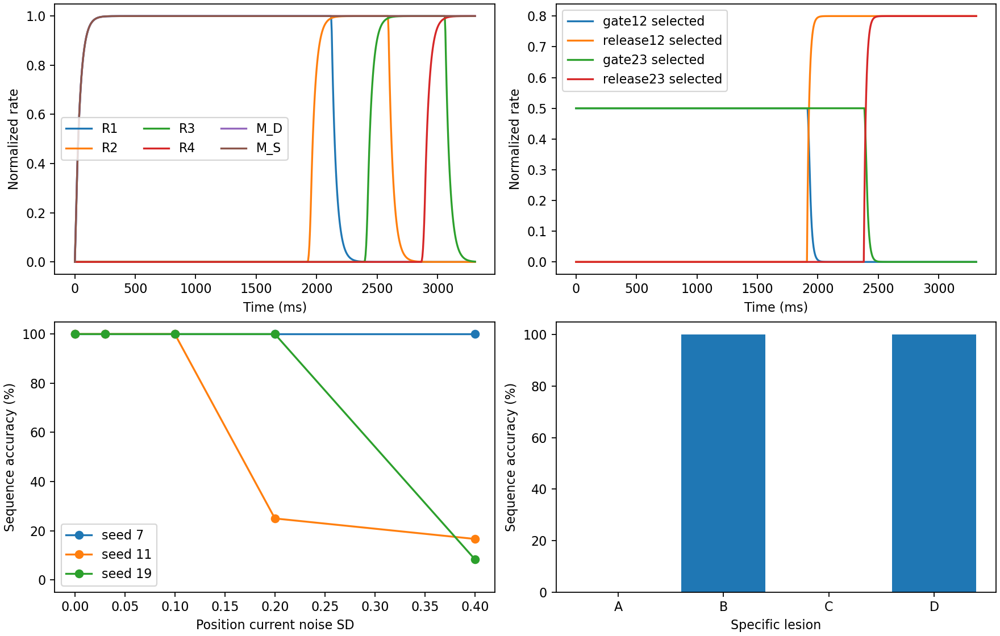

# Handcrafted E/I v1 验证报告

本结果验证给定 L/D/S、固定连接和外部时钟下的机制原型，不代表 primitive 推断、学习或生理参数拟合。

无噪声完整序列：24/24；逐 stage：[1.0, 1.0, 1.0, 1.0]。

所有实验的逐步率向量、群体标签、事件、干预连接及窗口均已归档；输入与 target 保存在独立 task 文件。
metrics.csv 为逐实验指标，manifest.json 为完整协议；source_hashes.json、config.json、environment.json 固定复现身份。

## 因果干预

- A: {'sequences_correct': 0, 'n': 24, 'stage_accuracy': [1.0, 0.0, 0.0, 0.0]}；等剂量随机对照 seeds 7/11/19：[12, 12, 12]
- B: {'sequences_correct': 24, 'n': 24, 'stage_accuracy': [1.0, 1.0, 1.0, 1.0]}；等剂量随机对照 seeds 7/11/19：[0, 12, 12]
- C: {'sequences_correct': 0, 'n': 24, 'stage_accuracy': [1.0, 1.0, 0.0, 0.0]}；等剂量随机对照 seeds 7/11/19：[6, 12, 6]
- D: {'sequences_correct': 24, 'n': 24, 'stage_accuracy': [1.0, 1.0, 1.0, 1.0]}；等剂量随机对照 seeds 7/11/19：[24, 24, 24]

## 表征与限制

representation.json 同时给出分支间 principal angles、分支内线性/中心化位置维数、奇异值、VAF、participation ratio 和活跃比例。
分支由固定的独立坐标群体构成，分离角受该拓扑直接影响，不能用来宣称涌现正交性。1/2/4/4 是潜在分支数。
保持测试只证明有限时窗中的持续活动；未证明连续吸引子、全局稳定性或自主阶段转换。
随机 lesion 仅三组连接抽样；报告原始数值，不作统计显著性或普适鲁棒性推断。噪声只在 sample 的 x_L 上采样一次。

## 复现

```powershell
python -m unittest discover -s handcrafted_ei/tests -v
python -m handcrafted_ei.evaluate --output <fresh-output-directory>
```



## 完整性与测试证据

16/16单元测试通过；五类机制故障注入触发判据失败，恢复后通过。初始红灯为缺少实现导致的导入失败，与后续行为性故障检查分开记录。

39个实验、936个trial均已从ZIP内逐步Y轨迹重新计算四次决策，并独立重算target与汇总准确率，verification.json为PASS。各实验ZIP由archives.json固定SHA256；内部保留独立task、events和完整rates。展开目录不需要提交。

source_hashes.json为执行开始时快照；release_source_hashes.json为测试修订与文档定稿后的发布指纹。模型、时钟、task、评估逻辑与实际计算快照一致；文档和测试定稿差异在release_audit.json中列出。
