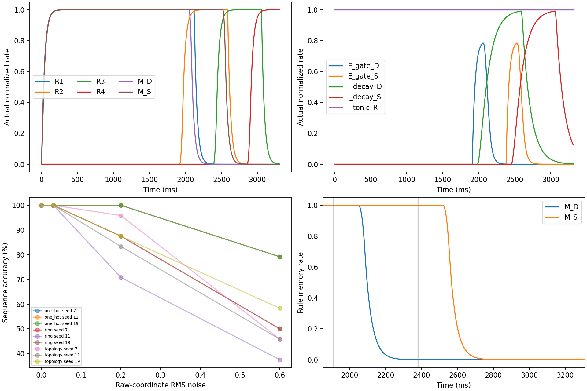
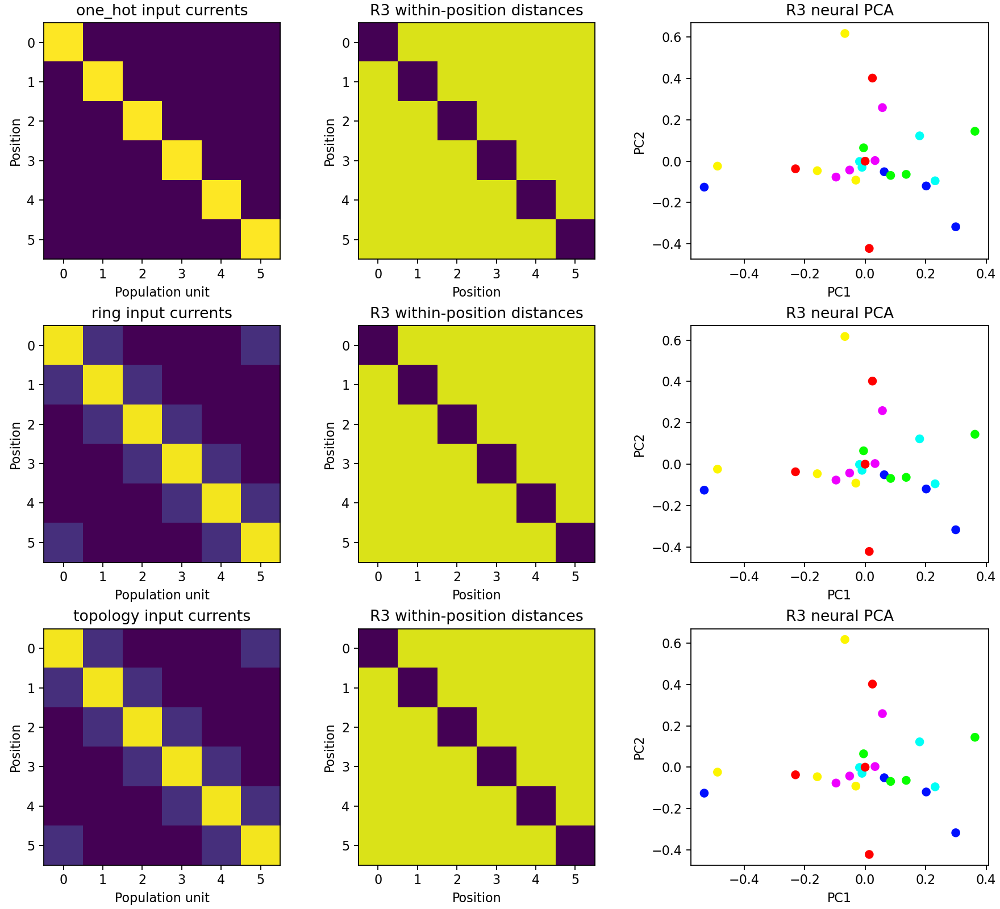
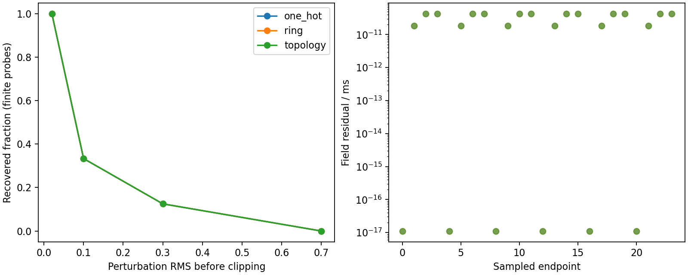

# E/I Decompression v2 实验报告

范围：相同六位置Response网络上的三种外部编码。固定连接、不训练；全部结果为条件穷举和有限扰动，不是泛化或生理拟合。

## 行为与机制

- one_hot：24/24，逐stage [1.0, 1.0, 1.0, 1.0]；机制检查 {'A': True, 'B': True, 'C': True, 'D': True, 'gate_D': True, 'gate_S': True, 'early_D': True, 'early_S': True, 'baseline_memory_decay': True, 'feedback_block_preserves_memory': True, 'delayed_handoff_correct': True}。
  - M_D：形成 2035.0 ms；半活动时刻 2100.0 ms；形成后半衰间隔 65.0 ms；80–20%拟合有效τ 37.600 ms；终末 4.27e-15；AUC 1907.070 rate·ms。
  - M_S：形成 2505.0 ms；半活动时刻 2570.0 ms；形成后半衰间隔 65.0 ms；80–20%拟合有效τ 37.600 ms；终末 1.21e-09；AUC 2377.070 rate·ms。
- ring：24/24，逐stage [1.0, 1.0, 1.0, 1.0]；机制检查 {'A': True, 'B': True, 'C': True, 'D': True, 'gate_D': True, 'gate_S': True, 'early_D': True, 'early_S': True, 'baseline_memory_decay': True, 'feedback_block_preserves_memory': True, 'delayed_handoff_correct': True}。
  - M_D：形成 2035.0 ms；半活动时刻 2100.0 ms；形成后半衰间隔 65.0 ms；80–20%拟合有效τ 37.600 ms；终末 4.27e-15；AUC 1907.070 rate·ms。
  - M_S：形成 2505.0 ms；半活动时刻 2570.0 ms；形成后半衰间隔 65.0 ms；80–20%拟合有效τ 37.600 ms；终末 1.21e-09；AUC 2377.070 rate·ms。
- topology：24/24，逐stage [1.0, 1.0, 1.0, 1.0]；机制检查 {'A': True, 'B': True, 'C': True, 'D': True, 'gate_D': True, 'gate_S': True, 'early_D': True, 'early_S': True, 'baseline_memory_decay': True, 'feedback_block_preserves_memory': True, 'delayed_handoff_correct': True}。
  - M_D：形成 2035.0 ms；半活动时刻 2100.0 ms；形成后半衰间隔 65.0 ms；80–20%拟合有效τ 37.600 ms；终末 4.27e-15；AUC 1907.070 rate·ms。
  - M_S：形成 2505.0 ms；半活动时刻 2570.0 ms；形成后半衰间隔 65.0 ms；80–20%拟合有效τ 37.600 ms；终末 1.21e-09；AUC 2377.070 rate·ms。

直接激活：source、gate和clock缺项负对照见自动化测试；A/C和gate_D/S损伤对应阶段，B/D保留继承。
切反馈不必损伤行为，其机制失败是memory未终止；无tonic的机制失败是提前/未选支路泄漏，不能要求所有消融均降低正确率。
全部单项和随机对照、noise各seed原值见metrics.csv；memory.json给出每个trial的时间、AUC、终末与交接后分支margin。
随机对照匹配边数/权重/突触前符号/窗口。tonic和全recurrence的精确匹配池可能只有目标边本身，不能由退化的随机池证明靶点特异性；池规模记录在events。

## 吸引子检测

关闭sample和全部clock、保留tonic：72个快照中 72 个达到残差<1e-8/ms且Euler谱半径<1；其中 9 个在全部0.02/0.1 RMS抽样扰动后恢复至全状态误差<0.02。
预置的饱和递归结构可以产生离散稳定点；这不是连续吸引子或自主阶段推进证据。未恢复的扰动、状态跳转/衰减及随机初态均原样保存在attractors.json。
早期测试曾假定0.1 RMS都恢复，但反例显示吸引域可能较窄；未修改检测阈值和实验幅度。单元测试仅检查已确认的小扰动恢复和无recurrence衰减，完整研究仍保留所有幅度。
attractor_trajectories/index.json索引72个NPZ分包，记录自由/受迫、全部扰动和初态轨迹。1368个数组逐一核验与原268 MB单包完全一致，最大分包3.82 MB。比较受迫与自主条件明确分开；谱为分段线性局部Jacobian，阈值处用对称导数，不是全局证明。

## 编码和子空间解释边界

原始编码维度6/1/2，内部各分支均6。ring/topology无噪声电流相同，二者差异来自噪声空间，不能宣称内部编码动力学不同。
各编码原始噪声期望能量σ²，sample一次采样；映射后电流L2归一化。manifest记录实际电流误差；相同原始能量不是相同神经误差，不作编码优越性推断。
representation.json分别给出编码几何与实际神经轨迹、均值、SVD/VAF、PR、分支内位置距离、principal angles和交接后活动。分支坐标预置分离，角度不证明涌现正交；候选分支数不是rank。
吸引域仅有限初态/种子/幅度扫描；没有统计显著性、全参数稳健性、细胞生物对应或学习结论。

## 复现与身份

完整配置见manifest/config，源码见source_hashes，环境见environment。HEAD只表示祖先，未提交实现由文件哈希标识。
`python -m unittest discover -s handcrafted_ei/tests -v`
`python -m handcrafted_ei.evaluate --output <fresh-dir>`
`python -m handcrafted_ei.receipt <dir>`

