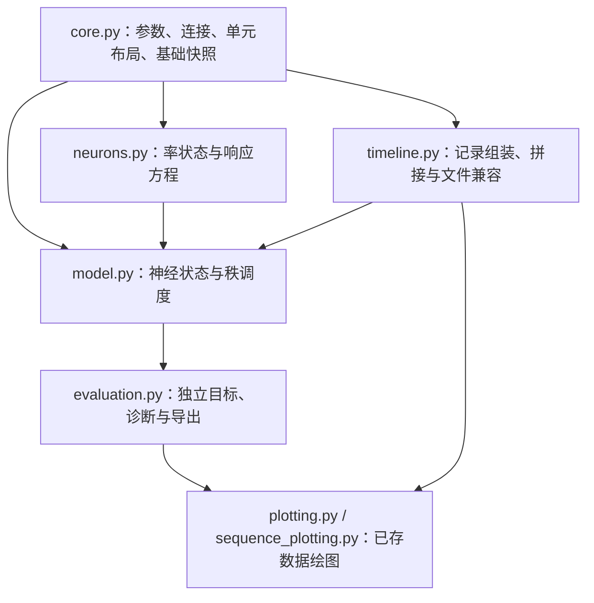

# L/D/S 回路架构与重构验收

## 目标与设计目的

输入是已知六位置压缩码 L、方向 D∈{−1,+1} 和步长 S∈{1,2}。
回路按三次外部秩脉冲执行 D、S·D、D 位移，产生四秩位置输出。
固定环移、乘积联合调谐和负向路径门控是显式结构先验。
每类神经元继承 `Neurons`，持有可打印的率变量；全回路保存29个标量率状态。
四条通路各有六个输入分量，但只有六个聚合中继 M 被积分。

## 六状态中继的闭合条件

四条路径的整流输入为 `F_p=[P_p Ebar + W_gate,p I_gate]_+`，输出投影为 `B_p`。
共同时间常数为 `tau_relay`，每次转移内 B 固定，各路径没有独立内部反馈。
若参考路径满足 `tau_R dR_p/dt=-R_p+F_p`，定义：

$$
M=\sum_{p=1}^{4}B_pR_p,\qquad
\tau_R\dot M=-M+\sum_{p=1}^{4}B_pF_p,\qquad u_E=M.
$$

默认 `B_p=I`，每个 `M_i` 就是四路在位置 i 的总活动。
可编辑的非负输出投影在求和前作用于各路输入，因而仍只需六个状态。
每秩六个 M 均从零开始，与四路参考中继的零初值匹配。
先逐路整流再聚合，不能把整流移到总和之外。

Euler 更新同样闭合：`M_next=M+dt/tau_R*(sum(B_p F_p)-M)`。
E/I 先读取当前 M 并同步计算目标，再更新 E/I/M，保留原有一个采样步的驱动时序。
四路静态 `relay_path_targets` 可用于检查门控，但不具有独立率历史。

这是一种下游可观测量的状态约简，不是从六个数恢复24个数。
路径时间常数不同、路径专有噪声/内部反馈，或积分中改变 B 时，需要重新推导闭合状态。

## 模块职责

依赖箭头表示定义被使用。神经元模块保留 `RateRecording` 的兼容导入；
它不调用时间线的文件导入或绘图逻辑。

静态定义集中在 `core.py`：符号码、数值参数、独立分配的连接、
路径顺序和单元布局。`Population` 是不可变传递快照，率状态由神经元对象持有。
模型只调度初始化与三次转移，并传递 `NeuralState`；评估目标不进入模型。

`RateRecording.from_groups` 按统一布局收集真实积分值与保持值。
新运行和旧 `activities.npz` 导入都使用这一个记录入口和同一段拼接逻辑：
公共边界采用下一段采样，E/I 连续，中继重置，末端只保留一次。
`SequenceTimeline` 附加秩时刻、实际位置和条件，用于保存与绘图。

## 实施与验收

1. 读取全部实现、测试、任务定义和依赖；记录重构前 Git 提交与测试结果。
2. 集中静态定义，合并记录组装和拼接，移除神经元更新中的重复数组复制。
3. 保留包级与原模块导入、模型调用和逐实例连接干预，明确记录数组的形状变化。
4. 检查所有合法码、空间探针、自定义参数、恢复状态、只读快照和记录边界。
5. 与固定 Git 四路参考比较 M=sum(B_p R_p)、完整 E/I 轨迹及输出，重新导出29行图。
6. 检查最终 diff，仅为本任务文件发起 Nimbalyst 提交提案。

## 风险控制

- 同步 Euler 必须先计算 E/I 目标再更新，保留中继驱动一个采样步的时序。
- 不改变归一化顺序、峰值规则、门控解析响应及每秩中继重置。
- 当前包的活动与图像随29变量定义同步导出，其他模型和依赖保持原状。
- 合并的记录层验证非有限值、形状、元数据和跨秩 E/I 连续性。
- 数值等价只覆盖实际验证的输入与参数，不代表学习、吸引子或生物机制证明。

实际命令、基线提交、计数与结果记录在 [VALIDATION.md](VALIDATION.md)。
