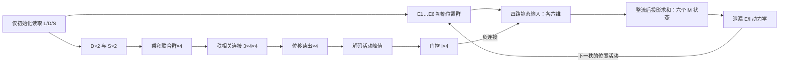
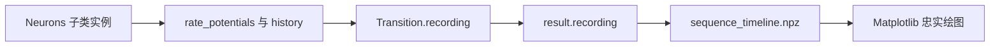

# 独立的六位置 L/D/S 率回路

按 [todo.md](../todo.md) 实现。此包不导入此前的 Hennequin、handcrafted_ei_model、
rate_ei_model 或 basis_sequence_model，也不修改它们。输入与任务以当前 todo 为准：
**已知压缩码 L、D、S，不需要从观察序列推断 D/S，不采用论文的运动任务。**

## 代码架构

静态定义集中在 [core.py](core.py)：参数、可编辑连接、路径顺序、单元布局与
`Population` 快照；[neurons.py](neurons.py) 持有各群的率状态并实现响应方程；
[model.py](model.py) 管理神经状态、初始化及逐秩调度。

[timeline.py](timeline.py) 统一管理 `RateRecording` 的29列组装与跨秩拼接，
同时支持旧活动文件导入和 `SequenceTimeline` 保存。新运行与旧文件共用同一条
记录路径，绘图只消费保存值。包级导入和原模块中的公开类型导入保持可用。

设计目的、依赖图、边界语义与验收方法见 [ARCHITECTURE.md](ARCHITECTURE.md)。

## 先定义位置与规则

仅有六个合法任务位置，标签是 1…6，位置群为 E1…E6。在单位圆上：

[
\theta_k=(k-1)\pi/3,\qquad (x_k,y_k)=(\cos\theta_k,-\sin\theta_k).
]

所以 E1 在 (1,0)，E2 在其右下方；标签递增是物理顺时针。
D=+1 表示顺时针，D=-1 表示逆时针，S 仅取 1 或 2。
四秩的位置遵循 `L → L+D → L+D+S·D → L+D+S·D+D`，所有标签在六点环上取模。
注意这是**相邻秩的三次位移 D、S·D、D**，而非三次都从 L 出发。

连续角度输入仅用于位置群诊断：六群活动为归一化的
`exp(kappa * (cos(theta-theta_k)-1))`。正式 `decompress` 的 L 仍只能是六个整数标签。
两个位置正中间存在最近标签歧义；诊断网格避开这类边界，不宣称连续位置精确解码。

## 单元与可检查连接

- 六个位置 E 率单元。
- 新增 12 个：D_CW / D_CCW 两个方向群；S1 / S2 两个步长群；
  J_CW1 / J_CW2 / J_CCW1 / J_CCW2 四个联合群；同序的四个位移读出群。
- 四条输入通路仍保留各自的环移和门控；它们对六个位置的总作用由六个 M 状态保存。
- 四个路径门控 I，加一个调节总 E 活动的 I_global，共五个 I。
- 完整实现共 29 个标量率变量：E×6、D×2、S×2、J×4、V×4、门控 I×4、M×6、全局 I×1。

矩阵均以 `[突触后, 突触前]` 为约定，各实例独立分配，允许单独干预：

| 字段 | 形状 | 含义 |
| --- | --- | --- |
| `connections.e_to_relay` | 4×6×6 | 共享 +1、+2、-1、-2 环移；非负 |
| `connections.relay_to_e` | 4×6×6 | 汇总前的四路输出投影；默认单位阵，允许逐实例非负干预 |
| `connections.rank_to_displacement` | 3×4×4 | 每次转移的联合群到位移群连接；非负 |
| `connections.winner_to_gate` | 4×4 | 选中路径不激活自身门控 I，其余路径激活门控 I |
| `connections.gate_to_relay` | 4×6×4 | 门控 I 对相应路径的负连接 |

联合群顺序是 `(D,S)=(+1,1),(+1,2),(-1,1),(-1,2)`。
第一、三次转移将同方向的两个联合群汇聚到 ±1 位移群；第二次按联合偏好投向 ±1/±2。
这些矩阵是任务提供的结构先验，不是从24条目标序列中拟合的权重。



## 实际率动力学

方向群用 `sigmoid(k_D * D * preferred_D)`，步长群用
`sigmoid(k_S * (2S-3) * preferred_step_sign)`，各自带逐单元增益。
每个调谐群有 `tau * dr/dt = -r + target` 的一阶率响应，使用恒定驱动下的解析解。
联合群的**原始驱动是方向归一化活动与步长归一化活动的乘积**；
联合群和位移群也使用一阶率响应。它们均保存 `raw_drive`、`rates`、`activity`：
分别是输入、未归一化响应率和群内和为1的活动，不能混用。

每秩只根据联合活动和对应连接片读出位移群，取唯一正峰值，然后生成门控 I。
门控先经过自身率时间常数的响应，再通过负连接压制未选中继；不以正向乘法直接选路。

四路分别计算输入，先整流，再做输出投影并求和：

[
F_p=[P_p\bar E+W^{I\to R}_p I_{gate}]_+,\qquad
T_M=\sum_p B_p F_p,\qquad \tau_R\dot M=-M+T_M,
]
[
u_E=M,
\quad \tau_E\dot E=-E+[u_E+w_{EE}E-w_{EI}I_{global}]_+,
]
[
\tau_I\dot I_{global}=-I_{global}+w_{IE}\sum_iE_i.
]

这里 `[ ]_+` 为整流，`Ebar` 为上一秩实际 E 末态的归一化活动。
`B_p` 是 `relay_to_e[p]`。默认 `B_p=I`，因此 `M_i` 就是四路在位置 i 的总和。
共同时间常数、固定输出投影及匹配初值使 `M=Σ B_p R_p` 成为闭合状态；
Euler 更新沿用先读 M、再同步计算 E/I 目标、最后更新 M 的原有时序。
四路各六维的 `F_p` 仍可检查，但它们只是输入分量，没有独立的率历史。
时间常数不同、路径内部反馈、路径专有噪声或积分期间改变输出投影时，此闭合关系不能直接使用。
每秩持有该源活动，重置中继并进行一次转移；当前 E 和 I_global 从上一秩连续接续。
更新采用同步前向 Euler，默认 dt=0.002 s；调谐和门控的恒定目标响应用解析解。

此处独立复现了旧设计的固定环移、共享路径思想，以及整流泄漏 E / 总活动反馈 I 形式；
旧的静态门控例子没有完整的中继动态模块，因此这里将中继与负向门控显式补齐。
它不是把现有 Hennequin SOC 方程接入新任务，也没有使用 SSA 优化。
所有参数都集中在 `ModelParameters`；默认值是工程基线，可按实例和单元增益调整。
率是无量纲模型活动，不能直接解释为 Hz。

## 信息边界与使用

### 神经元对象与可打印状态

[neurons.py](neurons.py) 定义 `Neurons` 基类，以及继承它的 `ENeurons`、
`INeurons`、`DNeurons`、`SNeurons`、`JNeurons`、`VNeurons` 和 `RelayNeurons`。
`VNeurons` 对应四个位移读出 `DISP_*`。全局 I 与门控 I 是分别初始化的两个
`INeurons` 实例，使用各自的时间常数。每个对象初始化自己的率变量，负责原有的
调谐、解析响应或 Euler 更新；`RateDecompressor` 负责连接、同步调度和状态传递。

每组的 `rate_potentials` 数组保存每个标量单元当前的未归一化率，`rates` 是它的别名。
此名称指原方程中的率变量 r；模型没有新增膜电位变量或电压方程。
`history` 保存该对象最近一次响应/积分的记录；解析响应只记录起点和终点，
不补造中间采样。`Population` 与 `NeuralState` 继续作为独立、只读的传递快照。

```python
from lds_decompressor import CompressedCode, RateDecompressor

model = RateDecompressor()
print(model.rate_potentials)                # 初始化后的 29 个零率
state = model.initialize(CompressedCode(1, 1, 2))
print(model.e.rate_potentials)              # 当前 E1…E6
state, transition = model.advance(state)
print(model.v.rate_potentials)              # 当前四个位移读出
print(model.gate_i.rate_potentials)         # 当前四个门控 I
rates = dict(zip(model.unit_names, model.rate_potentials))
print(rates)                               # 全部 29 个有名称的当前率快照
print(model.relay.rate_potentials)          # 六个总作用 M1…M6
print(model.e.history)                     # 最近一段 E 积分：时间 × 六单元

result = model.decompress(CompressedCode(1, 1, 2))
recording = result.recording
print(recording.rate_potentials)           # 全检索记录：1201 × 29
print(recording.labels)                    # 每列对应的单元名
```

`model.rate_potentials` 每次读取都汇总当前对象值，返回只读快照；已赋给其他变量的
快照不会随下一次运行变化。每次 `advance(state)` 都从传入的神经状态恢复所需值，
前一次运行或打印用对象的残留值不会成为推断输入。跨实例恢复时应使用相同参数和连接。

模型在每次转移结束时生成包含全部 29 个率变量的 `Transition.recording`；
`result.recording` 只拼接这些记录，在公共边界保留下一段的采样。
E/I/中继使用积分值，D/S/J 和读出/门控按原有保持规则记录。
评估层把记录保存为 `sequence_timeline.npz`，绘图层只加载已保存的率数组。



`decompress(code)` 仅调用初始化读取一次 L、D、S；`NeuralState` 只保存 E、I、
调谐/联合率状态及秩编号。之后 `advance(state)` / `resume(state)` 不接收符号码。
三次输出来自真实 E 末态峰值，没有把目标序列写回 E。
各次调用没有隐含历史状态，所以之前诊断形成的状态不会影响新解压缩。

```python
from lds_decompressor import CompressedCode, ModelParameters, RateDecompressor

model = RateDecompressor(ModelParameters(direction_slope=6.0))
result = model.decompress(CompressedCode(location=1, direction=1, step=2))
print(result.positions)  # 实测 (1, 2, 4, 5)
print(result.transitions[1].readout.raw_drive)
print(result.transitions[1].relay_inhibitory_drive)
print(model.connections.rank_to_displacement)
```

`result.position_activity` 保存四秩真实 E 活动；每个 `Transition` 保存读出、门控、
原始/抑制通路驱动、`relay_path_targets`（4×6 静态输入）、`relay_target`（六维总目标），
以及 `relay_rates`（时间×6 的 M）、E、I 时间过程。结果数组为只读快照。
`activities.npz` 的 `example_relays` 为三段×时间×6；旧的三段×时间×4×6 文件可由
`build_sequence_timeline` 按其保存的输出投影导入成六维总作用，无法反向恢复通路率。
需要做因果干预时，可改实例的连接矩阵，或用 `dataclasses.replace` 构造新的神经状态。

## 运行与复现

已核验现有 analysis 环境：Python 3.12.12、NumPy 2.3.5、Matplotlib 3.10.7，CPU。
不需要 GPU，也没有安装或修改任何依赖。声明的最低依赖见 [requirements.txt](requirements.txt)。
根目录执行：

```powershell
.\lds_decompressor\run.ps1 -Test
.\lds_decompressor\run.ps1
```

脚本显式使用已核验解释器，并临时补齐 Windows Conda DLL 路径，结束时恢复 PATH。
可用 `-PythonPath` 指定另一个兼容解释器，`-OutputDirectory` 指定输出目录。
已激活兼容环境时也可直接执行：

```powershell
python -m unittest discover -s lds_decompressor/tests -v
python -m lds_decompressor
```

评估目标只在 [evaluation.py](evaluation.py) 中构造，模型不导入评估模块。
图从保存的真实活动数组绘制，见 [plotting.py](plotting.py)。

## 验证证据与解释范围

已运行36项测试，其中15项回路行为测试覆盖全部24个合法条件、四种调谐峰、两个变量对联合响应的影响、
三次秩选择、每个起点的共享接线、初始化只读一次符号码、历史状态隔离、
联合活动/秩连接因果干预、中继断路、负向门控消融及减半 dt 的数值比较。
另完成72个非边界角度×4种D/S的288条位置群诊断。
其余测试覆盖神经元状态所有权、记录与绘图保真、跨秩边界及新旧文件兼容。
新增独立四路参考验证含时变输入、非零初值、非单位输出投影、整流顺序及不同时间常数的反例。

实际结果及可复查图、CSV、NPZ 见 [运行报告](artifacts/REPORT.md)。
完整验证说明见 [VALIDATION.md](VALIDATION.md)。

该回路使用已知 L/D/S、固定环结构、乘积交互、硬峰值解码、外部秩脉冲和保持的调谐状态。
正确解压缩验证的是预设规则下的执行能力，不是学习到压缩规则、连续吸引子、
无需保持输入的工作记忆，或自发产生四秩节拍的证据。
