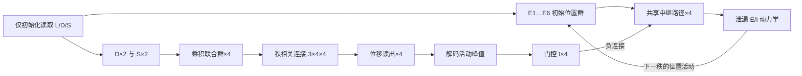

# 独立的六位置 L/D/S 率回路

按 [todo.md](../todo.md) 实现。此包不导入此前的 Hennequin、handcrafted_ei_model、
rate_ei_model 或 basis_sequence_model，也不修改它们。输入与任务以当前 todo 为准：
**已知压缩码 L、D、S，不需要从观察序列推断 D/S，不采用论文的运动任务。**

## 先定义位置与规则

仅有六个合法任务位置，标签是 1…6，位置群为 E1…E6。在单位圆上：

[
\theta_k=(k-1)\pi/3,\qquad (x_k,y_k)=(\cos\theta_k,-\sin\theta_k).
]

所以 E1 在 (1,0)，E2 在其右下方；标签递增是物理顺时针。
D=+1 表示顺时针，D=-1 表示逆时针，S 仅取 1 或 2。
四秩的位置遵循 `L → L+D → L+D+S·D → L+D+S·D+D`，所有标签在六点环上取模。
注意这是**相邻秩的三次位移 D、S·D、D**，而非三次都从 L 出发。

连续角度输入仅用于位置群诊断：六群活动为归一化的
`exp(kappa * (cos(theta-theta_k)-1))`。正式 `decompress` 的 L 仍只能是六个整数标签。
两个位置正中间存在最近标签歧义；诊断网格避开这类边界，不宣称连续位置精确解码。

## 单元与可检查连接

- 六个位置 E 率单元。
- 新增 12 个：D_CW / D_CCW 两个方向群；S1 / S2 两个步长群；
  J_CW1 / J_CW2 / J_CCW1 / J_CCW2 四个联合群；同序的四个位移读出群。
- 四条共享中继，每条六个率单元，共 24 个；各起点复用同一组路径。
- 四个路径门控 I，加一个调节总 E 活动的 I_global，共五个 I。
- 完整实现共 47 个标量率变量；“新增12个”专指上述调谐/联合/读出扩展。

矩阵均以 `[突触后, 突触前]` 为约定，各实例独立分配，允许单独干预：

| 字段 | 形状 | 含义 |
| --- | --- | --- |
| `connections.e_to_relay` | 4×6×6 | 共享 +1、+2、-1、-2 环移；非负 |
| `connections.relay_to_e` | 4×6×6 | 中继到六个 E 的同位置投射；非负 |
| `connections.rank_to_displacement` | 3×4×4 | 每次转移的联合群到位移群连接；非负 |
| `connections.winner_to_gate` | 4×4 | 选中路径不激活自身门控 I，其余路径激活门控 I |
| `connections.gate_to_relay` | 4×6×4 | 门控 I 对相应路径的负连接 |

联合群顺序是 `(D,S)=(+1,1),(+1,2),(-1,1),(-1,2)`。
第一、三次转移将同方向的两个联合群汇聚到 ±1 位移群；第二次按联合偏好投向 ±1/±2。
这些矩阵是任务提供的结构先验，不是从24条目标序列中拟合的权重。



## 实际率动力学

方向群用 `sigmoid(k_D * D * preferred_D)`，步长群用
`sigmoid(k_S * (2S-3) * preferred_step_sign)`，各自带逐单元增益。
每个调谐群有 `tau * dr/dt = -r + target` 的一阶率响应，使用恒定驱动下的解析解。
联合群的**原始驱动是方向归一化活动与步长归一化活动的乘积**；
联合群和位移群也使用一阶率响应。它们均保存 `raw_drive`、`rates`、`activity`：
分别是输入、未归一化响应率和群内和为1的活动，不能混用。

每秩只根据联合活动和对应连接片读出位移群，取唯一正峰值，然后生成门控 I。
门控先经过自身率时间常数的响应，再通过负连接压制未选中继；不以正向乘法直接选路。

对四条路径并行计算：

[
\tau_R\dot R_p=-R_p+[P_p\bar E+W^{I\to R}*p I*{gate}]_+,
]
[
u_E=\sum_p W^{R\to E}_pR_p,
\quad \tau_E\dot E=-E+[u_E+w_{EE}E-w_{EI}I_{global}]_+,
]
[
\tau_I\dot I_{global}=-I_{global}+w_{IE}\sum_iE_i.
]

这里 `[ ]_+` 为整流，`Ebar` 为上一秩实际 E 末态的归一化活动。
每秩持有该源活动，重置中继并进行一次转移；当前 E 和 I_global 从上一秩连续接续。
更新采用同步前向 Euler，默认 dt=0.002 s；调谐和门控的恒定目标响应用解析解。

此处独立复现了旧设计的固定环移、共享路径思想，以及整流泄漏 E / 总活动反馈 I 形式；
旧的静态门控例子没有完整的中继动态模块，因此这里将中继与负向门控显式补齐。
它不是把现有 Hennequin SOC 方程接入新任务，也没有使用 SSA 优化。
所有参数都集中在 `ModelParameters`；默认值是工程基线，可按实例和单元增益调整。
率是无量纲模型活动，不能直接解释为 Hz。

## 信息边界与使用

`decompress(code)` 仅调用初始化读取一次 L、D、S；`NeuralState` 只保存 E、I、
调谐/联合率状态及秩编号。之后 `advance(state)` / `resume(state)` 不接收符号码。
三次输出来自真实 E 末态峰值，没有把目标序列写回 E。
各次调用没有隐含历史状态，所以之前诊断形成的状态不会影响新解压缩。

```python
from lds_decompressor import CompressedCode, ModelParameters, RateDecompressor

model = RateDecompressor(ModelParameters(direction_slope=6.0))
result = model.decompress(CompressedCode(location=1, direction=1, step=2))
print(result.positions)  # 实测 (1, 2, 4, 5)
print(result.transitions[1].readout.raw_drive)
print(result.transitions[1].relay_inhibitory_drive)
print(model.connections.rank_to_displacement)
```

`result.position_activity` 保存四秩真实 E 活动；每个 `Transition` 保存读出、门控、
原始/抑制中继驱动，以及完整的中继、E、I 时间过程。结果数组为只读快照。
需要做因果干预时，可改实例的连接矩阵，或用 `dataclasses.replace` 构造新的神经状态。

## 运行与复现

已核验现有 analysis 环境：Python 3.12.12、NumPy 2.3.5、Matplotlib 3.10.7，CPU。
不需要 GPU，也没有安装或修改任何依赖。声明的最低依赖见 [requirements.txt](requirements.txt)。
根目录执行：

```powershell
.\lds_decompressor\run.ps1 -Test
.\lds_decompressor\run.ps1
```

脚本显式使用已核验解释器，并临时补齐 Windows Conda DLL 路径，结束时恢复 PATH。
可用 `-PythonPath` 指定另一个兼容解释器，`-OutputDirectory` 指定输出目录。
已激活兼容环境时也可直接执行：

```powershell
python -m unittest discover -s lds_decompressor/tests -v
python -m lds_decompressor
```

评估目标只在 [evaluation.py](evaluation.py) 中构造，模型不导入评估模块。
图从保存的真实活动数组绘制，见 [plotting.py](plotting.py)。

## 验证证据与解释范围

已运行15项行为测试，覆盖全部24个合法条件、四种调谐峰、两个变量对联合响应的影响、
三次秩选择、每个起点的共享接线、初始化只读一次符号码、历史状态隔离、
联合活动/秩连接因果干预、中继断路、负向门控消融及减半 dt 的数值比较。
另完成72个非边界角度×4种D/S的288条位置群诊断。

实际结果及可复查图、CSV、NPZ 见 [运行报告](artifacts/REPORT.md)。
完整验证说明见 [VALIDATION.md](VALIDATION.md)。

该回路使用已知 L/D/S、固定环结构、乘积交互、硬峰值解码、外部秩脉冲和保持的调谐状态。
正确解压缩验证的是预设规则下的执行能力，不是学习到压缩规则、连续吸引子、
无需保持输入的工作记忆，或自发产生四秩节拍的证据。
