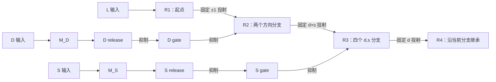

# Handcrafted E/I Decompression v1

### 从给定的 L/D/S 到四次在线空间读出

一个固定连接、不训练的兴奋性／抑制性率网络，用于研究：**已经给定的起点、方向和步长，如何通过神经记忆、通路特异性去抑制与响应状态继承，逐步展开为一条空间序列。**

网络在短暂输入结束后保持所需信息，由两层真实的 I→I 去抑制选择通路，再沿已形成的响应分支继续推进。四个位置在四个时窗依次读出，全程共用一个六位置输出群。

**当前归档验证：**16/16 测试通过；无噪声下 24/24 条完整序列正确；39 个实验、936 个 trial 的读出与行为指标已从保存轨迹独立复算。

[架构规格](https://github.com/Totheinfinity66y/LDS-EImodel/blob/main/architecture.md) · [验证报告](https://github.com/Totheinfinity66y/LDS-EImodel/blob/main/handcrafted_ei/artifacts/v1/REPORT.md) · [验收清单](https://github.com/Totheinfinity66y/LDS-EImodel/blob/main/todo.md)

---

## 科学问题

本项目聚焦 compression → memory → decompression 链条中的**解压缩机制**。输入是已经给定的三个 primitive：

| 变量 | 含义 | 取值 |
| --- | --- | --- |
| L | 初始位置 | 六位置圆环上的 0–5 |
| D | 运动方向 | +1：顺时针；−1：逆时针 |
| S | 中间一次转移的步长 | 1 或 2 |

我们检验四个相互衔接的问题：

1. **信息保持：**撤除输入后，R1 能否保持起点，M_D／M_S 能否分别保持方向与步长？
2. **通路选择：**D 与 S 能否依次通过真实去抑制回路，让位置活动进入正确分支？
3. **状态继承：**分支形成后，后续转移能否依赖当前响应活动及固定连接，而不再查询已使用的规则记忆？
4. **在线输出：**每一步能否先完成位置读出，再开始下一次转移？

本版直接提供 L/D/S，不研究如何从感官历史、反馈或 block context 中提取这些变量。

## 任务定义

六个位置构成圆环 $\mathbb{Z}_6=\{0,1,2,3,4,5\}$。给定 $(L,D,S)$，评价器定义目标序列：

$$
\begin{aligned}
R_1 &= L,\\
R_2 &= L+D,\\
R_3 &= L+D+DS,\\
R_4 &= L+2D+DS
\end{aligned}
\qquad (\bmod\ 6).
$$

三次转移的位移依次为 **D、D×S、D**：S 只影响中间一次转移。

例如：

$$
(L,D,S)=(0,+1,2)
\quad\Rightarrow\quad
0\rightarrow1\rightarrow3\rightarrow4.
$$

全部条件共 $6\times2\times2=24$ 种。**上述公式仅用于生成评价真值；模型运行时不读取目标序列，也不以该公式更新神经状态。**

## 回路如何工作

### 1. 短暂输入与内部保持

L、D、S 在同一个 200 ms sample 窗口内，以 6+2+2 个编码电流通道进入网络：

- L 驱动 R1 的六位置活动，起点由 R1 自身保持，没有独立的 L memory。
- D 驱动 M_D 的两个方向状态。
- S 驱动 M_S 的两个步长状态。

输入随后撤除。网络通过固定的 E→E 自反馈与 I 介导的竞争保持所需选择性；基线 delay 为 1.6 s。

### 2. 两次去抑制选择

D 决定 R1→R2 的方向分支，S 决定当前方向内 R2→R3 的步长分支。

每条受控通路同时包含固定的位置投射和显式的抑制回路：

$$
E_{\mathrm{source}}\rightarrow E_{\mathrm{target}},
\qquad
M(E)\rightarrow I_{\mathrm{release}}
\dashv I_{\mathrm{gate}}
\dashv E_{\mathrm{target}}.
$$

I_gate 默认抑制目标通路；被选中的 I_release 抑制 I_gate，使源位置活动能够传递。I_release 与 I_gate 都具有动态率状态，I→I 连接的作用为抑制。



D/S memory 与无内容的阶段许可电流共同驱动 release。memory 在 delay 中活跃，并不意味着下游路由已经开放：D 路由必须晚于第一次 readout，S 路由必须晚于第二次 readout。

### 3. 响应状态继承

R2 的活跃方向分支已经携带 D 的身份，因此 R2→R3 只需使用 S memory。

R3 形成后，当前活动位于一个确定的 $(d,s)$ 分支。该分支到 R4 的固定连接完成最后一次位移，R4 的形成不再需要读取 D/S memory。

这里的 1→2→4→4 表示四阶段的**潜在分支数**；一个无噪声 trial 中，每阶段只有一个主要分支承载位置内容。

### 4. 四次 readout-first

严格顺序为：

**读 R1 → 转移到 R2 → 读 R2 → 转移到 R3 → 读 R3 → 转移到 R4 → 读 R4。**

所有阶段都通过同一个六位置输出群 Y 读出。转移期间先保留源活动，完成传递后再统一抑制旧阶段，以减少旧位置对下一读窗的影响。

外部 clock 只规定阶段的时间，不提供方向、步长或位置答案。离散 argmax 只用于观察输出，不参与后续神经状态推进。

## 网络与动力学

当前实现包含 **104 个率状态：76 个 E 单元、28 个 I 单元**。

| 群体 | 数量 | 功能 |
| --- | ---: | --- |
| R1／R2／R3／R4 | 6／12／24／24 | 位置活动与分支继承 |
| M_D／M_S | 2／2 | 方向与步长记忆 |
| 共享 Y | 6 | 所有阶段使用同一位置坐标 |
| I_gate／I_release | 10／5 | 默认抑制与去抑制 |
| I_competition／I_retire | 10／3 | 候选竞争与旧阶段退役 |

所有单元，包括抑制单元与 Y，使用统一的率方程：

$$
\tau_i\frac{dr_i}{dt}
=
-r_i+
\phi\left(
\sum_{j\in E}W_{ij}r_j
-\sum_{j\in I}W_{ij}r_j
+I_i-\theta_i
\right),
\qquad
\phi(z)=\min(1,\max(0,z)).
$$

连接的 magnitude 非负，突触作用符号由突触前 E/I 身份决定，遵守 Dale 约束。位置映射在初始化时固定，运行期间不按试次标签选择连接矩阵。

基线使用 Euler 积分，dt=5 ms、τ_E=40 ms、τ_I=20 ms。率是无量纲归一化活动，不直接解释为 Hz。权重与阈值是手工设置的工程参数，未经过数据拟合。

完整参数见 [baseline.yaml](https://github.com/Totheinfinity66y/LDS-EImodel/blob/main/handcrafted_ei/config/baseline.yaml)，完整设计见 [architecture.md](https://github.com/Totheinfinity66y/LDS-EImodel/blob/main/architecture.md)。

## 当前证据

以下为 [v1 归档](https://github.com/Totheinfinity66y/LDS-EImodel/blob/main/handcrafted_ei/artifacts/v1/REPORT.md)中的实测结果。

| 检查 | 结果 |
| --- | --- |
| 自动化测试 | 16/16 通过 |
| 无噪声完整序列 | 24/24；四个 stage 准确率均为 100% |
| 撤除输入后的保持 | 1.6 s 与 4.0 s 测试中，R1／M_D／M_S 保持选择性 |
| Delay 扫描 | 1.6、2.4、3.2、4.0 s 四个测试点均为 24/24 |
| 位置输入噪声 σ=0.03 | seed 7／11／19 均为 24/24 |
| 故障注入 | 五类机制缺陷均能触发判据失败，恢复后通过 |
| 归档复算 | 39 个实验、936 个 trial 的读出与行为指标重算通过 |


图中展示一个 trial 的群体活动与所选门／release 轨迹，以及不同噪声样本、因果干预下的序列表现。较大的输入噪声可以造成明显退化；报告保留这些失败结果。

### 因果干预

| 干预 | 干预时机 | 实测结果 |
| --- | --- | --- |
| A：阻断 D release | R1→R2 前 | R1 正确；R2–R4 退化，完整序列 0/24 |
| B：切断 D memory 下游输出 | R2 形成并读出后 | 完整序列保持 24/24 |
| C：阻断 S release | R2→R3 前 | R1／R2 正确；R3／R4 退化，完整序列 0/24 |
| D：切断 D/S memory 下游输出 | R3 形成并读出后 | R4 保持，完整序列 24/24 |

每项干预配有相同边数、权重幅度与时窗的随机 lesion 对照，使用 seed 7／11／19，完整数值见[验证报告](https://github.com/Totheinfinity66y/LDS-EImodel/blob/main/handcrafted_ei/artifacts/v1/REPORT.md)。另有去 I→I、去 recurrence 的负对照，以及 R3 位置扰动传播至 R4 的测试。

这些结果支持：在本实现与所测条件中，前两次通路选择依赖相应 release，而已形成的响应状态能够支持后续输出。

## 复现

### 环境

验证环境为 **Python 3.12.12、NumPy 2.3.5、PyYAML 6.0.3，CPU**。评估绘图还需要 Matplotlib；依赖声明见 [requirements.txt](https://github.com/Totheinfinity66y/LDS-EImodel/blob/main/handcrafted_ei/requirements.txt)。

本模型不需要 GPU、训练数据或预训练权重。使用已具备相应依赖的 Python 环境，在仓库根目录运行：

```bash
python -m unittest discover -s handcrafted_ei/tests -v
python -m handcrafted_ei.evaluate --output results/v1-run
```

输出目录需为尚未生成过 receipt 的目录。已有归档不会被覆盖；再次评估时指定新的输出路径。

### Windows

[run.ps1](https://github.com/Totheinfinity66y/LDS-EImodel/blob/main/handcrafted_ei/run.ps1) 默认使用开发机器的 analysis 环境，并临时补齐所需 Conda DLL 路径：

```powershell
.\handcrafted_ei\run.ps1 -Test
.\handcrafted_ei\run.ps1 -OutputDirectory results\v1-run
```

其他机器请显式指定解释器：

```powershell
.\handcrafted_ei\run.ps1 -PythonPath 'C:\path\to\env\python.exe' -OutputDirectory results\v1-run
```

### 独立复核已保存结果

无需重新运行神经模拟，即可从归档轨迹重建读出与指标：

```bash
python -m handcrafted_ei.receipt handcrafted_ei/artifacts/v1
```

每个实验的 ZIP 保存 24 组独立 task、events 与完整 rates 文件。复核包含压缩包校验、输入重建、104 维逐步率记录、时间戳、四次 Y 决策、目标序列与汇总准确率。

[复算记录](https://github.com/Totheinfinity66y/LDS-EImodel/blob/main/handcrafted_ei/artifacts/v1/verification.json) · [实验指标](https://github.com/Totheinfinity66y/LDS-EImodel/blob/main/handcrafted_ei/artifacts/v1/metrics.csv) · [完整协议](https://github.com/Totheinfinity66y/LDS-EImodel/blob/main/handcrafted_ei/artifacts/v1/manifest.json)

## 代码导航

| 位置 | 职责 |
| --- | --- |
| [task](https://github.com/Totheinfinity66y/LDS-EImodel/blob/main/handcrafted_ei/task/__init__.py) | 条件枚举、输入编码、独立真值生成 |
| [neuron](https://github.com/Totheinfinity66y/LDS-EImodel/blob/main/handcrafted_ei/model/neuron.py) | 统一 E/I 率动力学 |
| [connectivity](https://github.com/Totheinfinity66y/LDS-EImodel/blob/main/handcrafted_ei/model/connectivity.py) | 固定位置投射、Dale 约束与群体连接 |
| [EINetwork](https://github.com/Totheinfinity66y/LDS-EImodel/blob/main/handcrafted_ei/model/ei_network.py) | 电流输入、状态积分与连续读出 |
| [simulation](https://github.com/Totheinfinity66y/LDS-EImodel/blob/main/handcrafted_ei/simulation/__init__.py) | 无内容时钟、逐窗读出与活动记录 |
| [behavior](https://github.com/Totheinfinity66y/LDS-EImodel/blob/main/handcrafted_ei/evaluation/behavior.py)／[representation](https://github.com/Totheinfinity66y/LDS-EImodel/blob/main/handcrafted_ei/evaluation/representation.py) | 行为指标与事后表征分析 |
| [evaluate](https://github.com/Totheinfinity66y/LDS-EImodel/blob/main/handcrafted_ei/evaluate.py)／[receipt](https://github.com/Totheinfinity66y/LDS-EImodel/blob/main/handcrafted_ei/receipt.py) | 实验归档与独立复算 |
| [序列测试](https://github.com/Totheinfinity66y/LDS-EImodel/blob/main/handcrafted_ei/tests/test_24_sequences.py) | 24 个条件与无噪声确定性 |

## 项目文档

- [architecture.md](https://github.com/Totheinfinity66y/LDS-EImodel/blob/main/architecture.md)：任务定义、回路结构、时序、配置与解释边界。
- [AGENTS.md](https://github.com/Totheinfinity66y/LDS-EImodel/blob/main/AGENTS.md)：强制开发规则、信息边界与验收纪律。
- [todo.md](https://github.com/Totheinfinity66y/LDS-EImodel/blob/main/todo.md)：M0–M5 的交付物和验收记录。