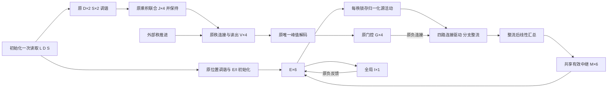

# L/D/S 解压缩模型优化设计 v1（待核对，尚未实现）

日期：2026-10-16。目标：审查现有47变量 handcrafted 回路，提出与旧代码独立的新设计，逐项标明保留、等价合并和实质改变。本文只交付方案；提交本文也不代表批准实现。

## 1. 结论与建议

**建议首先采用29变量方案：将四条路径的24个中继动态状态，合并为6个汇总中继状态；其余调谐、联合、读出、抑制门控和位置 E/I 保持原定义。**

这个选择减少18个率状态，同时保留当前任务对 `2 D + 2 S + 4 联合 + 4 位移读出` 的明确要求。它首先解决最明显的状态冗余，也能把“简化实现”与“更换神经机制”区分开。

进一步的25变量方案可把四个位移读出改为代数读出；在当前统一时间常数和只使用归一化终值的条件下，其下游选择可保持相同，但四个读出不再是独立的率单元，**违反当前任务对显式读出群的字面要求，必须另行批准**。

29变量方案的等价性来自下文对本代码的推导，尚未做新模型的数值验证。“等价”限于指定条件下的 E/I 输出及可保留干预，不意味着两种微观神经架构相同，也不意味着减少同等比例的实际生物神经元、突触或运行时间。

本轮未改旧代码、任务定义或原始产物，未建立新模型包，未实现新积分器。

## 2. 审查依据与任务契约

审查的是当前仓库的 [任务定义](../todo.md)、[模型说明](../lds_decompressor/README.md)、[实际模型源码](../lds_decompressor/model.py)、[行为测试](../lds_decompressor/tests/test_model.py)、[评估模块](../lds_decompressor/evaluation.py) 和 [时间轴实现](../lds_decompressor/timeline.py)。旧论文模型或其他 checkout 不作为本次方程来源。

任务保持：

- 六个位置标签 `L∈{1,…,6}`；`D∈{+1,-1}`；`S∈{1,2}`。
- 位置角 `θ_k=(k−1)π/3`，坐标 `(cos θ_k,−sin θ_k)`；编号增加表示物理顺时针。
- 三次相邻转移为 `D、S·D、D`。四个读出位置为 `L、L+D、L+D+S·D、L+D+S·D+D`，均在六点环上取模。
- 初始化仅读取一次符号码；后续只使用已编码活动、连接和外部秩推进。
- 不推断 D/S，不学习环结构，不用目标序列驱动位置活动。
- 连续角度只做六位置群诊断；不把有限网格的最近标签成功解释为精确连续位置恢复。
- 依然保留外部秩脉冲、保持的源活动和编码活动，不增添自主时钟或自主记忆的承诺。

当前任务既有“行为目标”，也有“指定回路结构”。29变量方案保留四条路径的计算与负向抑制，但将其24个独立中继率状态改为6个汇总状态。因此仍是**待用户确认的结构修改**；若研究必须逐路径施加动态中继扰动，就应继续保留47变量参考模型。

## 3. 47变量中哪些是状态，哪些是重复表征

| 模块 | 原率变量数 | 检索期间实际处理 | 本方案判断 |
| --- | ---: | --- | --- |
| 位置 E | 6 | Euler 连续积分，跨秩接续 | 保留，直接对应六位置群 |
| 方向 D | 2 | 编码解析终值，之后保持 | 保留调谐可检查性；不能据平坦曲线称自主保持 |
| 步长 S | 2 | 同上 | 同上 |
| 联合 J | 4 | 乘积驱动的解析终值，之后保持 | 保留，承载初始化后实际选路所用的规则活动 |
| 位移读出 V | 4 | 每秩从零响应到解析终值，随后保持 | 29版保留；25版可改为代数读出 |
| 路径门控 G | 4 | 每秩硬选峰后算解析终值，随后保持 | 29版保留其负连接和幅度作用 |
| 路径中继 R | 24 | 同一 τ_R，四条路径各六维 Euler 积分 | 最主要的可合并部分 |
| 全局 I | 1 | Euler 连续积分，跨秩接续 | 保留，与路径门控功能不同 |
| 合计 | 47 | 31个同步积分 + 16个保持率值 | 不是47个共同耦合积分的神经状态 |

这里的16个保持值为 D/S/J 共8个，加 V/G 共8个。它们也采用了率响应定义，但未与 E/I/R 共同采样控制准备阶段。

`raw_drive`、`rates`、`activity` 是同一群的三种数据含义，不应算作三组神经元；保留这些观测字段本身没有必要增加率单元。

特别注意：源码中 D/S 在检索阶段不再重新驱动 J，后续读取的是初始化完成后保持的 `joint.activity`。因此不能把现有模型画成检索时 D/S/J 持续互相作用的网络。29版保持这一点，不默默增加在线联合计算。

## 4. 原公式基线：逐项保留记录

以下重新排版源码公式，不修订其模型含义。记 `N(x)=x/Σx`，只对非负且总和为正的向量定义；`φ(x)=max(x,0)` 逐元素作用；`σ(x)=1/(1+exp(−x))`；`⊙` 为逐元素乘积。

### 4.1 位置调谐与初始化

\[
q_k(\theta)=\exp\{\kappa[\cos(\theta-\theta_k)-1]\},\qquad a^L=N(q).
\]

正式输入使用 `θ=θ_L`，不是 one-hot。初始化从 `E(0)=0,I(0)=0` 出发，以 `u_E=a^L` 驱动同一 E/I 方程0.8 s，取其真实末态作为第一秩状态。

**29版：位置调谐、κ、初始化驱动、初始化时间和初始条件全部保留。** 不改成 one-hot，不改成二维角度向量，不把初始 E 直接赋为最终峰值。

### 4.2 方向、步长与联合调谐

方向偏好 `d_pref=(+1,−1)`，步长偏好符号 `s_pref=(−1,+1)`：

\[
b^D_i=k_D D\,d_{pref,i},\quad T^D_i=g^D_i\sigma(b^D_i),
\]
\[
b^S_j=k_S(2S-3)s_{pref,j},\quad T^S_j=g^S_j\sigma(b^S_j).
\]

每群从零出发采用：

\[
\tau\dot r=-r+T,\quad r(t)=T(1-e^{-t/\tau}),\quad a=N(r).
\]

联合顺序为 `(+1,1),(+1,2),(−1,1),(−1,2)`：

\[
b^J=\operatorname{vec}(a^D(a^S)^\top),\quad T^J=g^J\odot b^J,
\quad r^J=T^J(1-e^{-T_{enc}/\tau_{tuning}}),\quad a^J=N(r^J).
\]

**29版：sigmoid 公式、偏好顺序、逐单元增益、乘积交互、一阶响应与归一化全部保留。** `raw_drive` 分别为 `b^D,b^S,b^J`，不能把 sigmoid 前后量混作一种率。

### 4.3 秩相关读出与路径门控

三片连接 `W_r∈R^{4×4}` 对应三次转移，路径顺序 `(+1,+2,−1,−2)`：

\[
b^V=W_r a^J,\quad T^V=g^V\odot b^V,
\quad r^V=T^V(1-e^{-T_{read}/\tau_{read}}),\quad a^V=N(r^V).
\]

取唯一正峰 `p*=argmax a^V`，构造单峰指示向量 `h`。并列或静默时显式失败：

\[
T^G=Hh,\quad G=T^G(1-e^{-T_{gate}/\tau_{gate}}).
\]

默认 `H=11ᵀ−I_4`，选中路径的门控率为零，其余为正。它依赖硬峰值程序操作，并非已经实现的连续神经竞争。

**29版：读出公式、硬选峰、门控解析响应和负向抑制全部保留。** 不将负向门控偷偷替换成 `h_p P_p E` 的正向选路。

### 4.4 中继与 E/I：原始47变量方程

记 `A_p=e_to_relay[p]`、`B_p=relay_to_e[p]`、`C_p=gate_to_relay[p]`；`A_p,B_p≥0`，`C_p≤0`。默认 `A_p=P_p` 为相应环移，`B_p=I_6`，`C_pG=−g_gate G_p 1_6`。

每次转移开始时 `Ebar=N(E_prev)`，在该次转移中保持：

\[
F_p=\phi(A_p\bar E+C_pG),\qquad
\tau_R\dot R_p=-R_p+F_p,
\]
\[
u_E=\sum_{p=1}^{4}B_p R_p,
\]
\[
\tau_E\dot E=-E+\phi(u_E+w_{EE}E-w_{EI}I_{global}\,1_6),
\]
\[
\tau_I\dot I_{global}=-I_{global}+w_{IE}\sum_{k=1}^{6}E_k.
\]

每秩 `R_p(0)=0`；E/I 从上一秩接续。Euler 使用同一旧时刻的 E、I、R 计算下一步，不能改成先更新 R 再用新 R 更新 E。

**29版：E 与全局 I 的方程完整保留；中继方程改为下一节的聚合形式。**

### 4.5 原默认参数与新方案处理

| 参数 | 原默认值 | 29版提案 |
| --- | --- | --- |
| `location_kappa` | 8.0 | 保留 |
| `direction_slope, step_slope` | 6.0, 6.0 | 保留 |
| D/S/J/读出各单元 gains | 全1 | 保留所有独立增益 |
| `tau_tuning, tau_readout, tau_gate` | 各0.020 s | 保留 |
| `tau_relay` | 0.030 s | 汇总中继沿用 |
| `tau_e, tau_i` | 0.100, 0.050 s | 保留 |
| 编码/读出/门控设置时长 | 各0.200 s | 保留原解析终值语义 |
| `rank_duration` | 0.800 s | 保留，也用于原初始化 |
| `dt` | 0.002 s | 保留同步 Euler |
| `w_ee,w_ei,w_ie` | 0.15,0.20,0.25 | 保留 |
| `gate_strength` | 2.0 | 保留负连接强度 |

不将 `raw_drive/rates/activity` 互相替代，不换非线性，不加噪声，不加随机权重，不训练，不因24条件结果调参。以上是待核对的“沿用原值”提案，不是已实施的新参数冻结。

## 5. 推荐架构：29变量的等价中继聚合

### 5.1 新状态与连接

定义六维汇总状态：

\[
M=\sum_p B_p R_p,\qquad F_{pool}=\sum_p B_p\phi(A_p\bar E+C_pG).
\]

用下式替代24个中继率的积分：

\[
\boxed{\tau_R\dot M=-M+F_{pool}},\qquad \boxed{u_E=M}.
\]

默认 `B_p=I_6` 时，M 就是四路中继按目的位置求和的六维非负率。一般固定 B 下，M 更准确地称为“投到 E 坐标的有效中继驱动状态”。不能把加权和无条件解释成某六个实际细胞的放电率。

模块计数：`6 E + 2 D + 2 S + 4 J + 4 V + 4 G + 6 M + 1 I = 29`；其中13个同步积分，16个保持率值。秩编号、源活动锁存、归一化中间量和连接矩阵仍属于模型状态/计算资源，不藏进神经元计数。

四路 `A_p/B_p/C_p` 和秩连接都保留、逐实例分配。四路分支依然有各自的兴奋驱动、负向抑制和整流后目标，但不再各持有六个积分率状态。

**必须先逐分支整流，再汇总。** 一般有 `Σφ(x_p)≠φ(Σx_p)`。将四路兴奋与抑制先相加、只整流一次，会让未选路径的抑制抵消选中路径，属于另一种模型，本提案禁止这样替换。

### 5.2 等价性推导与适用范围

固定 B 且四路同一 τ_R 时：

\[
\tau_R\dot M=\sum_pB_p\tau_R\dot R_p
=-\sum_pB_pR_p+\sum_pB_pF_p=-M+F_{pool}.
\]

同一 Euler 步长下也有：

\[
M^{n+1}=M^n+\frac{dt}{\tau_R}(F_{pool}-M^n)
=\sum_pB_p\left[R_p^n+\frac{dt}{\tau_R}(F_p-R_p^n)\right].
\]

因此在匹配的初始条件与更新顺序下，E 接收的驱动一致，继而 E/I 轨迹和秩末状态一致，逐秩递推也一致；实际浮点计算仍须做容差比较。

这不是“只有一条路径活动所以取其余为零”的近似：即使消融抑制使多路同时活动，上述聚合仍成立。也不要求 B 必须为单位阵，只要求它在被比较的积分段内固定。

适用条件必须写入新包说明：

1. 四路中继共享 τ_R；没有逐路径不同泄漏、延迟、适应、噪声或非线性中继输出。
2. 各中继向 E 只通过固定线性 B 汇入；没有另一个模块读取单独 R_p 后反过来控制系统。
3. 每秩初始 M 等于原 `Σ B_p R_p(0)`；原实现重置所有 R，因此新实现重置 M=0。
4. 源活动保持、门控设置、E/I 方程、时间步与同步更新顺序相同。
5. 不要求聚合状态本身支持原来任意的逐路径中途状态扰动。

这属于线性状态聚合的方法范围，可参照 [Li 与 Rabitz 的 exact lumping 原始研究](https://doi.org/10.1016/0009-2509(89)85014-6)。本文对该回路的具体结论由上面直接推导，不从该文借用生物解释或验证结果。

### 5.3 保留与失去的可干预性

保留：单独修改某条路径的 A/B/C、切断某路径、移除负向门控、改变 J 或某秩连接、改变读出增益。只要满足上节条件，新模型的输出可与旧模型对应。

不自动保留：分别向两个中继群注入随时间变化的扰动、在积分途中更改 B、给各路径不同 τ、让一条路径的当前 R 调节门控。M 不能唯一恢复四个 R_p；要研究这些问题，47变量模型仍是必要参考。

原模型每秩 F_p 恒定且 R_p(0)=0，故可事后计算：

\[
R_p^n=\left[1-(1-dt/\tau_R)^n\right]F_p.
\]

可用它核验原路径分解，但这属于**根据原假设重建的参考轨迹**，不能标成新模型额外模拟的24个神经元，更不能据此宣称恢复了逐路径独立动力学。

## 6. 哪些功能可更简单，代价是什么

### 6.1 位移读出群：可降为代数观测，得到25变量版本

当前四个读出共享响应系数 `c_V=1−exp(−T_read/τ_read)>0`，且下游只使用归一化活动：

\[
a^V=N(c_V g^V\odot W_r a^J)=N(g^V\odot W_r a^J).
\]

因此可以保留 `v_raw=W_r a^J` 和 `v_activity=N(g^V⊙v_raw)` 为可检查的代数读出，用同一峰值和门控继续计算，而不把 V 定义为四个独立率单元。即 `29−4=25`。

改动必须注明：取消 V 的独立率群、一阶响应的模型地位和读出准备时长对率幅度的作用；原 `r^V=c_V g^V⊙v_raw` 如输出，只能标为兼容诊断量。下游行为等价不等于原读出群被保留，也不证明两种模型在读出时序实验中等价。

**不纳入推荐29版。** 理由是当前任务明确要求四个读出率单元；若你更看重简洁执行器而非这层神经解释，25版才更合适。

### 6.2 D、S、J：计算冗余与研究价值要分开

统一时间系数在 D/S/J 的群内归一化中也会消掉，因此目前调节编码时长或共同 τ 会改变原始率幅度，但不改变传给下一层的归一化调谐形状。不能把这些参数直接当作检索记忆时长或选择速度。

源码在初始化后实际只需要 J 来完成后续选路；D/S 可以只在编码阶段存在并保存诊断快照。这可减少检索状态存储，却不能声称原有两个 D 群和两个 S 群从架构中消失了。

若反过来删除 J，每秩由保持的 D/S 活动现算乘积，虽可复现未干预时的联合值，但会失去“只改 J、保持 D/S 不变”的因果干预接口；并且变成在线联合计算。推荐29版不作此变更。

也不能无条件用两个标量代替任意 J：默认联合分布可分解为 D/S 的外积，但独立的四个 joint gains 或对 J 的干预一般会破坏这个可分解性。用 D/S 两个标量重建所有联合状态会额外施加约束。

### 6.3 秩控制：只有两种默认连接模式，不需要新增三组秩神经元

原三片 `W_1,W_2,W_3` 的默认值中 `W_1=W_3`，第二片负责 ±S。可以从“普通转移/中间转移”两个模板构造默认连接，减少重复定义。

但29版仍保存三片**可独立修改**的矩阵；不能让第一、三片成为同一可变对象。强制共享会改变只干预一次转移的能力。外部秩计数依旧明确标成控制器，不伪装成神经群。

### 6.4 四条环移可共用构造规则，不能误当作动态串联

固定算子满足 `P_+2=(P_+1)^2`、`P_-1=(P_+1)ᵀ`、`P_-2=(P_-1)^2`。可以共用一个清楚的环移构造器生成四份独立矩阵。

然而，两个有 τ_R 的 +1 中继级联，会引入两个滤波阶段，并可能激活中间位置，不等于原单阶段直接 +2 路径。推荐方案保留直接 ±2 投射，不把它换成两次动态 ±1。

### 6.5 门控 I 与全局 I：不建议合并

四个门控的目标是路径选择；全局 I 接收 E 总活动并广泛抑制位置群。它们的输入、靶点、时间处理与可干预含义不同。一个标量 I 无法一般地表达四路选择性抑制。

门控目前确实由程序硬选峰控制，若仅做执行器，可以改成代数抑制电流；但这会取消显式门控率群及其时间常数解释，不是换个名字就等价地“少四个神经元”。29版不改。

### 6.6 六个位置 E：不建议压成二维角度编码

正余弦两个数更适合纯几何执行器，但会失去六群各自的重叠调谐、峰值解码、群活动扰动和当前 E/I 方程。对“六位置偏好群如何执行解压缩”的问题，保留六维 E 更直接。

## 7. 本轮不采用的机制替换

| 可能的替换 | 为什么看起来简单或有吸引力 | 与原架构的实质区别 |
| --- | --- | --- |
| 直接算三个模六位移 | 最简、容易校验 | 变成符号规则执行器；可作评估 oracle，不能冒充神经机制 |
| `u=Σ a^V_p P_p Ebar` 软混合 | 去掉硬峰值与抑制门控 | 非峰路径仍传输，改变活动形状与消融逻辑；违反原负门控约定 |
| 用连续竞争网络替换 argmax | 路径选择可有真实时序 | 需新竞争方程、稳定性和选择时长验证；不保证更少神经元 |
| 门控与 E/I/R 全部共同积分 | 更适合研究选择延迟 | 改变准备阶段与跨秩时序，未选路径可能早期泄漏；不是等价优化 |
| 去掉 M，直接以 F_pool 驱动 E | 少六个中继状态 | 删除 τ_R 低通与原同步延迟，通常改变完整轨迹 |
| 去掉 I_global 或改成除法归一化 | 执行器可更简单 | 改变 E 竞争、幅度和瞬态，未证明与原方程等价 |
| 增强 E 复发形成吸引子 | 接近自主保持研究 | 新的科学目标；需要非线性、稳定性和扰动验证，非本次默认修改 |

这些是设计边界说明，未形成授权实施清单。

## 8. 命名、模块边界与独立实现草案

新模型拟采用独立的同级包名 `lds_decompressor_reduced`，当前尚未创建。原包作为只读参考保留。新模型运行模块不导入原包、旧模型或评估 oracle；比较脚本可同时导入新旧两包。

建议仅按职责组织：编码、可检查连接、动力学、模型接口、评估、绘图与测试。不为每个 rate 单元建立各自继承层级或“神经元类”；六维、四维数组配上固定名称已足够。

| 现有概念 | 建议表达 | 含义与限制 |
| --- | --- | --- |
| 编码 D/S/J | `EncodingSnapshot` | 如实说明初始化后保持，不宣称动态记忆 |
| 三次转移 | `transition_index` 与 `rank` 分开 | 转移1…3、输出秩1…4，避免 off-by-one |
| 四条路径 | `path_drive[path,site]` | 路径电流/驱动，不再误标成24个新率状态 |
| 六维汇总中继 | `pooled_relay_rates` 或 `effective_relay_drive` | 默认单位 B 可用前者；一般 B 用后者更准确 |
| 位置归一化源 | `held_source_activity` | 明示每秩锁存，不能暗示完全自主递推 |
| 三种群数据 | `raw_drive/rates/activity` | 保留三者，不用统一模糊的 activation |
| 时间轴 | `integrated/held/derived` 分类 | 不将事后重建路径率混入实际积分状态 |

拟保留入口语义：`initialize(code)`、`advance(state)`、`resume(state)`、`decompress(code)`。状态在秩边界包含 E/I、编码快照与秩；单秩过程中包含 M 和锁存源。若未来支持任意时刻暂停，checkpoint 还需显式包含这些中途状态及设置阶段，不能仅靠秩编号恢复。

独立意味着新代码、依赖入口、测试和产物目录独立；数学定义的明确复用并不违反独立实现要求。旧代码和旧产物不得因新实现而改写。

## 9. 所有拟修改的登记表

| ID | 对象 | 29变量推荐版 | 变化等级 |
| --- | --- | --- | --- |
| C01 | 四路24维 R | 变为六维 M，公式见第5节 | 状态聚合；限条件输出等价，微观架构改变 |
| C02 | E 输入表达 | `ΣB_pR_p` 改为 `M` | 数学重写，E 方程其他部分不变 |
| C03 | 逐路径记录 | 保留 A/B/C 和 F_p；24维路径率不再是积分状态 | 观测与干预边界改变，必须标注重建量 |
| C04 | 率变量计数 | 47→29；同步积分31→13 | 不声称同等比例减少突触/算时 |
| C05 | 名称与模块 | 使用快照、锁存源和有效中继等准确名称 | 软件组织与语义澄清 |
| U01 | 位置/D/S/J/V 调谐 | 全部原样保留 | 无公式、增益、偏好或归一化修改 |
| U02 | 负向门控 | G、C、分支整流、硬峰值原样保留 | 无门控机制修改 |
| U03 | E/I rate 方程 | 完整保留 | 无非线性、自反馈、抑制参数修改 |
| U04 | 时间、初值与重置 | 原设置时长、初始化、同步 Euler、E/I 接续、M对应原 R 重置 | 无默认时序修改 |
| U05 | 信息边界 | 初始化一次读取码，后续仅活动与连接 | 无信息增补 |
| O01 | 25变量选项 | 取消 V 率群，保留代数位移读出 | 可选，未采纳，需批准任务结构变化 |

所有未列为 C 或另行批准的 O 项，默认不改。发现实现必须偏离时，先更新本登记表，不以“重构”名义隐藏方程变化。

## 10. 科学解释：本次优化能证明什么

可以追求：在保留已知规则、控制器和调谐的条件下，用更少的动态状态实现相同 E/I 输出；辨认哪些路径状态对当前可观测行为是冗余的。

不能推出：学到了环几何或压缩规则、发现了生物最小回路、形成吸引子、自主工作记忆或自主秩时钟。29维中继聚合保持原模型已有的解释边界。

尤其在无 E 输入时，原参数 `w_ee<1` 且 I 非负，有：

\[
\tau_E\dot E_k=-E_k+\phi(w_{EE}E_k-w_{EI}I)
\leq -(1-w_{EE})E_k.
\]

所以移除中继/外部驱动后，位置 E 不能凭这条方程自主保持非零位置状态。若只是关闭新输入、但中继仍有残余活动，应先计入其中继衰减；它不构成持续位置记忆。保持的编码快照及锁存源也不能算作已经解释的神经记忆机制。

## 11. 核对通过后的验收计划（尚未执行）

### 11.1 实现范围

只实现最终批准的29版或另行指定版本，写入独立包和独立产物目录；旧模型、任务定义、论文模型和环境不改。若只批准本文的文档提交，不启动模型实现。

### 11.2 运行环境

已检查原包声明为 `numpy>=1.26,matplotlib>=3.8`，原启动入口指向现有 analysis 解释器，且本轮确认该解释器文件存在。本轮没有导入包核验安装版本，也没有运行模型或安装依赖。后续运行前须重新核验该解释器、NumPy/Matplotlib 版本与 CPU 能力，沿用原脚本的临时 Conda DLL 路径处理；不默认使用 base Python。

### 11.3 必需验证与证据

1. **基线新鲜核验**：先运行原模型现有21项测试并复核24条件，再做新旧比较。既有文档记载的通过结果，不作为本轮已重跑结果。
2. **轨迹等价**：全部24码比较初始化 E/I、每次转移每个采样点的 E、I、E输入与 `M=ΣB_pR_p`，以及四秩归一化活动；不能只比较 argmax。
3. **数值容差**：同 dt 下初拟最大绝对误差不超过 `1e−10`；这是待核对的工程验收阈值。报告实际最大误差，不把阈值当生物尺度或统计置信区间。
4. **聚合前提压力验证**：负向门控消融使多路同时活动；选中路径断路；非单位但固定的非负 B；逐路径 A/C 修改。验证聚合不是依赖“默认只有一路”的巧合。
5. **控制因果链**：独立干预 J、某一秩 W、读出 gains、门控负连接，检查真实 E 输出；第一、三片 W 修改互不串扰。
6. **信息隔离**：符号码各字段只读一次，后续接口不接收码/目标；同一实例先做诊断不影响新任务；参数连接跨实例独立；静默/并列情况显式失败。
7. **空间诊断**：复现72个非边界角×4种D/S的288项诊断；另单独记录正中边界的歧义处理，不能将边界排除隐藏成“任意位置均正确”。
8. **数值与图证**：对代表条件和必要受影响干预做 dt 减半比较；绘图从实际数组产生，标出13个积分状态和16个保持值，不画成29个共同积分的曲线。
9. **不适用条件**：明确记录不同 τ、路径内部反馈或中途改变 B 等情形不在等价承诺内；不把此时差异伪称实现错误或等价验证通过。

新模型自身运行与结果可独立复现；新旧对比工具才依赖旧包。所有目标 oracle 只在评估侧构造，不进入模型运行路径。

## 12. 当前交付与待核对事项

当前交付为本设计文档及其 Git 提交提案；没有新模型实现，没有新的性能或轨迹验证结果。

待核对的核心事项：是否采用29变量聚合；是否仍要求独立路径中继状态的动态干预；是否另外批准25变量代数读出选项。推荐范围是29版，25版尚未采纳；其余机制替换只作为边界记录。

确认架构后，再按第11节建立独立模型。批准文档入库与批准模型实现是两件事。
