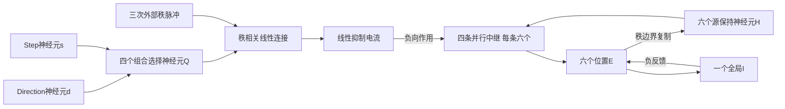

# Direction/Step双门控的并行四通路率回路

状态：独立完整设计，待核对，尚未实现。目标是用两个控制神经元和四个组合选择神经元，并行选择四条共享位置通路，完成六位置、四秩序列的解压缩。

## 1. 任务与总体结构

输入在初始化读取一次：L∈{1,…,6}、D∈{−1,+1}、S∈{1,2}。六个位置的坐标定义为：

\[
\theta_k=(k-1)\pi/3,\qquad (x_k,y_k)=(\cos\theta_k,-\sin\theta_k).
\]

编号增加为物理顺时针。四秩位置为L、L+D、L+D+S·D、L+D+S·D+D，均按六点环取模。D/S已经给定，不从观察序列推断或学习。

结构分工为：两个控制单元编码D/S；四个Q单元编码四种D/S组合；秩相关线性连接把Q活动投向四条位移通路；未选通路受到负向电流抑制；选中通路向位置E/I回路传输活动。

四条位移通路为+1、+2、−1、−2，每条包含六个中继神经元，所有起点共用。±2直接投射，不通过两次±1完成。

不设置独立的位移读出rate群或额外四个门控rate单元。四维读出与四维抑制电流是线性投射产生的量，不冒充新的神经群。

## 2. 单元与资源计数

| 模块 | rate单元数 | 功能 |
| --- | ---: | --- |
| 位置E | 6 | 表示六个位置偏好活动 |
| 源保持H | 6 | 一次转移内保持源活动 |
| Direction d | 1 | 顺时针/逆时针控制 |
| Step s | 1 | 一步/两步控制 |
| 组合选择Q | 4 | 四种D/S组合的非线性合取 |
| 四条中继R | 24 | 四种位移的空间传输与整流 |
| 全局I | 1 | 接收E总活动并向E提供负反馈 |
| 合计 | 43 | 包含源保持神经元 |

其中42个单元定义为整流率单元，全局I使用线性率响应。H、d、s在合法非负活动范围内的保持过程工作在线性区，但仍按具有整流传递函数的神经元计数。

外部资源：三次秩脉冲、秩连接片选择、H的边界复制和R的边界重置。没有每次转移内的多子相位时钟。43不是全局最小神经元数的声明；这是职责明确的并行架构。

## 3. 两个控制单元

定义非负二值率：

\[
d(0)=(D+1)/2,\qquad s(0)=S-1.
\]

d=1表示顺时针，d=0表示逆时针；s=0表示S=1，s=1表示S=2。零率是合法控制码，不对单个控制率做群内归一化。

记φ(z)=max(z,0)。检索期间：

\[
\tau_c\dot d=-d+\phi(d)=0,\qquad
\tau_c\dot s=-s+\phi(s)=0.
\]

取τ_c=0.020 s，自连接为1，初始化直接设置合法二值率。这是中性保持，不是抗噪声二稳态记忆。

## 4. 四个组合选择神经元

Q的顺序为(CW1、CW2、CCW1、CCW2)。线性输入分别为：

\[
b^Q=(d-s,\ d+s-1,\ 1-d-s,\ s-d)^\top.
\]

每个单元使用同一率公式：

\[
\tau_Q\dot Q=-Q+\phi(b^Q),\qquad Q(0)=0.
\]

取τ_Q=0.020 s。对四个合法D/S组合，φ(b^Q)中恰有一个为1，其余为0；因此Q中恰有一个单元产生正率，其他三个始终为零。

四个神经元共同使用固定矩阵和偏置实现AND型选择，不需要显式乘积、软件条件判断或argmax竞争。Q由d/s持续驱动，在初始化和检索中连续响应，不在秩边界重置。

Q的正率在有限时间为c(t)=1−exp(−t/τ_Q)，不把它近似为精确1，也不靠归一化或硬阈值将其改成1。

Q表示四种规则组合，不能独自表示某条完整位置序列；实际位置还由当前H和共享通路决定。

## 5. 秩连接与负向选路

四维位移顺序为(+1、+2、−1、−2)。第r次转移计算：

\[
v=W_rQ.
\]

第二次转移W₂=I₄。第一、第三次转移均使用：

\[
W_1=W_3=
\begin{pmatrix}
1&1&0&0\\
0&0&0&0\\
0&0&1&1\\
0&0&0&0
\end{pmatrix}.
\]

每列和为1。三片矩阵分配独立数组，即使默认第一、第三片相同，也可分别干预。

v是线性读出电流，不是四个rate神经元。定义：

\[
g=(\mathbf1\mathbf1^\top-I_4)v,\qquad
g_p=\sum_{q\ne p}v_q.
\]

合法状态下，选中通路的g恰为0，其余三条通路的g均为c(t)。g同样是线性电流，不是四个隐含的门控神经元。

不需要将v解码为标签再选路；对未选通路的压制直接来自负连接−βg_p。Q的有限正率对选中通路不造成残余抑制，因为该通路接收的是其他读出分量之和。

## 6. 位置源保持与四条中继

每次转移开始，线性复制H←E，并重置全部R_p=0。在该次转移中：

\[
\tau_H\dot H=-H+\phi(H)=0.
\]

取τ_H=0.020 s。H保持原始E率，不在检索中进行除法归一化。复制和重置由外部秩边界控制，不假装是自主产生的过程。

四个固定置换矩阵P_p分别实现+1、+2、−1、−2位移；对以0…5索引的源j，有(P_p)_{ij}=1当且仅当i=(j+位移_p)mod6。矩阵均非负。

每条中继有六个真实rate单元，并行积分：

\[
\tau_R\dot R_p=-R_p+
\phi(P_pH-\beta g_p\mathbf1_6),\qquad p=1,2,3,4.
\]

取τ_R=0.030 s、β=2。四条路径的24个整流和24个动态率都明确计数，没有用整流后的代数求和隐藏神经元。

默认中继到E的投射为同位置单位矩阵，故：

\[
u_E=\sum_pR_p.
\]

## 7. 位置E/I动力学与初始化

\[
\tau_E\dot E=-E+
\phi(u_E+w_{EE}E-w_{EI}I\mathbf1_6),
\]
\[
\tau_I\dot I=-I+w_{IE}\sum_kE_k.
\]

参数为τ_E=0.100 s、τ_I=0.050 s、w_EE=0.15、w_EI=0.20、w_IE=0.25。E/I跨秩连续接续，不在秩边界重置。

位置输入调谐为：

\[
a_k^L=
\frac{\exp\{\kappa[\cos(\theta_L-\theta_k)-1]\}}
{\sum_j\exp\{\kappa[\cos(\theta_L-\theta_j)-1]\}},\qquad \kappa=8.
\]

初始化从E=0、I=0、Q=0出发，d/s直接设置二值率，R保持为0。以u_E=a^L驱动E/I，同时让Q响应d/s，持续T_init=0.800 s。初始化结束复制H←E，观察第一秩位置。

输入位置编码的指数、余弦和归一化是提供的编码约定，输入编码电路没有另外建模；检索回路不反复调用该非线性编码器。

## 8. 三次转移与四秩观察

| 阶段 | 使用连接 | 实际通路 | 结束观察 |
| --- | --- | --- | --- |
| 初始化 | 位置输入驱动 | 起点L | 秩1 |
| 转移1 | W₁ | +1或−1 | 秩2 |
| 转移2 | W₂ | +1、+2、−1或−2 | 秩3 |
| 转移3 | W₃ | +1或−1 | 秩4 |

每次转移持续T_rank=0.800 s，检索时间为2.4 s。以初始化结束为t=0，四个观察时刻为0、0.8、1.6、2.4 s。观察使用真实E末态峰值，峰值不反馈给模型。

所有四条中继在同一次转移中共同积分，未选通路受到负向驱动并保持静默。不存在顺时针/逆时针/保持轮流计算的子相位。S=2的±2路径直接连接到两格外的位置，不要求中间位置先被激活。

外部时钟只选择三片秩连接、复制H、重置R，不计算目标位置，也不根据d/s改变转移时长。

## 9. 默认门控强度的充分条件

令α=1−w_EE=0.85。输入位置调谐每个分量不超过1，初始化的E最大值不超过1/α。若某秩源最大值为M，选中中继的最大驱动不超过M，位置E的最大值不超过M/α；I的非负作用只会减小此上界。

因此三次转移开始时的源最大值分别不超过α⁻¹、α⁻²、α⁻³。默认参数下最大源界为：

\[
\alpha^{-3}\approx1.628332994.
\]

初始化后Q的正率不低于c_init=1−exp(−0.8/0.02)，且随后继续增加。未选通路抑制为βc(t)，满足：

\[
\beta c_{init}>\alpha^{-3}.
\]

故默认二值控制和连接下，未选通路输入严格为负；选中通路抑制严格为零。此界只证明门控选择成立，**不等于已经验证有限时间E/I的全部24条输出**。

若改动Q增益、控制率、位置连接或E反馈参数，须重新检查该充分条件。多Q共同活动的干预应产生实际混合或抑制效应，不能由软件自动纠正成唯一选路。

## 10. 数值方法与参数范围

默认采用同步前向Euler，dt=0.002 s。Q、R、E、I均用同一旧时刻状态计算下一步；不能让E使用已经更新的R。H/d/s的合法保持状态导数为0。

所有率、输入电流、连接与时间常数均保存可检查值。至少保存Q线性原始驱动、Q率、v、g、逐路径兴奋/抑制驱动、R、E、I、H和秩编号。归一化活动仅可作标注清楚的诊断量，不反馈驱动回路。

参数均按实例分配。默认连接不从24条答案序列拟合。神经率为无量纲活动，不直接解释为Hz。

## 11. 科学与实现边界

- 这是一套已知L/D/S和已知环结构下的规则执行回路，不证明学习到规则或位置几何。
- 四个Q神经元是候选的组合选择机制，不将四种组合的正确选择当作压缩能力涌现的证据。
- d/s/H依赖中性保持和外部状态写入；三次秩脉冲也是给定的，不声称自主工作记忆或时钟。
- E/I位置动力学、H→R与R→E的默认符号明确；d/s到Q需要正负混合连接，因此整套控制部分不满足严格Dale定律。若要求每个神经元所有输出同号，单个d和单个s的约束需要重新审查。
- 允许有限角度网格诊断，不把六中心任务或有限网格通过表述为任意连续位置精确恢复。
- 本设计的门控界为解析推导；尚未实现或运行新模型，没有新的行为通过率或轨迹等价结果。

## 12. 独立实现与验收契约

使用独立模型包和产物目录，模型模块不导入评估oracle或其他模型实现。初始化后不保存L/D/S标签、目标序列或答案表。状态为E、H、I、d、s、Q和秩；转移内另有四条R。

验收条件：

1. 四个合法d/s条件分别激活一个Q，且其有限时间率与解析一阶响应一致；不使用乘积、argmax或归一化来制造单峰。
2. 三次秩连接分别产生D、S·D、D的通路选择；改变某片连接只影响其对应转移。
3. 全部24个合法码的四秩实际输出正确；必须运行验证，不能用门控界替代行为测试。
4. 未选中继严格静默、选中继传输源活动；断开路径、去除抑制或改写Q会改变实际E输出。
5. 检查43个rate变量完整性、H原始率保持、Q连续响应、R重置、E/I接续和共同积分时序。
6. 检查符号码只读取一次、历史隔离、快照不可改与跨实例连接独立。
7. 以dt减半及必要的独立ODE积分核对有限时间轨迹；输出原始率、矩阵、参数与实际误差。
8. 绘图包含双控制率、四Q选择、四路中继及E/I活动；中间时刻不补画虚构子相位，不用归一化掩盖原始幅度。

所有参数为待核对的工程提案。当前交付仅为设计文档，不实施新模型。模型执行前按本地依赖预检规则核验环境，不安装或修改依赖。
