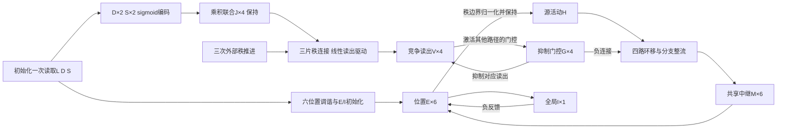

# 共享中继与竞争门控的L/D/S率回路

状态：完整独立设计，待核对，尚未实现。目标是在29个率变量的紧凑结构中，用读出与抑制门控的连续相互作用完成四通路选择，执行六位置、四秩序列解压缩。

## 1. 任务定义

初始化只读取一次L∈{1,…,6}、D∈{−1,+1}、S∈{1,2}。六个位置定义为：

\[
\theta_k=(k-1)\pi/3,\qquad (x_k,y_k)=(\cos\theta_k,-\sin\theta_k).
\]

标签增加表示物理顺时针。三个相邻输出之间的位移为D、S·D、D，四个输出为L、L+D、L+D+S·D、L+D+S·D+D，全部在六点环上取模。

D/S是给定压缩码，不从观察序列推断；固定环移和秩连接是提供的任务先验。输出只从实际位置E活动读取，不将目标序列写入模型。

## 2. 模块与计数

| 模块 | 率变量数 | 作用 |
| --- | ---: | --- |
| 位置E | 6 | 六位置偏好活动 |
| Direction编码D | 2 | 顺/逆时针的重叠sigmoid调谐 |
| Step编码S | 2 | 一步/两步的重叠sigmoid调谐 |
| 联合编码J | 4 | D/S归一化活动的乘积联合 |
| 位移读出V | 4 | 在门控负反馈下竞争 |
| 门控G | 4 | 抑制竞争读出及对应位移路径 |
| 共享有效中继M | 6 | 四路空间驱动汇总后的动态状态 |
| 全局I | 1 | 位置E总活动反馈 |
| 合计 | 29 | 编码快照8个，检索同步积分21个 |

另有每秩保持的六维源活动H、外部秩编号和连接矩阵。H是采样保持资源，不作为额外rate神经群建模，也不从资源说明中省略。

29是率变量的计数。四路各六维的分支整流仍有24个非线性计算分量；联合乘积、群内归一化和源保持也仍存在。因此不将本设计称为已经证明可以仅由29个普通点神经元实现的生物最小回路。

## 3. 编码公式与初始化映射

记φ(z)=max(z,0)，σ(z)=1/(1+exp(−z))，N(x)=x/Σx。N只对非负且总和为正的输入定义。

方向偏好为(+1,−1)，步长偏好符号为(−1,+1)：

\[
b_i^D=k_D D\,d_{pref,i},\quad T_i^D=g_i^D\sigma(b_i^D),
\]
\[
b_j^S=k_S(2S-3)s_{pref,j},\quad T_j^S=g_j^S\sigma(b_j^S).
\]

各编码群从零响应恒定驱动，采用一阶率终值：

\[
\tau_t\dot r=-r+T,\qquad r(T_{enc})=T(1-e^{-T_{enc}/\tau_t}),\qquad a=N(r).
\]

先计算D/S终值及归一化活动，再定义四维联合群，顺序为(CW1、CW2、CCW1、CCW2)：

\[
b^J=\operatorname{vec}(a^D(a^S)^\top),\quad
T^J=g^J\odot b^J,\quad
r^J=T^J(1-e^{-T_{enc}/\tau_t}),\quad a^J=N(r^J).
\]

默认k_D=k_S=6，τ_t=0.020 s，T_enc=0.200 s，所有逐单元编码增益为1。D/S/J保存raw_drive、rates、activity，分别表示线性原始输入或乘积输入、未归一化率、归一化活动，三者不混用。

这是初始化映射，检索期间D/S/J快照保持。它不声称编码群已具有自主记忆动力学，也不把分阶段终值计算拼成未经模拟的共同物理时间轴。

## 4. 位置初始化

正式输入L使用以下调谐而不是one-hot：

\[
a_k^L=N\!\left(\exp\{\kappa[\cos(\theta_L-\theta_k)-1]\}\right)_k,
\qquad \kappa=8.
\]

从E=0、I=0出发，以u_E=a^L驱动第8节的位置E/I方程0.800 s，取真实末态作为第1秩位置。初始化时M、V、G均为0，控制通路暂不参与位置驱动。

连续角度输入仅作为位置群诊断；正式任务L仍为六个整数标签。正中边界可有并列峰，不宣称任意连续位置精确恢复。

## 5. 秩相关驱动

位移路径顺序为(+1、+2、−1、−2)。第r次转移的四维读出驱动为：

\[
b^V=g^V\odot(W_r a^J).
\]

第二次转移W₂=I₄，第一、第三次转移使用：

\[
W_1=W_3=
\begin{pmatrix}
1&1&0&0\\
0&0&0&0\\
0&0&1&1\\
0&0&0&0
\end{pmatrix}.
\]

三片连接独立分配，可分别干预。默认读出增益g^V全部为1。每秩b^V恒定，不接收目标位置。b^V必须非负、非静默；并列最大驱动属于单一路径选择的歧义条件，不用固定标签优先级掩盖。

## 6. 读出与门控的连续竞争

定义非负交叉连接C=11ᵀ−I₄。读出只兴奋其他路径的门控；门控反过来抑制自己对应的读出和空间分支：

\[
\boxed{\tau_V\dot V=-V+\phi(b^V-G)},
\]
\[
\boxed{\tau_G\dot G=-G+CV}.
\]

默认τ_V=τ_G=0.020 s。V/G均为实际积分的非负率，不是准备好后保持的快照。G的驱动CV非负，线性率方程保持G非负。模型不对V归一化来控制G，也不把V的argmax转换为单峰指令。

作用直观如下：某个V升高，会使另外三个G升高；这三个G压低对应V并抑制对应空间路径；领先读出所对应的G因缺少其他V输入而下降，逐渐释放其路径。四个G同时承担读出竞争和空间门控，不另增竞争神经群。

对固定b^V且其最大分量b_k唯一，平衡点为：

\[
V^*=b_k e_k,\qquad G^*=CV^*.
\]

此时选中路径G_k*=0，其他路径G_p*=b_k。唯一性可直接检查：令S_V=ΣV；任何正率读出在平衡时必须满足b_i=S_V，所以不同输入驱动不能同时保持正率。任何驱动更大的静默读出又会被激活，故只能保留最大驱动通道。

当最大驱动严格大于其余分量时，平衡附近未选读出的整流输入严格为负。该局部线性系统可按未选V、选中G、选中V和其余G排序成稳定级联，特征值为−1/τ_V或−1/τ_G。因此该平衡局部渐近稳定。

这些结论不证明任意初值下的全局收敛，也不证明在0.8 s内一定完成切换。尤其是秩切换时V/G保留真实历史状态，切换速度与瞬态必须实测。

## 7. 分支抑制与共享中继

每次转移开始，将进入该秩的实际E归一化并保持：H=N(E)。E不能静默；H在该次转移内不更新。M在秩边界重置为0，V/G不重置。

每条路径的连接定义为A_p、B_p、C_p。A_p、B_p非负，C_p非正；默认A_p为相应环移P_p，B_p=I₆，C_pG=−βG_p·1₆，β=2。

共享中继使用：

\[
F_p(t)=\phi(A_pH+C_pG(t)),\qquad
F_{pool}(t)=\sum_pB_pF_p(t),
\]
\[
\boxed{\tau_M\dot M=-M+F_{pool}(t)},\qquad \tau_M=0.030\ \mathrm{s}.
\]

必须先逐路径整流，再线性汇总，不能将所有兴奋和抑制先相加后仅整流一次。四条路径始终并行计算；±2是直接两位置环移，不引入额外中间位置或内部转移。

M是投到E坐标中的有效驱动状态，不等于四条路径各自的独立率。若辅助定义四路参考状态τ_M·dR_p/dt=−R_p+F_p(t)，则固定B、相同τ_M以及匹配初值保证：

\[
M=\sum_pB_pR_p,\qquad
\tau_M\dot M=-M+\sum_pB_pF_p(t).
\]

该聚合对随时间变化的G以及多路径同时活动也成立，不要求只有一条路径非零。它只证明共享驱动的状态聚合，不是本设计与其他控制机制的完整轨迹等价证明。

不同路径τ、路径特有适应或噪声、中途变化的B，以及读取单独R_p的反馈，都不在此聚合承诺内。

## 8. 位置E/I率方程

\[
u_E=M,
\]
\[
\boxed{\tau_E\dot E=-E+
\phi(M+w_{EE}E-w_{EI}I\mathbf1_6)},
\]
\[
\boxed{\tau_I\dot I=-I+w_{IE}\sum_kE_k}.
\]

参数为τ_E=0.100 s、τ_I=0.050 s、w_EE=0.15、w_EI=0.20、w_IE=0.25。E/I在三次转移之间连续接续，不在秩边界重新赋值或重置。

率为无量纲活动，不解释为Hz。位置群峰值只用于输出观察，不向模型反馈目标或选路指令。

## 9. 三次秩推进与共同时间轴

以位置初始化结束为t=0，V=G=M=0。首先观察第1秩位置，随后连续执行三段各0.800 s的检索：

| 时间段 | 驱动连接 | 任务位移 | 结束观察 |
| --- | --- | --- | --- |
| 0–0.8 s | W₁ | D | 秩2 |
| 0.8–1.6 s | W₂ | S·D | 秩3 |
| 1.6–2.4 s | W₃ | D | 秩4 |

每次秩切换只更新外部连接片、采样H并重置M。E/I/V/G连续接续。21个检索变量V、G、M、E、I使用共同时间步同步积分，没有额外的读出准备窗口、门控准备窗口或方向轮流执行的子相位。

门控有真实延迟：初始G=0时各路径可能短暂传输；切换时也可能有旧路径残余和新路径暂时受抑制。必须保存和报告这些过程，不能把它们抹掉后声称未选路径全程静默。

外部秩时钟仍是显式先验，不声称本模型自行产生四秩节拍。

## 10. 默认参数与稳态门控尺度

| 参数 | 默认提案 |
| --- | --- |
| 位置κ | 8 |
| D/S调谐斜率 | 6、6 |
| D/S/J/V各单元增益 | 全1，逐实例分配 |
| 编码τ_t、T_enc | 0.020 s、0.200 s |
| τ_V、τ_G、τ_M | 0.020、0.020、0.030 s |
| τ_E、τ_I | 0.100、0.050 s |
| 读出受门控抑制增益 | 1 |
| 路径抑制β | 2 |
| E自反馈、I→E、E→I | 0.15、0.20、0.25 |
| 位置初始化时长、每秩时长 | 各0.800 s |
| dt | 0.002 s |

默认编码增益下，令p=σ(6)。第一、第三秩的最大读出驱动为p，第二秩为p²。标量公式计算给出p≈0.997527377、p²≈0.995060868，因此最小稳态未选路抑制βp²≈1.990121735，大于归一化源的最大分量1。

这支持稳态下未选分支被压制、选中分支被释放。它不证明瞬态已结束，不给出有限检索时间的行为通过率，也不排除竞争切换中的振荡或泄漏。

已对四种D/S组合、三片秩连接的12个静态平衡点作公式代入，V/G方程右端残差为0。此项只是平衡关系验算，没有运行新模型的ODE或验证秩切换过程。

读出增益会同时影响竞争驱动和门控幅度；不能把等比例缩放视为对回路没有影响。偏好变化、增益变化与门控尺度变化应分别检查。

## 11. 数值与观测规范

同步前向Euler以同一旧时刻的V、G、M、E、I计算全部下一步。G不使用已更新的V；F_pool不使用已更新的G；E不使用已更新的M。dt需满足dt≤0.2·min(τ_V,τ_G,τ_M,τ_E,τ_I)，并进行减半步长验证。

记录D/S/J的raw_drive、rates、activity；记录V的原始驱动W_r a^J、加增益驱动b^V、净驱动b^V−G及V实际率；记录CV、G、四路兴奋与负驱动、F_p、F_pool、M、E、I、H和秩。

归一化V可以作诊断图，但不驱动门控。方向或位移标签仅用于评估；不能从标签重新生成内部活动。所有实例的连接和增益独立分配，结果保存不可修改的快照。

## 12. 信息与解释边界

- 初始化一次读取符号码，之后仅有活动、连接、保持源与外部秩；目标序列只在评估端构造。
- 固定环、乘积联合、归一化和源保持均为显式机制或计算资源，不称为学到的能力。
- 竞争平衡点的局部稳定不等于六位置吸引子，也不等于控制记忆抗扰动。
- V对G的连接非负，G对V和分支的连接非正，显式竞争控制部分有清楚的兴奋/抑制符号。共享中继分支、乘积及归一化没有展开为逐细胞生物实现，整套模型不作29个细胞严格Dale实现的声明。
- 29个率变量外的H和控制器必须计入资源报告；不以变量数代表全部非线性操作或生物神经元数。
- 并列最大驱动、过弱门控、相位切换过慢或持续振荡均可能否定当前参数提案，不自动归因于实现错误。

## 13. 独立实现与验收契约

当前仅交付方案，不创建新模型。批准后采用独立包和产物目录，运行模块不导入其他模型实现或评估oracle。

必需验收：

1. 全部24个合法码的真实四秩输出；记录每秩峰值差和错误，不把稳态门控推导代替行为测试。
2. 固定驱动下V/G的竞争过程与平衡点；实际秩切换时对旧门控残余、新路径释放时间和振荡进行测量。
3. 记录每条分支的瞬态泄漏、末段残余与共享驱动；末段静默容差和切换时限在实验前单独约定，不能看过结果后反向定阈值。
4. 用相同连续控制和四路参考状态核对M聚合，逐采样比较E输入、E/I轨迹；参考展开只用于验证，不冒充新模型的额外29内神经元。
5. 干预J、单片W、V→G、G→V、G→分支以及路径A/B，验证各模块对实际E输出的因果作用。
6. 对静默与并列驱动显式报告失效；不使用argmax、目标序列或预选路径来修正内部竞争。
7. 核对输入只读一次、诊断历史隔离、连接实例独立、编码保持与V/G/M/E/I同步积分。
8. dt减半及必要独立ODE积分比较，核对标签、轨迹、峰值差和切换时延；绘制未经平滑的原始率图。
9. 连续角度只作单列诊断，边界歧义单独报告；不扩大六中心任务的结论。

此方案只有公式和稳态尺度核验，没有新模型仿真、行为通过率或完整轨迹等价结果。运行前按本地依赖预检规则检查兼容环境，不安装或修改依赖。
