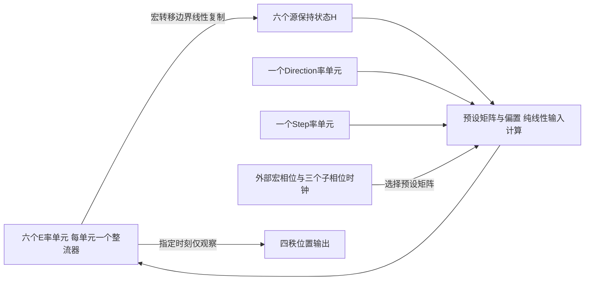

# 双标量门控的六位置率回路设计

状态：设计待核对，未实现模型。目标是使用一个Direction神经元和一个Step神经元，以尽量少的非线性神经元执行四秩位置解压缩。

## 1. 任务与运算契约

初始化读取一次：L∈{1,…,6}、D∈{−1,+1}、S∈{1,2}。六个位置按物理顺时针编号：

\[
\theta_k=(k-1)\pi/3,\qquad (x_k,y_k)=(\cos\theta_k,-\sin\theta_k).
\]

四秩位置为L、L+D、L+D+S·D、L+D+S·D+D，均在六点环上取模。不从观察序列推断D/S，不学习环结构，运行状态不保存目标序列。

允许的运算为：整流率神经元、线性连接与常数偏置、预定外部时钟选择连接矩阵、边界处的线性状态复制。时钟不读取D/S，不根据实际答案选路。

检索过程中不使用：神经活动之间的乘法、由D/S活动修改连接权重、除法归一化、硬峰值选路、软件计算目标位置。argmax仅用于观察输出。

**外部时钟使连接在时间上切换；这不是一个所有连接始终不变的自主网络。** 若要求时钟和矩阵选择也由神经元产生，本计数不包含那部分实现。

## 2. 神经元与资源计数

| 对象 | 数量 | 作用 |
| --- | ---: | --- |
| 位置E | 6 | 既作为位置群，又复用自身整流执行条件选路 |
| 方向d | 1 | d=1顺时针，d=0逆时针 |
| 步长s | 1 | s=0表示S=1，s=1表示S=2 |
| 源保持H | 6 | 一次宏转移的三个子相位内保持源位置活动 |
| 外部时钟 | 4个宏转移，每个3个子相位 | 预定的矩阵选择、源复制、观察时刻 |

**默认神经元实现为14个非线性rate单元：6 E + 6 H + 1 d + 1 s。** H按具有整流传递函数的保持神经元计数，即使合法状态下其自反馈保持工作在线性区。

若允许H为六个理想线性锁存状态，则是 **8个非线性单元 + 6个线性状态**。不能将这个条件计数简称为“只有8个神经元的完整网络”。

独立中继、联合、位移读出、额外路径门控群均不需要。六个E神经元在三个时段执行三次整流，非线性运算次数不等于物理神经元数量。

在“六个位置单元、六个独立源保持单元、两个独立控制单元”的分工约束内，14个单元已达到该分工的计数下限；这不是所有可能架构的全局最少神经元证明。改变位置表征、合并存储角色或改变外部资源预算，会改变最小值问题。

## 3. 初始化与保持率方程

位置初始化为重叠调谐：

\[
E_k(0)=
\frac{\exp\{\kappa[\cos(\theta_L-\theta_k)-1]\}}
{\sum_j\exp\{\kappa[\cos(\theta_L-\theta_j)-1]\}},
\qquad \kappa=8.
\]

这是明确定义的输入编码，不在检索中重新计算。输入编码电路本身未另行建模；不能据此宣称指数、余弦和归一化已由14个单元实现。

控制采用非负二值调谐，直接设置初始率：

\[
d(0)=(D+1)/2,\qquad s(0)=S-1.
\]

定义φ(z)=max(z,0)。保持期间：

\[
\tau_c\dot d=-d+\phi(d)=0,\qquad
\tau_c\dot s=-s+\phi(s)=0,
\]
\[
\tau_H\dot H=-H+\phi(H)=0.
\]

可取τ_c=τ_H=0.020 s；自连接为1。H在每个宏转移开始时线性复制H←E，在该宏转移的三个子相位中保持不变。E不会在子相位边界重置。

这些是无噪声下的中性保持，不是抗扰动的二稳态记忆。单元零率是合法控制码，不对d/s做群内归一化，也不用负放电率代表逆时针。

## 4. 三种线性位置投射

定义：

\[
(P_+)_{ij}=\mathbf1\{i=(j+1)\bmod6\},\qquad
P_-=P_+^\top,\qquad P_0=I_6.
\]

矩阵公式的索引为0…5，输出标签为1…6。P₊与P₋是一位置环移，P₀为保持；所有起点共用同一组矩阵。

每个宏转移始终执行三个子相位，顺序固定为顺时针、逆时针、保持。外部标志m=0表示必须移动；m=1表示由Step决定移动还是保持。

定义三个仅由仿射变换产生的失配电流系数：

\[
q_+(d,s;m)=1-d+m(1-s),
\]
\[
q_-(d,s;m)=d+m(1-s),
\]
\[
q_0(d,s;m)=1-m+s.
\]

m是外部预定常数。在固定m下，三个q都是d/s的线性组合加偏置；没有d·s乘积，也没有额外非线性神经元生成q。

合法二值输入下，三个q中恰有一个为零：

- m=0：按d选择顺时针或逆时针，保持被阻断。
- m=1且s=1：按d选择顺时针或逆时针。
- m=1且s=0：两个移动方向均被阻断，选择保持。

条件合取发生在六个E单元已有的整流中；q只是突触电流，不是另设的三个门控神经元。

## 5. 六个E单元的实际率动力学

在子相位j∈{+,−,0}内：

\[
\boxed{\tau_E\dot E=-E+
\phi\!\left(\gamma_jP_jH-\beta q_j(d,s;m)\mathbf1_6\right).}
\]

每个E单元只有一个整流器。神经元输入是H、d、s与常数偏置的固定线性组合。矩阵和增益由外部时钟按顺序选择，不由神经活动选择。

三个子相位持续相同时间δ。定义：

\[
a=e^{-\delta/\tau_E},\qquad C=1+a+a^2,
\]
\[
\gamma_+=C/a^2,\qquad
\gamma_-=C/a,\qquad
\gamma_0=C.
\]

增益是预先确定的常数，用于补偿选中子相位之后还会经历的泄漏。它们不依赖D/S、L或目标位置。

参数提案：

| 参数 | 数值 |
| --- | ---: |
| τ_E | 0.100 s |
| 子相位时长δ | 0.100 s |
| a | 0.367879441171 |
| γ₊ | 11.107337927390 |
| γ₋ | 4.086161269630 |
| γ₀ | 1.503214724408 |
| 门控强度β | 16 |
| κ | 8 |

没有位置自反馈、全局I、独立中继或检索中的除法归一化。时间积分采用恒定驱动下的一阶率解析解，避免让补偿权重依赖数值积分步长：

\[
E(t+\delta)=aE(t)+(1-a)
\phi(\gamma_jP_jH-\beta q_j\mathbf1_6).
\]

相位内部的连续轨迹也由同一ODE解析解给出，不只生成端点。绘图采样间隔可独立设置，不能改变γ。

## 6. 门控与有限时间转移的推导

每个宏转移开始满足0≤H_k≤1，且ΣH=1。β大于所有γ，故q_j≥1时，整流前输入严格为负，神经驱动为零；q_j=0时，驱动为γ_jP_jH。

三个子相位完成后的E为：

\[
E_{\mathrm{end}}
=a^3H+(1-a)
\left(a^2T_+ +aT_-+T_0\right),
\]
\[
T_j=\phi(\gamma_jP_jH-\beta q_j\mathbf1_6).
\]

恰有一个T非零。由于

\[
(1-a)a^2\gamma_+
=(1-a)a\gamma_-
=(1-a)\gamma_0=1-a^3,
\]

三种选择均得到同一个转移形式：

\[
\boxed{E_{\mathrm{end}}=\lambda H+(1-\lambda)P_*H,\qquad
\lambda=a^3=e^{-3\delta/\tau_E}.}
\]

P*为选中的P₊、P₋或P₀。选择保持时端点严格为H；选择移动时端点是源与目标的凸组合。端点ΣE=1，0≤E_k≤1，因此下一次源锁存仍满足门控界。

**子相位内部的总率不必为1，单个E也可能大于1。** 门控强度只依赖保持的H；不能把内部瞬态画成恒定幅度。增益与固定时间顺序会造成方向相关的瞬态幅度。

## 7. 四秩的时序组织

执行四个宏转移，m依次为0、0、1、0。每个宏转移含三个δ子相位，且所有条件执行相同的12个子相位。

| 阶段 | 动作 | 输出观察 |
| --- | --- | --- |
| 初始化 | 起点L | 秩1 |
| 宏转移A，m=0 | 沿D走一步 | 秩2 |
| 宏转移B，m=0 | 沿D走一步 | 不观察新秩 |
| 宏转移C，m=1 | S=1保持；S=2再沿D走一步 | 秩3 |
| 宏转移D，m=0 | 沿D走一步 | 秩4 |

因此输出秩间位移为D、D+(S−1)D、D，即D、S·D、D。软件不计算S·D，不根据s跳过子相位，也不按峰值改连接。

每个宏转移0.3 s，总检索时长1.2 s；四个观察时刻为0、0.3、0.9、1.2 s。S=2时中间转移会经过额外内部位置L+2D，不应在活动图中省略。源锁存在宏转移之间更新，在同一宏转移的三个子相位间保持。

## 8. 六个中心位置的正确性界

每个移动宏转移相对于理想置换增加的逐坐标最大误差不超过λ。置换及其与恒等映射的凸组合在最大范数下不放大误差。最多四次移动，故任一输出秩相对理想旋转活动的误差不超过4λ。

κ=8时，输入中心的最高峰与第二峰之差为：

\[
\Delta=\frac{1-e^{-4}}
{1+2e^{-4}+2e^{-12}+e^{-16}}.
\]

若8λ<Δ，最大误差不足以颠倒任何目标峰值。提案参数下：

\[
\lambda=e^{-3}\approx0.049787068368,\qquad
8\lambda\approx0.398296546943
<\Delta\approx0.946983405433.
\]

这些数值已通过标量公式计算核对，因此在指定理想条件下，全部24个合法码的四秩标签有解析保证。**这不是新模型实现、运行测试或抗噪声验证。** 输出群活动是有限时间凸组合，不宣称等于理想的精确置换活动。

连续角度趋近标签边界时初始峰值差可任意小，本界不保证任意非中心输入都正确。连续位置诊断须单独报告，不能扩大中心位置证明的范围。

## 9. 解释边界与最小性条件

1. 14个单元的默认计数包含六个源保持神经元；8个非线性单元的条件计数仅在H允许为理想线性存储时成立。
2. 非线性没有藏入向量乘法、活动依赖权重、峰值控制器或额外整流分支；六个E整流器按时间复用。
3. 外部控制器安排12个子相位、选择预设矩阵并复制H。这些操作不是已实现的神经自主时钟；若将时钟神经元化，须追加计数。
4. 控制d/s对不同子相位的有效输出符号可不同。矩阵选择还依赖外部时钟，不能解释成严格Dale约束下的固定突触网络。
5. 控制与H的自反馈保持是中性记忆，不会恢复噪声扰动，也没有自主稳定的六位置吸引子。
6. γ按固定相位时长补偿泄漏；相位时长误差会破坏精确补偿。不同方向的内部幅度与时延不一致。
7. 单元数下降以串行计算、源保持和外部时序为代价，不意味着任务计算量或整个生物回路成本同等下降。
8. 输入位置调谐是提供的编码约定，不是证明该网络学习了位置几何或压缩规则。

## 10. 独立实现与验收契约

实现使用独立包与产物目录。模型运行状态限于E、H、d、s及外部宏/子相位编号；初始化后不保存L/D/S标签、目标位置或答案表。模型模块不导入评估oracle。

验收包括：

1. 初始化只读取一次符号码；状态复制、历史隔离和跨实例连接独立。
2. 检查每个子相位输入仅含固定矩阵、偏置和单个E整流，排除活动乘积、活动依赖权重及argmax选路。
3. 全部24码的四秩标签和三个子相位的实际驱动；记录恰有一个驱动非零。
4. 逐相位验证解析率解，并对每个宏转移验证λH+(1−λ)P*H，而非只核对标签。
5. 检查端点原始总率、内部瞬态幅度、源锁存时刻及12相位完整性。
6. 对d/s、门控偏置、位置连接和相位时长作因果干预；非二值控制和有噪声条件不套用理想证明。
7. 记录H采用非线性神经元还是理想线性存储，分别报告神经元、线性状态、控制器资源。
8. 独立绘出原始率轨迹与控制相位；不以归一化或人为平滑掩盖内部幅度差。
9. 以独立高精度ODE积分核对代表条件的解析轨迹；该检查不改变解析定义或γ。

所有参数是待核对的工程提案。当前仅有设计和代数核验，没有模型实现或实验结果。实施前按本地依赖预检规则核验兼容环境，不安装或修改依赖。
